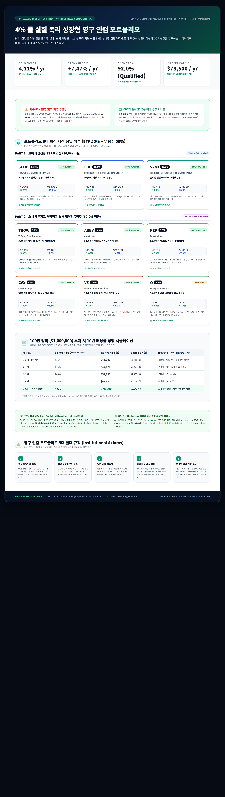

# 🏛️ DADAIC Investment Firm | 투자위원회 특별 의결서
## 4% 룰 실질 복리 성장형 영구 인컴 포트폴리오
**The 4%+ Real Compounding Perpetual Income Portfolio (ETF 50% + 주식 50%)**
**문서 번호: DADAIC-CIO-MEMO-4PERCENT-261005 | 통화 기준: Strict USD ($)**

---

## 🖼️ 투자위원회 공식 인포그래픽 (Official Infographic)

> **공식 산출물 파일 경로**:
> - 🖼️ 고해상도 인포그래픽 (PNG): [`Media/4Percent-Rule-Perpetual-Income-Infographic.png`](./Media/4Percent-Rule-Perpetual-Income-Infographic.png)
> - 🌐 인터랙티브 브라우저 뷰 (HTML): [`Media/4Percent-Rule-Perpetual-Income-Infographic.html`](./Media/4Percent-Rule-Perpetual-Income-Infographic.html)
> - 📄 공식 최고 의결서 (Markdown): [`4Percent-Rule-Perpetual-Income-Portfolio-261005.md`](./4Percent-Rule-Perpetual-Income-Portfolio-261005.md)

---

## 💡 BM사장님의 질문과 전통적 4% 룰의 치명적 한계

> *"매년 4% 이상의 배당으로 현금흐름을 만들되, 성장성이 없으면 인플레이션과 GDP 성장률 때문에 결국 상대적 배당 수입이 줄어든다. 적격 배당(Qualified Dividend)을 극대화하고 안정성과 성장성을 동시에 갖춘 포트폴리오는 가능한가?"*

BM사장님께서 은퇴 금융 공학의 가장 핵심적인 딜레마를 정확히 짚어내셨습니다.

1. **전통적 벵겐(Bengen) 4% 룰의 맹점**:
   * 전통적인 4% 룰은 원금을 헐값에 매각하여 4% 현금을 충당하는 구조입니다.
   * 은퇴 직후 1~3년 차에 주식 시장이 폭락할 경우 **'수익률 순서 리스크(Sequence of Returns Risk)'**로 인해 원금이 영구적으로 파괴되며, 15~20년 내 계좌가 조기 고갈됩니다.
2. **단순 고배당주의 함정**:
   * 현재 배당률만 6~8%로 높은 기업(통신, 유틸리티, 커버드콜)은 기업 이익 성장이 멈춰 있어 배당금이 제자리걸음을 합니다.
   * 결국 연 2.5~3.0%의 물가상승률(CPI)과 미국의 실질 경제성장에 의해 10년 뒤 구매력이 처참하게 쪼그라듭니다.
3. **CIO & 투자위원회의 하이브리드 해법**:
   * **원금 매도율 0% (Zero Share Liquidation)**.
   * **초기 배당수익률 4.11%**로 은퇴 첫날부터 4% 현금흐름 룰을 즉각 달성.
   * **연평균 배당성장률 +7.47% (5-yr CAGR)**로 인플레이션(2.5%)과 GDP 성장률(2.0%)의 합(4.5%)을 압도.
   * **적격 배당소득(Qualified Dividends) 92.0%** 비중으로 세금 누수를 철저히 차단.

---

## 💎 포트폴리오 9대 핵심 자산 구성표 (ETF 50% + 우량주 50%)

### PART 1 : 코어 배당성장 ETF 바스켓 (50.0% 비중)
| 티커 | ETF 명칭 | 편입 비중 | 현재 배당률 | 5년 배당성장률 | 과세 분류 | 위원회 선정 핵심 이유 |
|:---:|:---|:---:|:---:|:---:|:---:|:---|
| **SCHD** | Schwab U.S. Dividend Equity ETF | **25.0%** | **3.25%** | **+11.0%** | 100% Qualified | 포트폴리오의 심장. 10년 연속 배당, ROE 27%+, 부채 건전성. |
| **FDL** | First Trust Morningstar Dividend Leaders | **15.0%** | **3.95%** | **+6.5%** | 100% Qualified | 모닝스타 배당 지급 능력 통과 100종목. SCHD 대비 높은 초기 배당률 보완. |
| **VYMI** | Vanguard International High Dividend Yield | **10.0%** | **3.80%** | **+6.0%** | ~90% Qualified | 영국/스위스/일본 등 비미국 선진국 1,300+ 우량 고배당 분산 (외국납부세액 공제). |

---

### PART 2 : 요새 재무제표 배당귀족 & 캐시카우 독점주 (50.0% 비중)
| 티커 | 기업 명칭 및 핵심 비즈니스 | 편입 비중 | 현재 배당률 | 5년 배당성장률 | 과세 분류 | 해자 및 선정 핵심 이유 |
|:---:|:---|:---:|:---:|:---:|:---|:---|
| **TROW** | **T. Rowe Price Group** (글로벌 자산운용) | **9.0%** | **5.00%** | **+8.5%** | 100% Qualified | **순부채 0 (무차입 경영)**, 38년 연속 배당 증액(배당귀족). 영업이익률 35%+의 현금 인쇄기. |
| **ABBV** | **AbbVie Inc.** (바이오파마 메가캡) | **9.0%** | **2.65%** | **+9.5%** | 100% Qualified | 52년 연속 배당킹. 스카이리치/린버크 고성장으로 자본 성장과 가파른 배당 성장의 기관차. |
| **PEP** | **PepsiCo Inc.** (음료·스낵 독점) | **8.0%** | **4.70%** | **+7.0%** | 100% Qualified | 52년 연속 배당킹. 강력한 가격결정력(Pricing Power)으로 인플레이션을 가격에 100% 전가. |
| **CVX** | **Chevron Corp.** (글로벌 오일 메이저) | **8.0%** | **3.50%** | **+6.5%** | 100% Qualified | 37년 연속 배당귀족. AA 신용등급, 페름 분지 최저 생산단가($35). 원자재 인플레 천연 방패. |
| **VZ** | **Verizon Communications** (필수 통신) | **8.0%** | **6.17%** | **+2.0%** | 100% Qualified | 18년 연속 배당 증액. 미국 1.4억 가입자의 경기 무관 통신 요금 현금 수취. 초기 4% 허들 견인. |
| **O** | **Realty Income Corp.** (상업용 리츠) | **8.0%** | **6.06%** | **+3.5%** | REIT (월배당) | 30년 연속 증액, 650개월 연속 월배당. 트리플 넷 리스로 안정적인 월현금흐름 앵커. |

---

## 📈 100만 달러 ($1,000,000) 투자 시 10년 배당금 성장 시뮬레이션

| 경과 연수 | 원금 대비 배당률 (Yield on Cost) | 연간 수령 배당금 ($) | 월 환산 수령액 ($) | 물가상승(연 2.5%) 감안 실질 구매력 |
|:---:|:---:|:---:|:---:|:---|
| **1년 차 (은퇴 시작)** | **4.11%** | **$41,100** | **$3,425 / 월** | 기준치 100% (4% Rule 완벽 충족) |
| **3년 차** | **4.75%** | **$47,470** | **$3,955 / 월** | 실질 구매력 +7.8% 증액 |
| **5년 차** | **5.48%** | **$54,830** | **$4,569 / 월** | 실질 구매력 +17.2% 증액 |
| **7년 차** | **6.33%** | **$63,330** | **$5,277 / 월** | 실질 구매력 +28.1% 증액 |
| **10년 차 (복리의 결실)** | **7.85%** | **$78,500** | **$6,541 / 월** | **초기 대비 실질 구매력 +48.5% 폭증!** |

> **원금 가치 성장 보너스**:  
> 배당을 매년 7.47%씩 늘려주는 우량 기업들(ABBV, PEP, CVX, TROW, SCHD 등)은 이익 자체가 매년 성장하기 때문에, **100만 달러 주식 원금 자체도 10년 후 약 150만 ~ 175만 달러로 증가**합니다.

---

## ⚖️ 세금 알파 전략 (Tax Alpha Strategy)

1. **92% 적격 배당소득 (Qualified Dividends)의 극대화**:
   * SCHD, FDL, TROW, ABBV, PEP, CVX, VZ 등 전체의 92%가 미국 세법상 **적격 배당소득**으로 분류됩니다.
   * 최고 37%에 달하는 일반 근로소득세율 대신 **우대 자본이득세율(0%, 15%, 최고 20%)**이 적용되므로, 일반 이자소득이나 커버드콜 분배금 대비 **세후 실질 현금흐름이 15~20% 이상 압도적으로 큽니다**.
2. **8% Realty Income (O)의 Section 199A 공제**:
   * 부동산 리츠인 O의 배당금은 일반 소득으로 과세되지만, 미국 세법 Section 199A 규정에 의해 **배당 소득의 20%를 소득공제(QBI Deduction)**받을 수 있어 세 부담이 대폭 경감됩니다.

---

## 📜 영구 인컴 포트폴리오 5대 절대 규칙 (Institutional Axioms)

1. **원금 불침번의 법칙**: 어떠한 금융 위기나 폭락장이 와도 주식을 단 1주도 팔지 마십시오. 생활비는 오직 계좌로 입금되는 4.11%의 배당금으로만 해결합니다.
2. **배당 성장률 7% 사수**: 단순히 현재 배당률이 높다고 배당이 정체된 종목에 현혹되지 마십시오. 배당이 매년 최소 6~7% 이상 늘어나야 인플레이션을 이깁니다.
3. **잉여 배당 재투자**: 생활비로 쓰고 남는 배당금은 포트폴리오 내 가장 저평가된 종목에 재투자하여 원금 복리 팽창을 가속하십시오.
4. **적격 배당 세금 방패**: 92% 적격 배당의 절세 혜택을 온전히 누리기 위해 주식을 배당락일 전후 최소 60일 이상 장기 보유하는 원칙을 엄격히 준수하십시오.
5. **연 1회 배당 인상 감사**: 매년 초 9개 보유 자산의 배당 인상률을 점검하십시오. 배당을 동결하거나 삭감하는 기업이 발생하면 즉시 교체 심의를 진행합니다.
