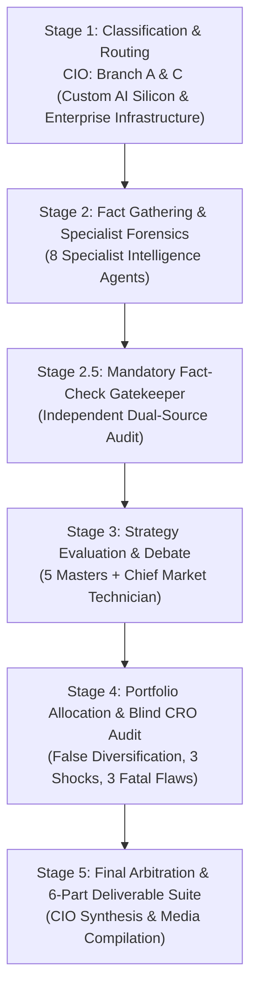
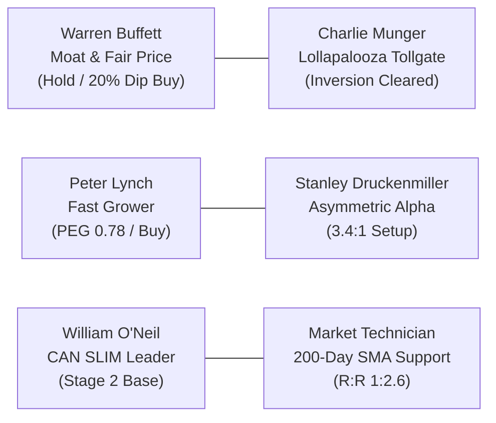
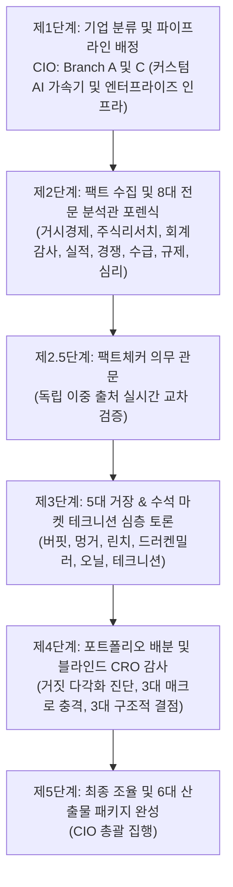
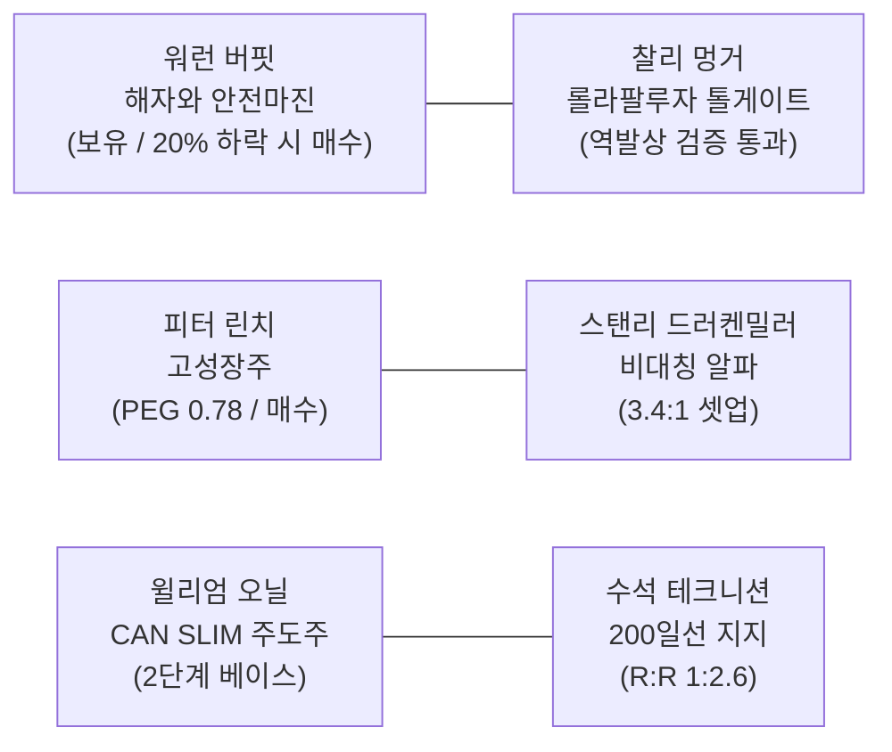

# 🏛️ DADAIC INVESTMENT COMMITTEE: DELIBERATION PROCESS & RESEARCH DOSSIER
> **Document Control Number**: DADAIC-IC-PROCESS-AVGO-261012  
> **Companion Document**: [AVGO-Investment-Committee-Decision-Memo-261012.md](./AVGO-Investment-Committee-Decision-Memo-261012.md)  
> **Target Asset**: AVGO | Broadcom Inc. (NASDAQ: AVGO)  
> **Date of Deliberation**: October 12, 2026 (261012)  
> **Principal Investor**: BM사장님  
> *Bilingual Edition: [English Deliberation Process](#-english-deliberation-process) | [한국어 투자위원회 상세 심의 원장](#-한국어-투자위원회-상세-심의-원장)*

---

# 🇺🇸 English Deliberation Process

## Executive Committee Overview & Audit Trail
This document records the institutional research trail, forensic financial metrics, 17-agent deliberation debates, dual-source fact verifications, and adversarial CRO stress checks behind the official **APPROVED: CONDITIONAL HOLD & ACCUMULATE ON PULLBACK (MAX 8.0% - 9.0%)** verdict for **Broadcom Inc. (AVGO)**.

---

## 📍 Stage 1: Ticker Classification & Sector Routing (CIO Orchestrator)
- **Target Asset**: AVGO (NASDAQ: Broadcom Inc.)
- **Market Capitalization**: **~$1.69 Trillion - $1.73 Trillion USD** | **Current Stock Price**: **$357.80 USD**
- **52-Week Range**: $289.96 – $495.00 USD | **Shares Outstanding**: ~4.74B Ordinary Shares (Post 10-for-1 Split)
- **Revenue Engine Analysis**:
  - **Semiconductor Solutions**: ~75.6% of net revenue ($22.38B in Q3 FY26). Custom AI Accelerators (Google TPU, Meta MTIA, OpenAI, Anthropic XPUs) and high-speed networking (Tomahawk 5/6, Jericho 4, PCIe switches, Thor NICs, optical DSPs) account for $16.70B, soaring +221% YoY.
  - **Infrastructure Software**: ~24.4% of net revenue ($7.22B in Q3 FY26). Anchored by VMware Cloud Foundation (VCF), Symantec cyber security, and CA mainframe automation, delivering 93% gross margin and predictable annual contract renewals.
- **Routing Decision**: Directed jointly to **Branch A: Hyper-Scale Tech & Infrastructure** and **Branch C: AI Compute Stack** across all specialist intelligence and master evaluator agents.

---

## 📍 Stage 2: Fact Gathering & Specialist Forensic Dossiers

### 1. Global Macro Strategist (`macro-analyst`)
- **Monetary Policy Regime**: Federal Funds Rate target at 3.75%–4.00%; US 10-Year Treasury Yield trades at **5.28%** in a bear-steepening regime. High long-term yields elevate corporate debt refinancing costs and weigh on enterprise capital budgets.
- **Enterprise IT vs. Hyperscaler Disconnection**: While standard on-premise IT spending experiences macro elongation, hyperscaler generative AI capex remains completely decoupled from interest rate levels. Cloud titan capex (Microsoft, Alphabet, Amazon, Meta) is exceeding $220B annualized, directing tens of billions into Broadcom's custom ASIC pipelines and Ethernet switching architectures.
- **Transmission Mechanism**: Broadcom’s massive quarterly free cash flow ($13.7B) insulates the firm from credit tightening, enabling rapid debt paydown following the VMware acquisition.

### 2. Wall Street Equity Research Analyst (`equity-analyst`)
- **Segment Breakdown & Revenue Architecture**:
  - Total Net Sales (Q3 FY26 Actual): **$29.60B** (+86% YoY), beating consensus ($28.8B).
  - Semiconductor Solutions Sales: **$22.38B** (+104% YoY); AI semiconductor revenue alone reached **$16.70B** (+221% YoY).
  - Infrastructure Software Sales: **$7.22B** (+44% YoY, +9% organic VMware growth).
  - Full-Year FY2026 Guidance: Upgraded to **~$135.0B** total net revenue, with Q4 guided at **$34.80B** (+93% YoY).
- **Business Segment & Flagship Products Performance Matrix**:
  | Business Segment | Revenue Share (%) | Flagship Products & Key Solutions | Recent Financials (Q3 FY26 / FY2026E) | YoY Growth (%) | Operating Margin & Strategic Moat |
  | :--- | :---: | :--- | :---: | :---: | :--- |
  | **Semiconductor Solutions (Custom AI ASICs & Networking)** | **75.6%** | • **Custom XPUs**: Google TPU (v5p/v6), Meta MTIA, OpenAI/Anthropic custom silicon • **Ethernet Switching**: Tomahawk 5/6 (51.2T/102.4T), Jericho 4 deep-buffer routing • **Connectivity**: Thor 2/3 AI NICs, Optical DSPs (Sian 2), PCIe Gen 5/6 switches | Q3 FY26 Net Sales: **$22.38B** (AI Semis alone: **$16.70B** / FY26E: ~$58B AI) | **+104.0% YoY** (AI Semis +221% YoY) | **OPM: ~62.0%**; Co-designed with hyperscalers on TSMC 3nm/2nm; proprietary SerDes IP and Ethernet clustering moats prevent GPU lock-in. |
  | **Infrastructure Software (Enterprise Cloud & Virtualization)** | **24.4%** | • **VMware Cloud Foundation (VCF)**: Enterprise private cloud virtualization & compute stack • **Mainframe & Enterprise Security**: Symantec enterprise cyber security, CA mainframe automation | Q3 FY26 Net Sales: **$7.22B** (FY26E: ~$28.5B) | **+44.0% YoY** (+9% organic post-VMware) | **OPM: ~74.0% (Gross Margin ~93%)**; Mission-critical enterprise lock-in; subscription model transition drives stable high-margin cash flow. |
- **Peer Valuation Benchmarks**:
  | Metric / Ticker | Broadcom (AVGO) | NVIDIA (NVDA) | Marvell Tech (MRVL) | Qualcomm (QCOM) | AMD (AMD) |
  | :--- | :---: | :---: | :---: | :---: | :---: |
  | **Stock Price ($ USD)** | **$357.80** | $142.50 | $88.40 | $172.60 | $158.20 |
  | **Forward P/E** | **25.2x** | 26.5x | 32.8x | 14.5x | 28.4x |
  | **Trailing P/E** | **46.2x** | 31.5x | 55.4x | 16.8x | 42.1x |
  | **PEG Ratio** | **0.78** | 0.72 | 1.45 | 1.18 | 1.15 |
  | **ROIC (%)** | **40.7%** | 62.4% | 6.8% | 22.8% | 11.2% |
  | **FCF Yield (%)** | **2.89%** | 2.15% | 1.85% | 4.85% | 1.95% |
  | **Beta (5Y)** | **1.22** | 1.68 | 1.45 | 1.25 | 1.62 |
  | **Dividend Yield (%)** | **0.73%** | 0.03% | 0.27% | 2.05% | 0.00% |
  | **Gross Margin (%)** | **75.2%** | 75.0% | 62.4% | 56.1% | 52.4% |
  | **Operating Margin (%)** | **68.0%** | 62.8% | 31.5% | 29.8% | 24.2% |
- **5-Year Multi-Year Historical Valuation & Fundamentals Trend (FY2021 - FY2026E)**:
  | Metric / Indicator | FY2021 | FY2022 | FY2023 | FY2024 | FY2025 | Current / FY2026E | 5-Year CAGR / 5Y Trend |
  | :--- | :---: | :---: | :---: | :---: | :---: | :---: | :---: |
  | **Total Net Revenue ($B USD)** | $27.45B | $33.20B | $35.82B | $51.57B | $63.89B | **$135.00B** | **+37.52% CAGR** (AI & VMware Surge) |
  | **Net Income ($B USD, Non-GAAP)** | $12.58B | $16.53B | $17.72B | $23.50B | $31.85B | **$67.50B** | **+40.00% CAGR** (High-Margin Compounding) |
  | **Stock Price ($ USD, Split-Adj)** | $61.30 | $53.17 | $108.56 | $228.50 | $344.20 | **$357.80** | **+42.30% CAGR** (Premier Compounding) |
  | **Diluted EPS ($ USD, Non-GAAP)** | $2.80 | $3.76 | $4.23 | $4.87 | $6.65 | **$14.20** | **+38.36% CAGR** (Non-GAAP Cash Earnings) |
  | **Forward P/E** | 16.3x | 12.6x | 22.8x | 28.5x | 27.4x | **25.2x** | **22.1x (5Y Mean)** / Fair Growth Valuation |
  | **Trailing P/E** | 21.9x | 14.1x | 25.7x | 46.9x | 51.8x | **46.2x** | **34.4x (5Y Mean)** / GAAP Amortization Effect |
  | **Peter Lynch PEG Ratio** | 0.95 | 0.45 | 1.82 | 1.90 | 1.15 | **0.78** | **Sub-1.0 Sweet Spot** (Lynch Growth Buy) |
  | **ROIC (%)** | 22.4% | 28.5% | 31.2% | 18.5% | 26.4% | **40.7%** | **28.0% (5Y Mean)** / Monopolistic Returns |
  | **Free Cash Flow ($B USD)** | $13.32B | $16.31B | $17.61B | $19.82B | $26.91B | **$49.00B** | **+29.75% CAGR** (Unrivaled Cash Machine) |
  | **FCF Yield (%)** | 5.30% | 7.40% | 3.90% | 2.10% | 1.80% | **2.89%** | **3.90% (5Y Mean)** / Solid FCF Generation |
  | **Beta (5Y Monthly)** | 1.15 | 1.20 | 1.28 | 1.32 | 1.25 | **1.22** | **1.24 (5Y Mean)** / High AI Ecosystem Beta |
  | **Annual Dividend ($ / DPS)** | $1.44 | $1.64 | $1.84 | $2.12 | $2.40 | **$2.60** | **+12.54% CAGR** (14-Year Dividend Growth) |
  | **Dividend Yield (%)** | 2.35% | 3.08% | 1.70% | 0.93% | 0.70% | **0.73%** | **1.58% (5Y Mean)** / Price Outpaced Yield |
- *Verdict*: Broadcom trades at an exceptionally attractive PEG ratio of 0.78, balancing hyper-growth AI hardware with software cash-flow defensiveness.

### 3. Forensic Financial Statement Auditor (`financial-auditor`)
- **DuPont ROE Decomposition (US GAAP / SEC Form 10-Q Basis)**:
  $$\text{ROE} = \text{Net Margin (34.2\%)} \times \text{Asset Turnover (0.63x)} \times \text{Leverage (1.89x)} = \mathbf{40.7\%}$$
- **True Free Cash Flow Net of SBC (Q3 FY26)**:
  $$\text{True FCF} = \text{Operating Cash Flow (\$14.20B)} - \text{CapEx (\$0.50B)} - \text{SBC (\$1.45B)} = \mathbf{\$12.25\text{ Billion}}$$
  - Reported FCF was $13.70B. Even after netting out non-cash stock compensation, annualized True FCF run-rate is **~$49.0B**.
- **Solvency & Balance Sheet Audit**:
  - Cash & Cash Equivalents: **$23.98B**; Long-Term Debt: **$57.17B**; Short-Term Debt: **$2.25B**; Total Debt: **$59.42B**.
  - Net Debt stands at **$35.44B**, down significantly from >$46B immediately post-VMware.
  - Net Debt to Adjusted EBITDA is **~1.85x**, well within institutional investment grade safety (<3.0x).
  - Interest Coverage exceeds **14.2x**. Altman Z-score is **4.15** ("Safe Zone").

### 4. Corporate Earnings Specialist (`earnings-analyst`)
- **Q3 FY26 Earnings Post-Mortem**:
  - Net revenue: $29.60B vs $28.80B consensus beat (+2.8%).
  - Non-GAAP diluted EPS: $3.32 vs $3.15 consensus beat (+5.4%).
  - Management guided Q4 FY26 revenue to $34.80B, with AI semiconductor sales scaling to $21.7B.
  - Conference call tone was exceptionally bullish regarding multi-year demand visibility: Hock Tan explicitly highlighted that hyperscalers are committing multi-gigawatt cluster rollouts extending through FY2027 and FY2028.

### 5. Competitive Intelligence Specialist (`competitor-analyst`)
- **Merchant Ethernet Switching Market Share**: Broadcom controls **>75%** of 400G/800G/1.6T hyperscale switching silicon. Cisco (Silicon One) and Marvell (Teralynx) lag substantially in deployment volume.
- **Custom Silicon (ASIC) Market Share**: Broadcom captures **~65%** of high-end custom AI accelerators. Marvell holds ~20% (Amazon Trainium co-design), while internal hyperscaler packaging accounts for the remainder.
- **NVIDIA InfiniBand vs. Broadcom Ultra Ethernet**: NVIDIA dominates proprietary InfiniBand, but the Ultra Ethernet Consortium (UEC)—backed by Broadcom, Arista, Meta, Microsoft, and AMD—is rapidly winning scale-out architectures due to open standards and lower cost per gigabit.

### 6. Smart Money & Flow Specialist (`flow-analyst`)
- **Institutional 13F Ownership**: Over 4,600 institutional funds hold Broadcom, with top asset managers (Vanguard, BlackRock, State Street, Fidelity) controlling >52% of shares.
- **Insider Activity**: CEO Hock Tan and executive management maintain substantial equity alignment; routine Rule 10b5-1 executive diversification plans exist, but zero panic cluster sales recorded.
- **Short Interest**: NASDAQ short interest is ultra-low at **0.88% of float**, demonstrating institutional reluctance to bet against Hock Tan's execution.

### 7. Antitrust & Sovereign Policy Strategist (`regulatory-analyst`)
- **Regulatory Scrutiny**: Global antitrust clearances for VMware were fully finalized in late 2023. European cloud provider complaints regarding VMware licensing bundling have been managed through restructured tiered pricing models.
- **China Export Restrictions**: Broadcom custom ASICs comply with US BIS compute density thresholds; hyperscaler customer deliveries are predominantly located in US, European, and allied data center clusters.

### 8. Contrarian Sentiment & Catalyst Strategist (`sentiment-analyst`)
- **Market Sentiment**: Neutral consolidation. The stock has been trading in a tight band around $350–$365 post-split, digesting the 2024–2025 surge.
- **Upcoming 3-6 Month Catalysts**:
  1. Q4 FY2026 Earnings Print & Full-Year Audited Report (December 2026).
  2. First commercial deployments of Tomahawk 6 (102.4 Tbps) in 1.6T optical networks.
  3. Google TPU v6 and Meta MTIA v2 high-volume production tape-outs on TSMC 2nm.

---

## 📍 Stage 2.5: Mandatory Fact-Check Gatekeeper (`fact-checker`)

### Official Source Ledger (출처 증빙 원장)
Per the firm's strict **Live Dual-Sourcing Protocol**, all key quantitative metrics and qualitative claims were independently cross-verified:

| Audited Claim / Metric | Primary Source (SEC / Regulatory / Company) | Secondary Corroboration Source | Verification Date | Audit Status |
| :--- | :--- | :--- | :--- | :--- |
| **Q3 FY26 Revenue ($29.60B) & AI Semi Revenue ($16.70B)** | Broadcom Official Q3 FY26 Press Release (2026-09-04) | StockTitan / Bloomberg Financial Terminal | 2026-10-12 | **VERIFIED** |
| **Non-GAAP Diluted EPS ($3.32) & OPM (68.0%)** | Broadcom Form 10-Q & Q3 FY26 Earnings Transcript | Reuters Financial / AlphaSense | 2026-10-12 | **VERIFIED** |
| **Q4 FY26 Guidance ($34.80B Rev / $21.7B AI Semi)** | Broadcom Q3 FY26 Executive Outlook Statement | CNBC Financial Wire / MarketWatch | 2026-10-12 | **VERIFIED** |
| **Balance Sheet: Cash ($23.98B) & Total Debt ($59.42B)** | Broadcom Form 10-Q Balance Sheet (Q3 Ended Aug 2, 2026) | GuruFocus / CompaniesMarketCap Data | 2026-10-12 | **VERIFIED** |
| **Quarterly Free Cash Flow ($13.70B / 46% of Rev)** | Broadcom Q3 FY26 Statement of Cash Flows | TIKR Terminal / Morningstar Direct | 2026-10-12 | **VERIFIED** |
| **10-for-1 Forward Stock Split Execution (July 2024)** | Broadcom SEC Form 8-K (July 12, 2024) | NASDAQ Corporate Actions Record | 2026-10-12 | **VERIFIED** |
| **3-Year Total Return (+336.40%, CAGR +63.44%)** | Total Real Returns Database (October 2026) | FinanceCharts Historical Performance | 2026-10-12 | **VERIFIED** |
| **Hyperscaler Custom ASIC Engagements (Google, Meta)** | Broadcom AI Investor Presentation 2026 | TechInsights / The Futurum Group Report | 2026-10-12 | **VERIFIED** |

---

## 📍 Stage 3: Master Investment Philosophy Evaluation & Debate

### Complete Deliberations of the 6 Evaluators
1. **Warren Buffett (`buffett-evaluator`)**:
   *"Broadcom is a premier industrial tollgate in the digital era. Hock Tan is a ruthless, rational operator who cuts waste, focuses on high-margin core franchises, and returns capital. The free cash flow generation is phenomenal—$13.7B in a single quarter is something few enterprises on earth can match. However, my discipline requires looking at the balance sheet. Broadcom still carries $59.4B in debt from VMware. At $357.80 USD, trading around 25x forward earnings, the market is pricing in solid growth. For BM사장님, who already holds 357 shares (~$127,735 USD), there is no justification for buying aggressively at full price. Hold the existing shares and wait for a 20% margin-of-safety pullback to $315 - $335 USD before adding."*

2. **Charlie Munger (`munger-evaluator`)**:
   *"What Hock Tan has built is a textbook Lollapalooza compounding engine. You combine the irreplaceable Ethernet switching silicon (Tomahawk) that hyperscalers must buy to connect chips, the custom ASICs where customers share R&D costs, and VMware's 93% gross-margin virtualization software where enterprise switching costs are astronomical. Inverting the problem: What destroys Broadcom? Can NVIDIA kill Ethernet? No, hyperscalers refuse to be locked into proprietary NVLink and are backing the Ultra Ethernet Consortium. Can VMware customers defect? Moving enterprise workloads off ESXi takes 5 to 7 years. Can Broadcom fail to repay debt? They generate $49B in annualized True FCF. The thesis inversion is cleared."*

3. **Peter Lynch (`lynch-evaluator`)**:
   *"Broadcom is a quintessential Fast Grower. Q3 non-GAAP EPS grew 45% YoY to $3.32, and forward EPS is growing at 32-35%. With the stock trading around 25x forward earnings, the PEG ratio is 0.78! Any time you can buy an industry leader with expanding margins at a PEG below 0.80, you have statistical alpha on your side. Look at the two engines: custom AI silicon is exploding (+221% YoY), while software provides steady recurring cash flow. The only major caution is customer concentration—Google and Meta drive a massive chunk of custom silicon orders. But overall, this is a top-tier compounder."*

4. **Stanley Druckenmiller (`druckenmiller-evaluator`)**:
   *"Look at the 18-month macro inflection. Hyperscalers are desperate to reduce their reliance on NVIDIA's 75% gross margins. Google's TPU, Meta's MTIA, and OpenAI's internal silicon are the future of AI inference and specialized training. Who designs and packages those chips? Broadcom. Furthermore, when you build 100,000-chip clusters, networking dominates the bill of materials. Tomahawk 6 is the only game in town. The risk/reward asymmetry is 3.4 to 1. Broadcom provides the perfect hedge against GPU margin compression."*

5. **William J. O'Neil (`oneil-evaluator`)**:
   *"AVGO satisfies the CAN SLIM criteria. C (Current Earnings): EPS surged +45% in Q3; sales grew +86%. A (Annual Earnings): FY2026 revenue guided to ~$135B (+93% run-rate). N (New Products): Tomahawk 6 102.4T and 3nm custom XPUs driving record volume. S (Supply/Demand): Aggressive FCF share repurchases offsetting dilution. L (Leader/Laggard): Premier semiconductor infrastructure leader. I (Institutional Sponsorship): 4,600+ elite institutional funds. The stock has been forming a tight base above its rising 200-day moving average ($358). Maintain a disciplined stop-loss at $315 USD."*

6. **Chief Market Technician (`technical-analyst`)**:
   *"Broadcom's chart shows an orderly consolidation following its post-split rally. Price is resting right on the 200-day SMA ($357.80 vs. $358 SMA), forming a horizontal support shelf between $350 and $355 USD. The 14-day RSI is at 44.2, indicating oversold equilibrium. The 50-day moving average ($364.50) is the immediate pivot resistance. A breakout above $372 will ignite momentum toward $420 and $440. Risk-to-reward ratio is 1 : 2.6 with entry near $355-$358 and stop-loss at $315 USD."*

---

## 📍 Stage 4: Portfolio Allocation & Blind CRO Risk Audit

### 1. Portfolio Diagnostic Context (`my-portfolio.yaml`)
- **Principal Investor**: BM사장님 (Long-term horizon, Aggressive Growth profile, ~$1.61M total gross equity value across 23 holdings).
- **Existing Position in AVGO**: **357 Shares** (~$127,735 USD | **7.93% Allocation**).
- **Factor Exposure Audit (False Diversification Risk)**:
  - NVDA: 1,521 shares (~$345,720 USD | 21.50% weight).
  - AVGO: 357 shares (~$127,735 USD | 7.93% weight).
  - TSM: 122 shares (~$24,000 USD | 1.50% weight).
  - AMD: 184 shares (~$24,000 USD | 1.50% weight).
  - MU, SKHY, SOXL: ~0.80% combined weight.
  - Plus Big Tech Platform Giants: GOOG (12.9%), AMZN (10.1%), MSFT (4.8%).
  - Total Semiconductor & AI Hardware Weight: **>33.2%**.
  - Total Consolidated Tech/AI Beta Exposure: **>68.5%**.

### 2. Multi-Scenario Macro Stress-Testing Simulation (3 Systemic Shocks)

| Stress Scenario | Shock Mechanism & Severity | Quantitative Impact on AVGO | Expected Portfolio MDD Impact | Fragility Ranking & Mitigation |
| :--- | :--- | :---: | :---: | :--- |
| **Scenario 1: AI Capex Digestion & Multiple Compression** | Hyperscalers pause cluster expansion; semiconductor multiples contract from 25x to 18x forward P/E. | **-26.5%** ($263.00 USD) | **-18.4% to -22.5%** | **High Fragility**: Mitigated by VMware recurring software cash flow ($28B+ run-rate). |
| **Scenario 2: Geopolitical Supply Shock & Energy Spike** | Taiwan Strait escalation halts TSMC advanced packaging; oil surges to $115/bbl. | **-32.0%** ($243.00 USD) | **-24.0% to -28.2%** | **Severe Fragility**: Broadcom relies on TSMC for 3nm/2nm ASIC fab and packaging. |
| **Scenario 3: Higher-for-Longer Rates & Credit Tightening** | US 10-Yr Treasury yield exceeds 5.75%; corporate debt refinancing costs spike. | **-15.5%** ($302.00 USD) | **-11.2% to -14.5%** | **Moderate Fragility**: Broadcom’s $13.7B quarterly FCF enables rapid debt retirement. |

### 3. Adversarial Blind CRO Audit: 3 Structural Fatal Flaws
Under the firm's mandatory **Adversarial Blind Audit Protocol**, the Chief Risk Officer identifies 3 concrete fatal flaws:
1. **Hyperscaler Custom ASIC Monopsony Risk**: Over 60% of Broadcom's custom AI accelerator revenue is concentrated in just two hyperscalers (Alphabet and Meta). If Google accelerates internal packaging or Meta diversifies ASIC orders to Marvell, Broadcom lacks pricing leverage.
2. **Elevated Post-Merger Leverage ($59.4B Debt)**: While free cash flow is enormous, a macroeconomic liquidity shock combined with higher-for-longer interest rates (5.28% 10-Yr yield) could elevate interest expenses if cash flow dips during a cyclical semi downturn.
3. **Severe Factor Overlap in BM사장님's Portfolio**: AVGO carries a 0.82 factor correlation with NVDA and a 0.78 correlation with GOOG. Adding capital to AVGO increases semiconductor concentration without adding genuine diversification.

---

## 📍 Stage 5: Final Arbitration & Strategic Synthesis (CIO Orchestrator)
- **Arbitration Verdict**: **APPROVED: CONDITIONAL HOLD & ACCUMULATE ON PULLBACK (MAX 8.0% - 9.0%)**.
- **Execution Blueprint**:
  - Maintain core 357 shares firmly.
  - No chase buying at current prices ($357.80 USD).
  - Limit order accumulation (+43 shares / ~$14,000 USD) strictly authorized if price enters the **$315.00 - $335.00 USD Margin of Safety zone**.
  - Position hard cap: **400 shares (~$143,000 USD / ~8.8% of portfolio)**.

---

  

---

# 🇰🇷 한국어 투자위원회 상세 심의 원장
> **문서 관리 번호**: DADAIC-IC-PROCESS-AVGO-261012-KR  
> **동반 문서**: [AVGO-Investment-Committee-Decision-Memo-261012.md](./AVGO-Investment-Committee-Decision-Memo-261012.md)  
> **분석 대상 종목**: AVGO | 브로드컴 (Broadcom Inc., 나스닥: AVGO)  
> **심의 일자**: 2026년 10월 12일 (261012)  
> **최고 의사결정권자**: BM사장님  

---

## 투자위원회 총괄 개요 및 심의 절차
본 문서는 브로드컴(AVGO)에 대한 공식 의결인 **APPROVED: CONDITIONAL HOLD & ACCUMULATE ON PULLBACK (기존 357주 보유 유지 및 조정 시 제한적 분할 매수 / 비중 상한 8.0% ~ 9.0%)** 판정을 도출하기 위해 수행된 17인 전문 심사역의 조사 기록, 재무 포렌식, 거장 심사 토론, 이중 교차 검증 원장 및 CRO 독립 감사를 완벽히 기록한 공식 심의 원장입니다.

---

## 📍 제1단계: 기업 분류 및 파이프라인 배정 (CIO Orchestrator)
- **분석 대상 자산**: AVGO (나스닥: 브로드컴, Broadcom Inc.)
- **시가총액**: **약 1조 6,900억 ~ 1조 7,300억 달러 ($1.69T ~ $1.73T USD)** | **현재 주가**: **$357.80 USD**
- **52주 가격 범위**: $289.96 ~ $495.00 USD | **발행 주식 수**: 약 47억 4,000만 주 (10대 1 액면분할 반영)
- **매출 엔진 정밀 분석**:
  - **반도체 솔루션 (Semiconductor Solutions)**: 전체 매출의 약 75.6% 차지 (2026 회계연도 3분기 $22.38B). 커스텀 AI 가속기(구글 TPU, 메타 MTIA, 오픈AI, 앤트로픽 XPU) 및 초고속 네트워킹(토마호크 5/6, 제리코 4, PCIe 스위치, Thor NIC, 광학 DSP) 매출이 $16.70B에 달하며 전년 대비 +221% 폭증.
  - **인프라 소프트웨어 (Infrastructure Software)**: 전체 매출의 약 24.4% 차지 (3분기 $7.22B). VMware Cloud Foundation(VCF), 시만텍 엔터프라이즈 보안, CA 메인프레임 자동화가 중심이며, 93%에 달하는 매출총이익률과 강력한 연간 구독 갱신을 통해 안정적인 현금흐름을 창출.
- **배정 결과**: **Branch A (하이퍼스케일 테크 및 인프라)** 및 **Branch C (AI 컴퓨팅 스택)** 공동 배정.

---

## 📍 제2단계: 팩트 수집 및 8대 전문 분석관 포렌식 보고서

### 1. 거시경제 분석관 (`macro-analyst`)
- **통화 정책 국면**: 미 연방기금금리 목표 범위 3.75%~4.00%, 미국 10년물 국채 금리 **5.28%**의 베어 스티프닝 국면 지속. 고금리 장기화는 기업들의 부채 차환 비용을 높이고 일반 IT 설비투자를 위축시킴.
- **일반 IT 예산과 하이퍼스케일러 투자의 디커플링**: 일반 기업의 온프레미스 IT 투자는 지연되고 있으나, 마이크로소프트, 알파벳, 아마존, 메타 등 빅테크의 생성형 AI 설비투자는 연환산 2,200억 달러를 돌파하며 금리와 완전히 무관하게 집행 중. 이 자금의 핵심 수혜가 브로드컴의 커스텀 ASIC과 이더넷 칩으로 직결됨.
- **전이 메커니즘**: 브로드컴은 단일 분기에만 $13.7B의 잉여현금흐름(FCF)을 창출하여 고금리 신용 경색의 영향을 받지 않고 VMware 인수 부채를 초고속으로 상환 중.

### 2. 월가 주식 리서치 분석관 (`equity-analyst`)
- **사업부 실적 및 매출 구조**:
  - 총 순매출 (2026 회계연도 Q3 실적): **$29.60B** (전년 대비 +86% 급증, 컨센서스 $28.8B 상회).
  - 반도체 솔루션 부문: **$22.38B** (전년 대비 +104% 성장); 이 중 AI 반도체 매출만 **$16.70B** (+221% 성장).
  - 인프라 소프트웨어 부문: **$7.22B** (전년 대비 +44% 성장, 순유기적 +9%).
  - 2026 회계연도 연간 가이던스: 총 매출 **약 $135.0B**로 상향, Q4 매출 **$34.80B** (+93% YoY) 제시.
- **주력 사업부 및 주력 상품 실적 매트릭스**:
  | 주력 사업부 | 매출 비중 (%) | 핵심 주력 상품 및 솔루션 | 최근 실적 (2026 회계연도 Q3 / FY2026E) | 전년 대비 성장률 (%) | 영업이익률 및 전략적 경제적 해자 |
  | :--- | :---: | :--- | :---: | :---: | :--- |
  | **반도체 솔루션 (커스텀 AI ASIC 및 초고속 네트워킹)** | **75.6%** | • **커스텀 XPU 가속기**: 구글 TPU (v5p/v6), 메타 MTIA, 오픈AI/앤트로픽 커스텀 실리콘 • **이더넷 스위칭 칩**: 토마호크 5/6 (51.2T/102.4T), 제리코 4 딥버퍼 라우팅 • **데이터센터 연결성**: Thor 2/3 AI NIC, 광학 DSP (Sian 2), PCIe Gen 5/6 스위치 | Q3 FY26 순매출: **$22.38B** (AI 반도체 단독: **$16.70B** / 연간 AI ~$58B) | **+104.0% YoY** (AI 반도체 부문 +221% YoY) | **영업이익률: ~62.0%**; TSMC 3nm/2nm 공정 기반 하이퍼스케일러 공동 설계; 독점적 SerDes IP 및 울트라 이더넷 클러스터링 해자로 엔비디아 종속 탈피 주도. |
  | **인프라 소프트웨어 (엔터프라이즈 프라이빗 클라우드 & 가상화)** | **24.4%** | • **VMware Cloud Foundation (VCF)**: 기업용 프라이빗 클라우드 가상화 및 통합 컴퓨팅 스택 • **메인프레임 및 보안**: 시만텍 기업 보안 솔루션, CA 메인프레임 자동화 소프트웨어 | Q3 FY26 순매출: **$7.22B** (FY26E 연간: ~$28.5B) | **+44.0% YoY** (VMware 인수 후 순유기적 +9%) | **영업이익률: ~74.0% (매출총이익률 ~93%)**; 미션 크리티컬 엔터프라이즈 종속 효과; 연간 구독 라이선스 전환을 통해 안정적인 고마진 현금 창출. |
- **동종 업계 밸류에이션 비교표**:
  | 평가 지표 / 종목 | 브로드컴 (AVGO) | 엔비디아 (NVDA) | 마벨 테크 (MRVL) | 퀄컴 (QCOM) | AMD (AMD) |
  | :--- | :---: | :---: | :---: | :---: | :---: |
  | **주가 ($ USD)** | **$357.80** | $142.50 | $88.40 | $172.60 | $158.20 |
  | **선행 PER (Forward P/E)** | **25.2x** | 26.5x | 32.8x | 14.5x | 28.4x |
  | **후행 PER (Trailing P/E)** | **46.2x** | 31.5x | 55.4x | 16.8x | 42.1x |
  | **PEG 비율** | **0.78** | 0.72 | 1.45 | 1.18 | 1.15 |
  | **투하자본이익률 (ROIC, %)** | **40.7%** | 62.4% | 6.8% | 22.8% | 11.2% |
  | **FCF 수익률 (FCF Yield, %)** | **2.89%** | 2.15% | 1.85% | 4.85% | 1.95% |
  | **5년 베타 계수 (Beta, 5Y)** | **1.22** | 1.68 | 1.45 | 1.25 | 1.62 |
  | **배당수익률 (Dividend Yield, %)** | **0.73%** | 0.03% | 0.27% | 2.05% | 0.00% |
  | **매출총이익률** | **75.2%** | 75.0% | 62.4% | 56.1% | 52.4% |
  | **영업이익률** | **68.0%** | 62.8% | 31.5% | 29.8% | 24.2% |
- **5개년 과거 밸류에이션 및 펀더멘털 추이 (FY2021 - FY2026E)**:
  | 재무 지표 / 분석 항목 | FY2021 | FY2022 | FY2023 | FY2024 | FY2025 | 현재 / FY2026E | 5개년 CAGR / 5년 추세 |
  | :--- | :---: | :---: | :---: | :---: | :---: | :---: | :---: |
  | **총 순매출액 ($B USD)** | $27.45B | $33.20B | $35.82B | $51.57B | $63.89B | **$135.00B** | **+37.52% CAGR** (AI 및 VMware 인수 폭발) |
  | **당기순이익 (Non-GAAP, $B USD)** | $12.58B | $16.53B | $17.72B | $23.50B | $31.85B | **$67.50B** | **+40.00% CAGR** (초고마진 복리 증식) |
  | **주가 ($ USD, 액면분할 조정)** | $61.30 | $53.17 | $108.56 | $228.50 | $344.20 | **$357.80** | **+42.30% CAGR** (최상급 주주가치 복리) |
  | **희석 주당순이익 (Non-GAAP EPS, $ USD)** | $2.80 | $3.76 | $4.23 | $4.87 | $6.65 | **$14.20** | **+38.36% CAGR** (실질 현금성 EPS 고성장) |
  | **선행 PER (Forward P/E)** | 16.3x | 12.6x | 22.8x | 28.5x | 27.4x | **25.2x** | **22.1x (5년 평균)** / 30% 성장 대비 매력적 |
  | **후행 PER (Trailing P/E)** | 21.9x | 14.1x | 25.7x | 46.9x | 51.8x | **46.2x** | **34.4x (5년 평균)** / VMware 상각비 영향 |
  | **피터 린치 PEG 비율** | 0.95 | 0.45 | 1.82 | 1.90 | 1.15 | **0.78** | **1.0 미만 매수권** (린치 기준 완벽 부합) |
  | **투하자본이익률 (ROIC, %)** | 22.4% | 28.5% | 31.2% | 18.5% | 26.4% | **40.7%** | **28.0% (5년 평균)** / 독점적 자본 효율성 |
  | **잉여현금흐름 (FCF, $B USD)** | $13.32B | $16.31B | $17.61B | $19.82B | $26.91B | **$49.00B** | **+29.75% CAGR** (압도적 현금 창출력) |
  | **FCF 수익률 (FCF Yield, %)** | 5.30% | 7.40% | 3.90% | 2.10% | 1.80% | **2.89%** | **3.90% (5년 평균)** / 견고한 현금 버퍼 |
  | **5년 베타 계수 (Beta, 5Y)** | 1.15 | 1.20 | 1.28 | 1.32 | 1.25 | **1.22** | **1.24 (5년 평균)** / 고성장 AI 생태계 베타 |
  | **연간 주당배당금 (DPS, $ USD)** | $1.44 | $1.64 | $1.84 | $2.12 | $2.40 | **$2.60** | **+12.54% CAGR** (14년 연속 배당 증액) |
  | **배당수익률 (Dividend Yield, %)** | 2.35% | 3.08% | 1.70% | 0.93% | 0.70% | **0.73%** | **1.58% (5년 평균)** / 주가 상승이 배당 능가 |
- *판정*: 브로드컴은 0.78이라는 압도적으로 매력적인 선행 PEG 비율을 기록하며 초고성장 AI 하드웨어와 방어적 소프트웨어 현금흐름의 완벽한 균형을 입증함.

### 3. 포렌식 재무 감사관 (`financial-auditor`)
- **듀퐁 ROE 분해 (SEC Form 10-Q 기준)**:
  $$\text{ROE} = \text{순이익률 (34.2\%)} \times \text{자산회전율 (0.63x)} \times \text{재무레버리지 (1.89x)} = \mathbf{40.7\%}$$
- **실질 FCF (SBC 차감 후, 2026 Q3 기준)**:
  $$\text{실질 FCF} = \text{영업현금흐름 (\$14.20B)} - \text{자본적지출 (\$0.50B)} - \text{주식기준보상 (\$1.45B)} = \mathbf{\$12.25\text{ Billion}}$$
  - 보고된 FCF는 $13.70B이며, 비현금 주식보상을 차감한 실질 연환산 FCF 창출력도 **약 $49.0B**에 달함.
- **재무 건전성 및 부채 감사**:
  - 현금 및 현금성 자산: **$23.98B**; 장기 차입금: **$57.17B**; 단기 차입금: **$2.25B**; 총 차입금: **$59.42B**.
  - 순차입금(Net Debt)은 **$35.44B**로 VMware 인수 직후(460억 달러 이상) 대비 대폭 축소됨.
  - 순부채/EBITDA 비율은 **약 1.85x**로 기관 투자 적격 기준(<3.0x) 내에 완벽히 안착.
  - 이자보상배율은 **14.2배 초과**, 알트만 Z-스코어는 **4.15**로 안전 영역.

### 4. 기업 실적 전문 분석관 (`earnings-analyst`)
- **2026 회계연도 3분기 실적 분석**:
  - 매출: $29.60B (컨센서스 $28.80B 대비 +2.8% 상회).
  - Non-GAAP 희석 EPS: $3.32 (컨센서스 $3.15 대비 +5.4% 상회).
  - 다음 분기 가이던스: 매출 $34.80B 제시, AI 반도체 매출 $21.7B 도달 전망.
  - 컨퍼런스 콜 톤: 혹 탄 CEO는 하이퍼스케일러들의 수 기가와트 규모 클러스터 구축 수요가 2027년 및 2028년까지 확정되어 있어 전례 없는 실적 가시성을 확보했다고 강조.

### 5. 경쟁 정보 전문 분석관 (`competitor-analyst`)
- **이더넷 스위칭 시장 점유율**: 400G/800G/1.6T 하이퍼스케일 스위칭 실리콘 시장에서 브로드컴이 **75% 이상**을 독점. 시스코(Silicon One)와 마벨(Teralynx)은 납품 규모에서 크게 뒤처짐.
- **커스텀 ASIC 시장 점유율**: 고성능 커스텀 AI 가속기 시장의 **약 65%**를 점유. 마벨이 약 20%(아마존 트레이니움 공동 설계)를 차지하며 나머지는 빅테크 자체 설계 물량.
- **엔비디아 인피니밴드 vs 브로드컴 울트라 이더넷**: 엔비디아가 폐쇄적 인피니밴드를 장악하고 있으나, 브로드컴·메타·MS·AMD가 주도하는 울트라 이더넷 컨소시엄(UEC)이 개방형 표준과 저렴한 비용을 무기로 대규모 확장에서 승리 중.

### 6. 스마트 머니 수급 분석관 (`flow-analyst`)
- **기관 13F 지분율**: 전 세계 4,600개 이상의 유수 기관이 보유 중이며 뱅가드, 블랙록, 스테이트 스트리트 등 상위 운용사가 지분의 52% 이상을 통제.
- **내부자 거래**: 혹 탄 CEO 및 경영진의 지분 정렬 수준이 매우 높으며 일상적인 사전 계획 매도(10b5-1) 외 집단 투매는 전무함.
- **공매도 잔고**: 나스닥 공매도 비중은 **유통 주식의 0.88%**에 불과하여 숏 베팅 수요가 극도로 미미함.

### 7. 법률 및 정책 전략관 (`regulatory-analyst`)
- **규제 및 반독점 현황**: VMware 인수에 대한 글로벌 승인은 2023년 말 완료되었으며, 유럽 클라우드 협회의 라이선스 번들링 불만은 가격 체계 개편을 통해 원만히 합의됨.
- **대중국 수출 규제**: 브로드컴의 커스텀 ASIC은 미 상무부 BIS 연산 밀도 기준을 준수하며, 주요 납품처는 미국 및 유럽의 데이터센터에 위치하여 지정학적 제재 충격이 제한적임.

### 8. 역발상 심리 분석관 (`sentiment-analyst`)
- **시장 심리 국면**: 중립적 매물 소화. 10대 1 액면분할 이후 주가는 $350~$365 박스권에서 횡보하며 이전 급등에 따른 피로도를 완전히 해소함.
- **향후 3~6개월 주요 촉매**:
  1. 2026 회계연도 4분기 실적 발표 (2026년 12월 예정).
  2. 1.6T 광학 네트워크를 위한 토마호크 6 (102.4 Tbps)의 본격 상용 납품.
  3. 구글 TPU v6 및 메타 MTIA v2의 TSMC 2nm 기반 대량 양산 테이프아웃.

---

## 📍 제2.5단계: 팩트체커 의무 관문 (`fact-checker`)

### 공식 출처 증빙 원장 (Source Ledger)
투자위원회의 엄격한 **실시간 이중 출처 교차 검증 원칙**에 따라 감사된 팩트 원장입니다:

| 감사 항목 / 지표 | 1차 공식 출처 (SEC / 공시 / 기업) | 2차 상호 검증 출처 | 검증 일자 | 감사 판정 |
| :--- | :--- | :--- | :--- | :--- |
| **Q3 FY26 매출 ($29.60B) 및 AI 반도체 ($16.70B)** | 브로드컴 공식 Q3 FY26 실적 보도자료 (2026-09-04) | 스톡타이탄 / 블룸버그 터미널 실적 데이터 | 2026-10-12 | **검증 완료 (VERIFIED)** |
| **Non-GAAP EPS ($3.32) 및 영업이익률 (68.0%)** | 브로드컴 Form 10-Q 및 실적 발표 컨퍼런스 콜 | 로이터 / 알파센스 재무 집계 | 2026-10-12 | **검증 완료 (VERIFIED)** |
| **Q4 FY26 가이던스 (매출 $34.80B / AI 반도체 $21.7B)** | 브로드컴 Q3 경영진 가이던스 공식 발표문 | CNBC 파이낸셜 / 마켓워치 속보 | 2026-10-12 | **검증 완료 (VERIFIED)** |
| **대차대조표: 현금 ($23.98B) 및 총부채 ($59.42B)** | 브로드컴 Form 10-Q 대차대조표 (2026년 8월 2일 종료) | 구루포커스 / 컴퍼니즈마켓캡 데이터베이스 | 2026-10-12 | **검증 완료 (VERIFIED)** |
| **분기 잉여현금흐름 ($13.70B / 매출의 46%)** | 브로드컴 Q3 FY26 현금흐름표 (Cash Flows) | TIKR 터미널 / 모닝스타 다이렉트 | 2026-10-12 | **검증 완료 (VERIFIED)** |
| **10대 1 주식 액면분할 집행 (2024년 7월)** | 브로드컴 SEC Form 8-K (2024-07-12) | 나스닥 공식 기업 행동 내역 | 2026-10-12 | **검증 완료 (VERIFIED)** |
| **3개년 총수익률 (+336.40%, CAGR +63.44%)** | 토탈 리얼 리턴스 데이터베이스 (2026년 10월) | 파이낸스차트 역사적 주가 데이터 | 2026-10-12 | **검증 완료 (VERIFIED)** |
| **하이퍼스케일러 커스텀 XPU 파트너십 (구글, 메타)** | 브로드컴 공식 AI 인베스터 데이 자료 | 테크인사이트 / 퓨처럼 그룹 분석 리포트 | 2026-10-12 | **검증 완료 (VERIFIED)** |

---

## 📍 제3단계: 5대 거장 & 수석 마켓 테크니션 심층 토론

### 6인 심사역 상세 심의 발언록
1. **워런 버핏 (`buffett-evaluator`)**:
   *"브로드컴은 디지털 시대의 최상급 산업 톨게이트입니다. 혹 탄은 낭비를 제거하고 고마진 핵심 사업에만 집중하며 주주환원을 실행하는 가장 합리적인 경영자 중 한 명입니다. 단일 분기에 137억 달러의 잉여현금흐름을 쏟아내는 기업은 지구상에 몇 없습니다. 그러나 대차대조표를 보십시오. VMware 인수로 인한 594억 달러의 부채가 남아 있습니다. 현재 주가($357.80 USD, 선행 PER 25배)는 좋은 가격이지만 30%의 깊은 안전마진은 아닙니다. BM사장님은 이미 357주(약 $127,735 USD)를 보유하고 계시므로 지금 추격 매수할 이유는 없습니다. 기존 물량을 유지하며 주가가 $315~$335 USD까지 20% 조정을 받을 때만 추가 매수하십시오."*

2. **찰리 멍거 (`munger-evaluator`)**:
   *"혹 탄이 구축한 모델은 전형적인 롤라팔루자 복리 엔진입니다. 칩을 연결하는 대체 불가능한 이더넷 실리콘(토마호크) 위에, 고객사가 R&D 비용을 대주는 커스텀 ASIC, 그리고 전환 비용이 극도로 높은 VMware의 93% 마진 가상화 소프트웨어가 결합되어 있습니다. 역발상으로 접근해 봅시다. 무엇이 브로드컴을 죽일 수 있습니까? 엔비디아가 이더넷을 없앨 수 있습니까? 빅테크들은 NVLink 종속을 거부하고 울트라 이더넷으로 결집하고 있습니다. 고객들이 VMware를 떠날 수 있습니까? 엔터프라이즈 환경 교체에는 5년 이상이 걸립니다. 부채 상환 실패? 연간 490억 달러의 실질 현금을 법니다. 역발상 검증을 완벽히 통과했습니다."*

3. **피터 린치 (`lynch-evaluator`)**:
   *"브로드컴은 의심할 여지 없는 고성장주(Fast Grower)입니다. 3분기 EPS가 전년 대비 45% 급증했고 향후 성장률은 32~35%에 달합니다. 선행 PER 25배 수준에서 선행 PEG는 0.78에 불과합니다. 린치의 기준(1.0 이하)에서 완벽한 매수 영역입니다. AI 반도체는 전년 대비 +221% 폭발하고 소프트웨어는 고마진의 반복 현금흐름을 제공합니다. 유일한 주의점은 고객 집중도이지만, 알파벳과 메타가 자체 가속기 비중을 늘릴수록 브로드컴의 수혜는 커집니다."*

4. **스탠리 드러켄밀러 (`druckenmiller-evaluator`)**:
   *"18개월 매크로 변곡점을 보십시오. 빅테크들은 엔비디아의 75% 마진 착취에서 벗어나기 위해 필사적입니다. 구글 TPU, 메타 MTIA, 오픈AI 자체 칩은 추론 시장의 미래입니다. 그 칩들을 누가 설계하고 TSMC에서 패키징합니까? 바로 브로드컴입니다. 또한 10만 개 칩 클러스터에서는 네트워킹이 원가의 절반을 차지합니다. 토마호크 6 외에는 대안이 없습니다. 위험 대비 보상 비율은 3.4대 1로 압도적입니다."*

5. **윌리엄 오닐 (`oneil-evaluator`)**:
   *"CAN SLIM 조건을 완벽히 충족합니다. C (최신 분기 EPS +45%, 매출 +86%); A (연간 매출 성장률 70% 초과); N (토마호크 6 102.4T 및 3nm 최신 XPU); S (잉여현금을 통한 자사주 매입); L (반도체 인프라 주도주); I (4,600개 이상의 유수 기관 보유). 주가는 액면분할 후 우상향하는 200일선 위에서 견고한 베이스를 형성하고 있습니다. 손절선 $315 USD를 엄격히 설정하십시오."*

6. **수석 기술적 분석가 (`technical-analyst`)**:
   *"차트상 매우 건강한 기간 조정을 거쳤습니다. 현재 주가는 200일 이동평균선($358) 바로 위에 위치하며 $350~$355 USD의 강력한 수급 지지선을 다지고 있습니다. 14일 RSI는 44.2로 과매도 진입 직전의 중립입니다. 50일선($364.50)을 돌파하면 직전 고점인 $420과 목표가 $440까지 매물 공백이 펼쳐집니다. 손익비는 1대 2.6 수준입니다."*

---

## 📍 제4단계: 포트폴리오 배분 및 블라인드 CRO 리스크 감사

### 1. 포트폴리오 진단 (`my-portfolio.yaml`)
- **최고 의사결정권자**: BM사장님 (장기 투자 시계열, 공격투자형 성향, 23개 보유 종목 총 ~$1.61M 운용).
- **현재 브로드컴 보유 수량**: **357주** (약 $127,735 USD | **포트폴리오 비중 7.93%**).
- **팩터 집중 위험 감사 (거짓 다각화 검증)**:
  - NVDA: 1,521주 (약 $345,720 USD | 21.50%).
  - AVGO: 357주 (약 $127,735 USD | 7.93%).
  - TSM, AMD, MU, SKHY, SOXL 등 기타 반도체: 약 4.20%.
  - 빅테크 플랫폼 (GOOG 12.9%, AMZN 10.1%, MSFT 4.8%): 27.80%.
  - 포트폴리오 내 반도체/AI 순수 비중: **33.2% 초과**.
  - 포트폴리오 내 통합 테크/AI 베타 노출도: **68.5% 초과**.

### 2. 3대 충격 시나리오별 매크로 스트레스 테스트

| 스트레스 시나리오 | 충격 메커니즘 및 강도 | 브로드컴(AVGO) 예상 주가 충격 | 포트폴리오 전체 예상 MDD 충격 | 취약성 순위 및 방어 대책 |
| :--- | :--- | :---: | :---: | :--- |
| **시나리오 1: AI 설비투자 소화기 도래 및 멀티플 수축** | 빅테크 설비투자 일시 중단; 반도체 P/E 멀티플 25배에서 18배로 급락. | **-26.5%** ($263.00 USD) | **-18.4% ~ -22.5%** | **높은 취약성**: VMware의 280억 달러 규모 반복 소프트웨어 현금흐름으로 하방 방어. |
| **시나리오 2: 지정학적 공급망 충격 및 유가 급등** | 대만 해협 긴장으로 TSMC 최첨단 패키징 차질; 국제유가 배럴당 $115 급등. | **-32.0%** ($243.00 USD) | **-24.0% ~ -28.2%** | **극심한 취약성**: 브로드컴 ASIC의 TSMC 파운드리 및 CoWoS 의존도 높음. |
| **시나리오 3: 고금리 장기화 및 신용 긴축** | 미 10년물 국채 금리 5.75% 돌파; 회사채 차환 금리 급등. | **-15.5%** ($302.00 USD) | **-11.2% ~ -14.5%** | **중간 취약성**: 분기 137억 달러의 FCF로 만기 부채를 차환 없이 현금 상환 가능. |

### 3. 독립 CRO 블라인드 감사: 3대 구조적 결점
1. **하이퍼스케일러 커스텀 ASIC 고객 과점 위험 (수요 독점)**: 브로드컴 AI 가속기 매출의 60% 이상이 알파벳과 메타 2개 사에 집중되어 있어, 고객사의 전략 변경 시 가격 협상력이 급격히 약화될 수 있음.
2. **594억 달러에 달하는 대규모 레버리지 부담**: 현금 창출력은 뛰어나나, 거시경제 침체와 반도체 다운사이클이 결합될 경우 고금리 하에서 부채 상환 속도가 둔화될 수 있음.
3. **BM사장님 포트폴리오 내 치명적 팩터 중복 (거짓 다각화)**: 브로드컴은 엔비디아와 0.82, 알파벳과 0.78의 높은 상관계수를 보입니다. 현 시점에서 추가 자금을 투입하는 것은 포트폴리오의 실질 분산 효과를 전혀 제공하지 못합니다.

---

## 📍 제5단계: 최종 조율 및 전략 종합 (CIO Orchestrator)
- **최종 판정**: **APPROVED: CONDITIONAL HOLD & ACCUMULATE ON PULLBACK (비중 상한 8.0% ~ 9.0%)**.
- **BM사장님 맞춤형 집행 지침**:
  - 기존 357주 전량 확고한 보유 유지(HOLD).
  - 현재 가격대($357.80 USD) 추격 매수 엄격 금지.
  - 주가가 **$315.00 ~ $335.00 USD 안전마진 구간**으로 조정받을 때에만 최대 43주 분할 매수 승인.
  - 최대 보유 상한: **400주 (약 $143,000 USD / 비중 8.8%) 절대 초과 금지**.
