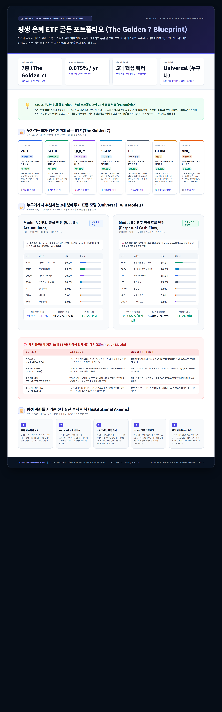

# 🏛️ DADAIC Investment Firm | 투자위원회 공식 의결서
## 평생 은퇴 ETF 골든 포트폴리오 (The Golden 7 Blueprint)
**문서 번호: DADAIC-CIO-MEMO-GOLDEN7-261005 | 통화 기준: Strict USD ($)**

---

## 🖼️ 투자위원회 공식 인포그래픽 (Official Infographic)

> **파일 생성 위치**:
> - 🖼️ 고해상도 인포그래픽 (PNG): [`Media/CIO-Universal-Retirement-ETF-Infographic.png`](./Media/CIO-Universal-Retirement-ETF-Infographic.png)
> - 🌐 인터랙티브 브라우저 뷰 (HTML): [`Media/CIO-Universal-Retirement-ETF-Infographic.html`](./Media/CIO-Universal-Retirement-ETF-Infographic.html)

---

## 💡 CIO & 투자위원회 핵심 철학 선언문
> **"은퇴 포트폴리오에 26개 종목은 분산이 아니라 독(Poison)이다."**

개인 투자자들은 종목 수가 많을수록 안전하다고 착각하지만, 26개 리스트는 다음과 같은 치명적 결함을 안고 있습니다:
1. **가짜 다각화 (False Diversification)**: VOO, VTI, VUG, VGT, QQQM, SMH를 동시에 보유하면, 실제로는 엔비디아, 마이크로소프트, 애플 등 상위 빅테크 주식에 자산의 40~50% 이상이 중복 몰빵됩니다.
2. **커버드콜의 비대칭 손익 함정 (Option Asymmetry)**: JEPI, JEPQ, DIVO의 높은 분배율(7~10%)은 상승장에서 원금 성장이 잘려나가고(Capped upside) 하락장에서는 원금이 함께 추락(Uncapped downside)하는 치명적 구조로, 20~30년 장기 보유 시 인플레이션을 이기지 못하고 원금을 갉아먹습니다.
3. **리밸런싱 마찰 비용 (Execution Drag)**: 26개 종목을 매 분기 리밸런싱하는 것은 과도한 매매 수수료, 세금, 그리고 극심한 행동경제학적 관리 피로도를 유발합니다.

따라서 투자위원회는 **상호 간의 상관관계가 가장 낮으면서도(Uncorrelated), 운용보수가 극단적으로 저렴하고(가중평균 0.075%), 어떤 경제 위기에도 스스로 복리 증식하는 'The Golden 7' 정예 라인업**을 확정했습니다.

---

## 👑 투자위원회가 엄선한 7대 골든 ETF (The Golden 7)

| # | 티커 | ETF 명칭 | 자산군 역할 | 연간 보수 | 위원회 선정 근거 및 시각 |
|:---:|:---:|:---|:---|:---:|:---|
| **01** | **VOO** | Vanguard S&P 500 ETF | 미국 시장 복리 닻 | **0.03%** | **워런 버핏 1순위 추천**: 미국 자본주의 최상위 500대 기업의 이익 성장을 가장 저렴하게 수취하는 핵심 앵커. |
| **02** | **SCHD** | Schwab U.S. Dividend Equity ETF | 우량 배당성장 머신 | **0.06%** | **찰리 멍거 퀄리티 픽**: 10년 연속 배당, ROE 27%+, 부채 안전망. 연 3.2% 배당과 연 11% 배당성장률의 황금 조화. |
| **03** | **QQQM** | Invesco NASDAQ 100 ETF | 테크 메가트렌드 알파 | **0.15%** | **피터 린치 성장주 픽**: QQQ 대비 수수료를 0.05% 낮춘 장기 적립용 ETF. 글로벌 디지털·AI 혁신 과실 독점. |
| **04** | **SGOV** | iShares 0-3 Month Treasury Bond ETF | 초단기 무위험 국채 | **0.07%** | **리스크 매니저 픽**: 0~3개월 무위험 국채. 대폭락장에도 주식을 손절하지 않게 해주는 1~2년 치 생활비 절대 방패. |
| **05** | **IEF** | iShares 7-10 Year Treasury Bond ETF | 중기 미국 국채 | **0.15%** | **매크로 헤지 픽**: 7~10년 중기 국채. TLT의 극단적 변동성을 피하면서 금융위기 및 경기침체 시 주식 폭락을 방어. |
| **06** | **GLDM** | SPDR Gold MiniShares Trust | 실물 금 (인플레 헤지) | **0.10%** | **올웨더 자산배분 픽**: GLD(0.40%) 대비 1/4 보수. 달러 화폐가치 희석과 지정학적 위기 시 주식·채권 동반 하락 방어. |
| **07** | **VNQ** | Vanguard Real Estate ETF | 실물 부동산 리츠 | **0.13%** | **실물 인컴 픽**: 미국 핵심 데이터센터, 물류센터, 주거용 리츠. 인플레이션 임대료 전가 및 배당 인컴 창출. |

---

## ⚖️ 누구에게나 추천 가능한 2대 생애주기 표준 모델 (Universal Twin Models)

이 7개 ETF는 종목을 바꿀 필요 없이, **투자자의 생애주기에 따라 '비중(Weight)'만 조절**하면 20대부터 80대까지 평생 완벽하게 작동합니다.

### 🚀 Model A : 부의 증식 엔진 (Wealth Accumulator)
* **적용 대상**: 20대 ~ 50대 초반 (자산 형성기 직장인, 은퇴 준비자 누구나)
* **포트폴리오 구성**:
  * **VOO (미국 코어)**: `30.0%`
  * **SCHD (배당성장)**: `25.0%`
  * **QQQM (빅테크 성장)**: `20.0%`
  * **SGOV (비상 유동성)**: `10.0%`
  * **IEF (중기 국채)**: `5.0%`
  * **GLDM (실물 금)**: `5.0%`
  * **VNQ (부동산 리츠)**: `5.0%`
* **자산군 비율**: **주식 75% | 안전·헤지 자산 25%**
* **성과 시뮬레이션**:
  * 기대 연환산 복리 수익률: **연 9.5% ~ 11.5%**
  * 초기 배당수익률: 연 2.2% (100% 재투자)
  * 경제위기 예상 최대 낙폭(MDD): **-19.5% 이내** (단일 주식 대비 50% 이상 안정적)

---

### 🛡️ Model B : 영구 현금흐름 엔진 (Perpetual Cash Flow)
* **적용 대상**: 50대 후반 ~ 70대+ (은퇴 생활자, 즉각적인 월 생활비 수령자 누구나)
* **포트폴리오 구성**:
  * **SCHD (우량 배당성장 코어)**: `35.0%`
  * **SGOV (초단기 국채 / 2년 치 생활비)**: `20.0%`
  * **VOO (인플레이션 방어 대형주)**: `15.0%`
  * **IEF (중기 국채 위기 방어)**: `15.0%`
  * **GLDM (실물 금)**: `5.0%`
  * **VNQ (부동산 리츠)**: `5.0%`
  * **QQQM (장기 구매력 유지)**: `5.0%`
* **자산군 비율**: **배당 및 현금 55% | 위기방어 채권·금 25% | 장기성장 주식 20%**
* **성과 시뮬레이션**:
  * 연간 순수 현금흐름 (순배당+이자): **연 3.65% (월 배당)**
  * **원금 매도율: 0%** (주식을 1주도 팔지 않고 순수 배당과 이자만으로 생활비 충당)
  * 경제위기 예상 최대 낙폭(MDD): **-11.2% 이내** (극강의 자본 보존력)

---

## 🚫 기존 19개 ETF 과감한 탈락 사유 (Elimination Matrix)

| 탈락 그룹 | 탈락 티커 | 포렌식 분석 및 위원회 탈락 사유 | 대체 해결책 |
|:---|:---|:---|:---|
| **커버드콜 군** | `JEPI`, `JEPQ`, `DIVO` | 상방 이익은 옵션 매도로 제한되고, 하방 위험은 열려 있어 장기 보유 시 실질 원금 훼손. | **전원 일치 탈락**. 원금 훼손 없는 **SCHD(배당성장) + SGOV(무위험채)**로 대체. |
| **중복 테크/반도체** | `VUG`, `VGT`, `SMH` | 엔비디아, 애플, MS에 대한 극단적 중복 몰빵 유발. 반도체 사이클 급락 리스크 과다. | **QQQM 1종목으로 압축**. 나스닥 100의 포괄적 혁신 과실을 최저비용으로 수취. |
| **중복 시장/해외** | `VTI`, `VT`, `VEA`, `VWO`, `VXUS` | VTI는 VOO와 상관계수 0.99로 동일. 비미국 주식은 15년간 저성장 및 환율 디스카운트로 장기 수익률 훼손. | **미국 S&P 500(VOO)에 집중**. 다국적 미국 대형주의 글로벌 매출로 자연 분산. |
| **초장기채 / 중복 리츠** | `TLT`, `XLRE`, `BND` | TLT는 금리 변동에 따른 듀레이션 리스크가 주식보다 큼(-45% 폭락 이력). XLRE는 VNQ의 하위 집합. | **중기 국채(IEF) 및 광범위 리츠 VNQ로 일원화**. 위험 대비 보상비율 극대화. |
| **미국 소형주** | `IJR`, `VB` | 고금리 장기화 환경에서 부채비율이 높은 소형주들의 이자 비용 부담 및 변동성 과다. | 대형 우량주 복리 엔진에 집중하여 포트폴리오 단순성 유지. |

---

## 📜 평생 계좌를 지키는 5대 실전 투자 원칙 (Institutional Axioms)

1. **종목 단순화의 미학 (The Rule of Simplicity)**: 7개 ETF면 전 세계 자산배분이 끝납니다. 종목이 10~20개를 넘어가면 투자자가 스스로 통제할 수 없으며, 운용 효율만 급격히 떨어집니다.
2. **SGOV 2년 생활비 철칙 (The 2-Year Cash Buffer)**: 은퇴자는 2년 치 순생활비를 무조건 SGOV로 채워두십시오. 2008년이나 2020년 같은 역사적 폭락장이 닥쳐도, 주식을 단 1주도 팔지 않고 2년을 버텨낼 수 있습니다.
3. **가짜 고배당 현혹 금지 (Beware the Yield Trap)**: 8~10% 커버드콜 분배금은 본인의 원금을 깎아서 지급하는 착시일 확률이 높습니다. 진정한 배당은 기업의 잉여현금흐름과 이익 성장의 결과물(SCHD)이어야 합니다.
4. **연 1회 생일 리밸런싱 (Annual Birthday Rebalancing)**: 매년 생일이나 연초에 단 한 번만 목표 비중을 점검하십시오. 폭등한 테크주를 조금 덜어내어 헐값에 떨어진 배당주나 채권을 기계적으로 사 모으는 것이 최고의 알파입니다.
5. **평생 인출률 4% 규칙 (The 4% Safe Withdrawal Rule)**: 은퇴 후에는 포트폴리오 총액의 연 3.5%~4.0% 내외만 인출하십시오. Golden 7 포트폴리오는 원금이 100세까지 줄어들지 않고 자녀에게 상속될 수 있는 지속 가능성을 보장합니다.
