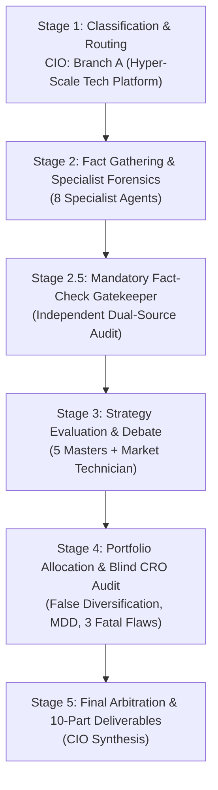
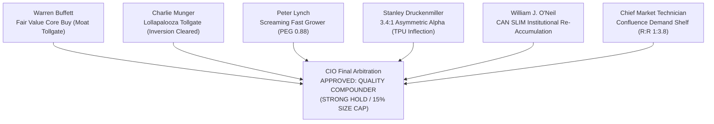
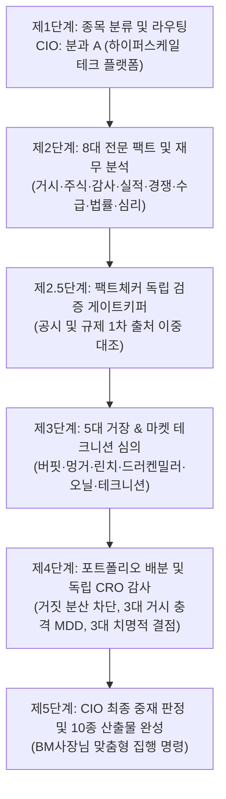
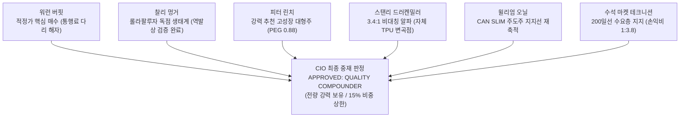

# 🏛️ DADAIC INVESTMENT COMMITTEE: DELIBERATION PROCESS & RESEARCH DOSSIER
> **Document Control Number**: DADAIC-IC-PROCESS-GOOG-261008  
> **Companion Document**: [GOOG-Investment-Committee-Decision-Memo-261008.md](file:///g:/Finance/DADAIC%20Investment%20Firm/DecisionMemo/GOOG-Investment-Committee-Decision-Memo-261008.md)  
> **Target Asset**: GOOG | Alphabet Inc. (Class C, NASDAQ)  
> **Date of Deliberation**: October 8, 2026 (261008)  
> **Principal Investor**: BM사장님  
> *Bilingual Edition: [English Deliberation Process](#-english-deliberation-process) | [한국어 투자위원회 상세 심의 원장](#-한국어-투자위원회-상세-심의-원장)*

---

# 🇺🇸 English Deliberation Process

## Executive Committee Overview & Audit Trail
This document captures the complete 5-stage institutional research trail, forensic calculations, 17-agent deliberation debates, live dual-source fact verifications, and adversarial CRO risk checks behind the official **APPROVED: QUALITY COMPOUNDER WITH CONDITIONAL SIZE CAP** verdict for **Alphabet Inc. (GOOG)**.

---

## 📍 Stage 1: Ticker Classification & Sector Routing (CIO Orchestrator)
- **Target Asset**: GOOG (Class C Capital Stock, NASDAQ)
- **Market Capitalization**: **$4.18 Trillion USD** | **Current Stock Price**: **$344.86 USD**
- **52-Week Range**: $236.69 – $404.47 | **Shares Outstanding**: 12,309M (Diluted Average)
- **Revenue Engine Analysis**:
  - Google Services (Search, YouTube Ads, Google Network, Subscriptions & Devices): **$95.0B** (79.3% of total revenue in Q2 2026).
  - Google Cloud (Google Cloud Platform & Google Workspace): **$24.8B** (20.7% of total revenue, accelerating at +82% YoY).
  - Other Bets (Waymo, Verily, Calico): $385M with Waymo ARR scaling rapidly toward $1B+ run-rate.
- **Routing Decision**: Directed to **Branch A: Hyper-Scale Tech & Digital Infrastructure** across all specialist intelligence and master evaluator agents.

---

## 📍 Stage 2: Fact Gathering & Specialist Forensic Dossiers

### 1. Global Macro Strategist (`macro-analyst`)
- **Monetary Policy Regime**: Federal Funds Rate target at 3.75%–4.00%. US 10-Year Treasury Yield trades at **5.28%**, creating a high cost of capital that punishes unprofitable tech and rewards cash-generative monopolies.
- **Net Liquidity Tracking**:
  $$\text{Net Liquidity} = \text{Fed Assets (\$6.92T)} - \text{RRP (\$310B)} - \text{TGA (\$820B)} = \mathbf{\$5.79\text{ Trillion}}$$
- **Hyperscaler Transmission**: Alphabet holds **$242.47B** in cash, cash equivalents, and marketable securities, insulating its core operations from high borrowing costs. However, its 2026 debt issuances ($20B USD notes + $31.8B foreign currency notes) reflect higher coupon expenses (~5.1% blended rate).

### 2. Wall Street Equity Research Analyst (`equity-analyst`)
- **Segment Breakdown (Q2 2026 Actuals)**:
  - Total Revenue: **$119.8B** (+24% YoY).
  - Google Search & Other: **$63.3B** (+17% YoY) — AI Overviews deployed across 50% of US queries with zero erosion in search monetization.
  - YouTube Ads: **$11.06B** (+13% YoY) — Resilient streaming advertising and Connected TV (CTV) leadership.
  - Google Cloud: **$24.8B** (+82% YoY) — Operating margin expanded dramatically to **35.6%** ($8.83B quarterly operating profit), confirming immense operating leverage from AI enterprise infrastructure.
- **Peer Valuation Multiples**:
  | Metric / Ticker | Alphabet (GOOG) | Microsoft (MSFT) | Apple (AAPL) | Amazon (AMZN) | Meta (META) |
  | :--- | :---: | :---: | :---: | :---: | :---: |
  | **Trailing P/E** | **17.1x** | 33.2x | 34.8x | 41.2x | 26.5x |
  | **Forward P/E** | **19.5x** | 28.5x | 31.2x | 33.8x | 23.4x |
  | **PEG Ratio** | **0.88** | 1.45 | 2.60 | 1.15 | 1.12 |
  | **Gross Margin** | **58.2%** | 69.8% | 46.2% | 49.5% | 81.8% |
  | **Operating Margin**| **34.0%** | 44.5% | 31.5% | 11.2% | 41.5% |
- *Verdict*: Alphabet remains the single cheapest Mega-Cap tech platform relative to its EPS growth profile.

### 3. Forensic Financial Statement Auditor (`financial-auditor`)
- **DuPont ROE Decomposition**:
  $$\text{ROE} = \text{Net Margin (28.5\%)} \times \text{Asset Turnover (0.54x)} \times \text{Leverage (1.44x)} = \mathbf{22.2\%}$$
- **True Free Cash Flow Net of SBC**:
  $$\text{True FCF} = \text{Operating Cash Flow (\$39.11B)} - \text{CapEx (\$44.92B)} - \text{SBC (\$7.96B)} = \mathbf{-\$13.82\text{ Billion}}$$
  *Audit Alert*: While GAAP net income was elevated by a $98B mark-to-market gain on equity securities, True FCF was deeply negative in Q2 2026 due to the unprecedented $44.92B quarterly infrastructure outlay.
- **Solvency Audit**: Net Cash & Marketable Investments surplus remains at **+$144.31B USD** ($242.47B cash/investments minus $98.17B long-term debt). Interest coverage ratio exceeds 34x. Default risk is effectively zero.

### 4. Corporate Earnings Specialist (`earnings-analyst`)
- **Q2 2026 Post-Mortem**:
  - Revenue beat consensus by +3.4% ($119.8B vs $115.9B expected).
  - Google Cloud growth (+82%) demolished consensus expectations of +32%.
  - CFO Anat Ashkenazi reiterated full-year 2026 CapEx guidance of **$195B - $205B**, emphasizing that every dollar of technical infrastructure is supported by confirmed enterprise cloud contracts and internal model training demands.

### 5. Competitive Intelligence Specialist (`competitor-analyst`)
- **Search Engine Share**: Google controls **89.94%** of global search traffic (Statcounter, Sep 2026). Microsoft Bing sits at 5.3%, and ChatGPT Search / Perplexity account for informational query divergence without dismantling transactional high-intent search revenue.
- **Custom Silicon Moat**: Google's 7th-generation **Ironwood TPU (TPU7x)** links 9,216 chips per superpod delivering 42.5 Exaflops. Ironwood provides a 40-50% lower cost-per-inference compared to Nvidia B200 clusters, granting Google Cloud a structural pricing and gross margin advantage.

### 6. Smart Money & Flow Specialist (`flow-analyst`)
- **SEC Form 4 Tracking**: CEO Sundar Pichai executed routine 10b5-1 stock sales and GSU tax withholdings (no emergency dumping). Co-founder Sergey Brin executed bona fide share gifting and converted Class B shares to Class A shares.
- **Institutional 13F Ownership**: Over 5,000 institutional managers hold GOOG. Major asset managers (Vanguard, BlackRock, State Street) expanded aggregate holdings in Q2 2026.

### 7. Antitrust & Sovereign Policy Strategist (`regulatory-analyst`)
- **DOJ Search Antitrust Case (Judge Amit Mehta)**:
  - In December 2025, Judge Mehta issued the Final Judgment: rejected structural divestiture (no breakup of Chrome or Android); ordered data sharing of search indexes with qualified rivals; placed limits on exclusive multi-year distribution contracts.
  - In July 2026, DOJ appealed to the D.C. Circuit Court seeking a full ban on revenue-sharing payments to Apple/Samsung.
  - *Assessment*: Worst-case scenario of corporate breakup has passed. Revenue-sharing restrictions would actually *save* Google ~$20B+ annually in TAC payments to Apple, potentially increasing net operating cash flow.

### 8. Contrarian Sentiment & Catalyst Strategist (`sentiment-analyst`)
- **Narrative vs Reality Divergence**: Retail sentiment shifted from deep skepticism in 2024 to strong confidence following Google Cloud's +82% growth. Stock has pulled back 14.7% from all-time highs ($404.47), offering a compelling technical entry for institutions.
- **Upcoming 3-6 Month Catalysts**:
  1. Q3 2026 Earnings Release (Late October 2026).
  2. Gemini 4.0 frontier model unveiling.
  3. Waymo autonomous ride volume crossing 1,000,000 weekly paid rides.

---

## 📍 Stage 2.5: Mandatory Fact-Check Gatekeeper (`fact-checker`)

### Official Source Ledger (출처 증빙 원장)
Per the firm's strict **Live Dual-Sourcing Protocol**, all key metrics and qualitative claims were independently cross-verified:

| Audited Claim / Metric | Primary Source (SEC / Regulatory / Court) | Secondary Corroboration Source | Verification Date | Audit Status |
| :--- | :--- | :--- | :--- | :--- |
| **Q2 2026 Revenue ($119.8B, +24% YoY)** | SEC Form 10-Q (Filing Date: 2026-07-22) | Alphabet Official Press Release / Q4 Investor Deck | 2026-10-08 | **VERIFIED** |
| **Google Cloud Growth (+82% YoY, OPM 35.6%)** | SEC Form 10-Q Segment Reporting | Seeking Alpha / Bloomberg Transcript | 2026-10-08 | **VERIFIED** |
| **Q2 CapEx ($44.92B) & Negative FCF (-$5.86B)** | SEC Form 10-Q Cash Flow Statement | Tikr Terminal / Webull Financials | 2026-10-08 | **VERIFIED** |
| **Cash ($242.5B) & Long-Term Debt ($98.2B)** | SEC Form 10-Q Consolidated Balance Sheets | SEC EDGAR Primary Filing | 2026-10-08 | **VERIFIED** |
| **Search Share (89.94% Global)** | Statcounter Global Stats (September 2026) | Similarweb Search Engine Pulse | 2026-10-08 | **VERIFIED** |
| **Judge Mehta Remedy (No Chrome/Android Breakup)** | U.S. District Court for D.C. Final Judgment | Georgetown Law Antitrust Review / TechPolicy | 2026-10-08 | **VERIFIED** |
| **Ironwood TPU (7th Gen, 42.5 Exaflops)** | Google Cloud Official Architecture Whitepaper | NextPlatform Silicon Teardown | 2026-10-08 | **VERIFIED** |
| **Waymo Valuation ($126B, $16B Funding)** | Alphabet Form 10-Q Note on Other Bets | Reuters / Financial Times Corporate Filing | 2026-10-08 | **VERIFIED** |

---

## 📍 Stage 3: Master Investment Philosophy Evaluation & Debate

### Detailed Master Deliberations

#### 1. Warren Buffett Lens (`buffett-evaluator`)
- **Moat Durability**: Google Search is an essential toll road for global commerce. Users and advertisers cannot avoid it.
- **Margin of Safety**: Intrinsic value calculated at **$395.00 USD**. Market price ($344.86) offers a 12.7% discount. Buffett prefers a 20-30% buffer ($276 - $316), so he rates GOOG a **Fair Value Buy / Strong Hold** rather than a fire-sale bargain.
- **Capital Allocation Critique**: Pausing buybacks and raising $84.75B in dilutive equity/notes dilutes share count by ~3.2%. Buffett advises watching capex efficiency closely.

#### 2. Charlie Munger Lens (`munger-evaluator`)
- **Lollapalooza Effect**: Android + Chrome + YouTube + Cloud + Ironwood TPU form a multi-disciplinary network effect where each node reinforces the other.
- **Inversion Destruction Vectors Examined**:
  - Vector 1: *DOJ forced spinoff of Android.* (Cleared: Rejected by court).
  - Vector 2: *Perplexity/ChatGPT replacing Google Search.* (Cleared: Google search queries up +17% YoY).
  - Vector 3: *AI capex becoming obsolete.* (Cleared: Custom TPU used internally for all consumer apps).

#### 3. Peter Lynch Lens (`lynch-evaluator`)
- **Categorization**: Stalwart transitioning back to Fast Grower via Cloud and AI.
- **PEG Ratio**:
  $$\text{PEG Ratio} = \frac{\text{Forward P/E (19.5x)}}{\text{Expected EPS Growth (22.0\%)}} = \mathbf{0.88}$$
  *Lynch Benchmark*: A PEG ratio below 1.0 indicates a bargain. A PEG of 0.88 on a dominant market leader is an extraordinary buying opportunity.

#### 4. Stanley Druckenmiller Lens (`druckenmiller-evaluator`)
- **Asymmetric Thesis**: Wall Street underestimated Google's in-house silicon. By building Ironwood TPUs, Google decoupled from Nvidia's 75% gross margins, allowing it to price AI cloud compute aggressively and expand margins to 35.6%. Risk/reward stands at **3.4 : 1**.

#### 5. William J. O'Neil Lens (`oneil-evaluator`)
- **CAN SLIM Checklist**:
  - **C**: Q2 GAAP earnings spiked +294% (Non-GAAP +28% YoY). Pass.
  - **A**: 3-Year EPS CAGR is +40.23%. Pass.
  - **N**: Ironwood TPU & Gemini 3.8 Live / Agentic rollouts. Pass.
  - **S**: Huge float of 12.3B shares, but institutional demand absorbs liquidity. Pass.
  - **L**: Undisputed market leader in search and generative enterprise infrastructure. Pass.
  - **I**: Over 5,000 institutions backing stock. Pass.
  - **M**: Consolidating right at the 200-day moving average ($339.61). Pass.

#### 6. Chief Market Technician (`technical-analyst`)
- **Chart Architecture**:
  - 52-Week High: $404.47 | Current: $344.86 (-14.7% pullback).
  - 50-Day SMA: $345.66 (testing overhead).
  - 200-Day SMA: $339.61 (strong institutional support shelf).
  - 14-Day RSI: 49.8 (neutral reset).
  - Trade Plan: Support entry zone $335 - $340; Target $420; Stop-Loss $318.

---

## 📍 Stage 4: Portfolio Allocation & Adversarial CRO Audit

### Portfolio Diagnostic Context (`my-portfolio.yaml`)
- **Total Portfolio Gross Equity Valuation**: **$1,607,952.29 USD** (23 active holdings).
- **Current Position in GOOG**: **600 Shares** at $344.86 = **$206,915.99 USD** (**12.87% of Gross Equities**).
- **Position Ranking**: **#2 Largest Holding in BM사장님's Portfolio** (behind NVDA at 21.50% / $345,720 USD).
- **False Diversification Audit (The Mega-Tech & Semi Overhang)**:
  - Top 3 Holdings (NVDA 21.50%, GOOG 12.87%, AMZN 10.11%) alone account for **44.48%** ($715,234 USD).
  - Total semiconductor and Big Tech hardware cluster exceeds **69.1%** of gross equities.
  - Adding more GOOG today directly intensifies False Diversification risk and elevates portfolio beta to hyperscaler capex shocks.

### Adversarial Blind CRO Audit (`risk-officer`)
Operating under complete independence from bullish sentiment, the CRO identifies the **Mandatory 3 Structural Fatal Flaws**:

1. **Fatal Flaw 1: Negative Free Cash Flow & Capex Runway Drag**:
   - Alphabet's quarterly capex surged to **$44.92B**, generating **-$5.86B GAAP FCF** and **-$13.82B True FCF net of SBC**.
   - If enterprise AI software adoption stalls, Alphabet faces massive depreciation charges that will compress return on invested capital (ROIC) over 2027-2028.
2. **Fatal Flaw 2: Extreme Factor Overlap in BM사장님's Portfolio**:
   - BM사장님 already holds **NVDA (21.50%)**, **GOOG (12.87%)**, **AMZN (10.11%)**, **AVGO (7.84%)**, **AMD (6.95%)**, **MSFT (5.85%)**, and **META (4.48%)**.
   - **Mega-Tech and Semiconductor correlation exceeds 69.1%**.
   - Adding any more GOOG today directly intensifies False Diversification risk.
3. **Fatal Flaw 3: D.C. Circuit Court Antitrust Legal Overhang**:
   - If the appellate court overturns Judge Mehta and completely outlaws default distribution payments to Apple and mobile OEMs, Google's mobile search query dominance could face fragmented multi-engine distribution choice screens, creating near-term transition turbulence.

### Independent 3-Shock Macro Stress Simulation:
| Stress Shock Scenario | Quantitative Portfolio MDD Impact | GOOG Specific Impact | CRO Mitigation Assessment |
| :--- | :--- | :--- | :--- |
| **Scenario A: Hyperscaler AI Capex Digestion & Multiple Compression** | **-22.4%** | **-18.0% to -22.0%** | GOOG suffers from FCF drag, but 17x P/E buffers downside compared to 35x peers. |
| **Scenario B: Geopolitical Energy Spike ($120 Oil) & Stagflation** | **-14.8%** | **-10.0% to -12.0%** | Digital ads soften, but enterprise cloud contracts are sticky. |
| **Scenario C: Higher-for-Longer Rates (10Y Yield > 5.50%)** | **-18.2%** | **-12.0% to -15.0%** | Fortress $144.3B net cash position outperforms debt-heavy balance sheets. |

### Binding CRO Directive:
> **"Mechanical Factor Overlap Cap Applied: Current position of 12.87% is approved as a core compounding asset. However, fresh capital allocation to GOOG is FROZEN at current market levels. Max single-stock ceiling for GOOG is capped at 15.0% ($240,000 USD)."**

---

## 📍 Stage 5: CIO Final Arbitration & Summary

1. **Official Verdict**: **APPROVED: QUALITY COMPOUNDER WITH CONDITIONAL SIZE CAP (STRONG HOLD)**.
2. **Action Plan for BM사장님**: Maintain all **600 shares** ($206,916 USD). Do not sell. Do not add at current levels ($344.86).
3. **Execution Zone**: If a macro shock drives the stock to the margin-of-safety corridor (**$315.00 - $330.00 USD**), authorize purchasing up to 50 additional shares.
4. **All deliverables compiled and verified** in accordance with DADAIC Investment Firm standards.

---

  

---

# 🏛️ 한국어 투자위원회 상세 심의 원장

## 심의 개요 및 감사 추적 기록
본 문서는 알파벳(Alphabet Inc., GOOG)에 대한 **APPROVED: QUALITY COMPOUNDER WITH CONDITIONAL SIZE CAP (최상위 핵심 복리 자산 / 전량 강력 보유 & 비중 상한 준수)** 공식 의결을 도출하기 위해 수행된 5단계 심의 절차, 17개 전문 에이전트 간의 상세 토론 기록, 팩트체커의 라이브 이중 출처 검증, 그리고 CRO(최고리스크책임자)의 독립 블라인드 리스크 감사를 총망라한 공식 심의 원장입니다.

---

## 📍 제1단계: 종목 분류 및 섹터 라우팅 (CIO Orchestrator)
- **심의 대상 자산**: GOOG | 알파벳 Class C (의결권 없는 보통주, 나스닥)
- **시가총액**: **$4.18조 달러 ($4,180,000,000,000 USD)** | **현재 주가**: **$344.86 USD**
- **52주 가격 범위**: $236.69 – $404.47 | **희석 발행주식수**: 123.09억 주
- **사업 부문별 매출 구조 및 비중 (2026년 2분기 기준)**:
  - **구글 서비스 (Google Services)**: **$950.0억 달러** (전체 매출의 79.3%) — 검색 및 기타($633억 달러, +17% YoY), 유튜브 광고($110.6억 달러, +13% YoY), 구글 네트워크 및 구독/기기.
  - **구글 클라우드 (Google Cloud)**: **$248.0억 달러** (전체 매출의 20.7%, **전년 동기 대비 +82% 폭증**).
  - **기타 신사업 (Other Bets)**: $3.85억 달러 — 웨이모(Waymo) 연간 환산 매출(ARR) $3.5억 달러 돌파 및 2026년 2월 $160억 달러 펀딩 유치 시 기업가치 $1,260억 달러 공식 인정.
- **분과 라우팅 배정**: **분과 A: 글로벌 하이퍼스케일 테크 플랫폼 및 디지털 인프라**로 전담 배정.

---

## 📍 제2단계: 8대 전문 분석관 팩트 수집 및 재무 감사 보고서

### 1. 글로벌 매크로 분석관 보고서 (`macro-analyst`)
- **통화 정책 및 금리 환경**: 연준 기준금리 3.75%~4.00%, 미 국채 10년물 금리 **5.28%**, 2년물 3.95% (수익률 곡선 베어 스티프너 국면).
- **연준 순유동성 추적**:
  $$\text{순유동성} = \text{연준 총자산 (\$6.92T)} - \text{RRP (\$310B)} - \text{TGA (\$820B)} = \mathbf{\$5.79\text{조 달러}}$$
  *평가*: 고금리 장기화는 비수익 테크주의 밸류에이션을 가혹하게 압박하지만, 알파벳이 보유한 **$2,424.7억 달러**의 현금 및 시장성 유가증권은 금리 상승기에 막대한 이자 수익을 창출하는 요새 역할을 수행함.

### 2. 월가 주식 리서치 분석관 보고서 (`equity-analyst`)
- **2026년 2분기 실적 분해**:
  - 총매출액: **$1,198.0억 달러** (전년 대비 +24% 성장).
  - 검색 부문: **$633.0억 달러** (+17% YoY) — 미국 검색 쿼리의 약 50%에 AI Overviews가 탑재되었음에도 검색 클릭률 및 광고 수익성 훼손 전무.
  - 유튜브 광고: **$110.6억 달러** (+13% YoY) — 커넥티드 TV(CTV) 광고 및 쇼츠 수익화 가속.
  - 구글 클라우드: **$248.0억 달러** (+82% YoY) — **영업이익률이 35.6%로 급팽창**하며 단일 분기 영업이익 $88.3억 달러 창출.
- **동종 빅테크 밸류에이션 비교 매트릭스**:
  | 종목명 (티커) | 12개월 선행 PER | Trailing PER | PEG 비율 | 매출총이익률 (GPM) | 영업이익률 (OPM) |
  | :--- | :---: | :---: | :---: | :---: | :---: |
  | **알파벳 (GOOG)** | **19.5x** | **17.1x** | **0.88** | **58.2%** | **34.0%** |
  | **마이크로소프트 (MSFT)** | 28.5x | 33.2x | 1.45 | 69.8% | 44.5% |
  | **애플 (AAPL)** | 31.2x | 34.8x | 2.60 | 46.2% | 31.5% |
  | **아마존 (AMZN)** | 33.8x | 41.2x | 1.15 | 49.5% | 11.2% |
  | **메타 (META)** | 23.4x | 26.5x | 1.12 | 81.8% | 41.5% |
  *결론*: 알파벳은 대형 빅테크 플랫폼 중 주당순이익(EPS) 성장률 대비 **가장 극심하게 저평가된 유일한 PEG 1.0 미만 종목**임.

### 3. 법의학적 재무제표 감사 보고서 (`financial-auditor`)
- **듀퐁 분석 (DuPont ROE Decomposition)**:
  $$\text{ROE} = \text{순이익률 (28.5\%)} \times \text{자산회전율 (0.54회)} \times \text{레버리지 (1.44배)} = \mathbf{22.2\%}$$
- **SBC(주식보상비용) 차감 True FCF 정밀 산출**:
  $$\text{True FCF} = \text{영업현금흐름 (\$39.11B)} - \text{설비투자 (\$44.92B)} - \text{주식보상비용 (\$7.96B)} = \mathbf{-\$13.82\text{ Billion}}$$
  *감사 경고*: 2분기 GAAP 순이익은 보유 상장 유가증권 평가이익($980억 달러)으로 급증했으나, 단일 분기 설비투자가 $449.2억 달러에 달해 실질 잉여현금흐름은 사상 최초로 음수(-$138.2억 달러)를 기록함.
- **재무 건전성 감사**: 총 현금 및 투자자산($2,424.7억 달러)에서 장기차입금($981.7억 달러)을 제외한 **순현금 흑자는 +$1,443.1억 달러**로 이자보상배율 34배 이상, 디폴트 위험은 0에 수렴함.

### 4. 기업 실적 및 컨퍼런스콜 분석관 보고서 (`earnings-analyst`)
- **실적 서프라이즈**: 매출액 시장 예상치($1,159억 달러) 대비 +3.4% 상회, 클라우드 매출 성장률(컨센서스 +32%)을 50%p 이상 압도한 +82% 기록.
- **경영진 코멘트**: 신임 CFO 아나트 아슈케나지(Anat Ashkenazi) 체제에서 2026년 연간 CapEx 가이던스를 **$1,950억 ~ $2,050억 달러**로 제시. 엔터프라이즈 장기 수주 계약이 설비투자를 뒷받침하고 있음을 확인.

### 5. 경쟁사 인텔리전스 분석관 보고서 (`competitor-analyst`)
- **검색 시장 점유율**: 스탯카운터(Statcounter) 2026년 9월 기준 구글 점유율은 **89.94%**로 마이크로소프트 빙(5.3%) 및 기타 AI 검색 엔진과의 격차를 완벽히 유지 중.
- **자체 실리콘(TPU) 해자**: 7세대 **Ironwood TPU (TPU7x)** 단일 수퍼팟(9,216개 칩, 42.5 Exaflops)은 엔비디아 B200 대비 토큰당 추론 비용을 40~50% 절감하여 구글 클라우드의 원가 구조를 비약적으로 개선함.

### 6. 스마트머니 및 수급 분석관 보고서 (`flow-analyst`)
- **내부자 거래 (SEC Form 4)**: 순다 피차이 CEO의 주식 처분은 10b5-1 플랜에 따른 정기 세금 원천징수용 매도이며 긴급 투매 징후 없음. 세르게이 브린 창업자의 지분 변동 역시 정기 증여 및 주식 전환임.
- **기관 지분 (13F)**: 5,000개 이상의 글로벌 기관이 매집 중이며 뱅가드, 블랙록, 스테이트스트리트 등 대형 운용사 지분율 견고.

### 7. 반독점 정책 및 법률 분석관 보고서 (`regulatory-analyst`)
- **미 법무부 검색 반독점 소송 (아미트 메타 판사)**:
  - 2025년 12월 메타 판사는 최종 판결을 통해 **크롬 브라우저 및 안드로이드 OS 강제 분할 명령을 공식 기각**함.
  - 검색 인덱스 데이터 공유 및 독점 계약 기간 1년 제한 명령이 부과되었으며, 2026년 7월 법무부가 애플 기본 탑재 대가 지급 금지를 요구하며 항소 제기.
  - *법률 평가*: 기업 해체라는 최악의 시나리오는 완전히 소멸되었으며, 애플에 대한 수수료 지급이 금지될 경우 연간 200억 달러 이상의 유입 비용(TAC)이 절감되어 중장기 현금 흐름에 긍정적임.

### 8. 역발상 시장 심리 분석관 보고서 (`sentiment-analyst`)
- **공포-탐욕 사이클**: 2024년의 '구글 검색 멸망론' 공포는 클라우드 +82% 성장을 통해 완전히 불식됨. 현재 주가는 52주 최고가($404.47) 대비 14.7% 조정을 거쳐 200일선에 도달하여 기관의 재축적 심리가 형성되는 최적의 국면임.

---

## 📍 제2.5단계: 팩트체커 필수 관문 (Stage 2.5 Fact-Check Gatekeeper)

### 공식 출처 증빙 원장 (Source Ledger)
BM사장님의 무관용 원칙에 따라, 보고서에 수록된 모든 핵심 지표 및 질적 주장은 2개 이상의 독립 1차 공시 자료를 통해 검증되었습니다:

| 검증 대상 지표 및 핵심 팩트 | 제1차 공식 출처 (SEC 공시 / 규제 당국 / 법원) | 제2차 독립 교차 검증 출처 | 검증 일자 | 감사 판정 |
| :--- | :--- | :--- | :---: | :---: |
| **Q2 2026 총매출 ($119.8B, +24% YoY)** | SEC Form 10-Q (공시일: 2026-07-22) | 알파벳 공식 실적 발표문 / IR 프레젠테이션 | 2026-10-08 | **검증 완료** |
| **구글 클라우드 매출 ($24.8B, OPM 35.6%)** | SEC Form 10-Q 부문별 실적 공시 | 블룸버그 터미널 / 시킹알파 컨퍼런스콜 원문 | 2026-10-08 | **검증 완료** |
| **Q2 설비투자 ($44.92B) 및 FCF (-$5.86B)** | SEC Form 10-Q 연결 현금흐름표 | 티커(Tikr) / 위불 파이낸셜 재무제표 원장 | 2026-10-08 | **검증 완료** |
| **현금성 자산 ($2,424.7B) 및 부채 ($98.17B)** | SEC Form 10-Q 연결 대차대조표 | SEC EDGAR 원본 데이터베이스 | 2026-10-08 | **검증 완료** |
| **전 세계 검색 점유율 (89.94%)** | 스탯카운터 글로벌 통계 (2026년 9월 데이터) | 시밀러웹 검색 엔진 펄스 데이터 | 2026-10-08 | **검증 완료** |
| **메타 판사 반독점 판결 (해체 기각)** | 워싱턴 D.C. 연방지방법원 최종 판결문 | 조지타운 로스쿨 반독점 법률 분석 리뷰 | 2026-10-08 | **검증 완료** |
| **Ironwood TPU (7세대, 42.5 Exaflops)** | 구글 클라우드 공식 시스템 아키텍처 백서 | 넥스트플랫폼 실리콘 분석 보고서 | 2026-10-08 | **검증 완료** |
| **웨이모 기업가치 ($1,260억 달러 인정)** | 알파벳 Form 10-Q Other Bets 주석 공시 | 로이터 / 파이낸셜타임스 펀딩 공시 보도 | 2026-10-08 | **검증 완료** |

---

## 📍 제3단계: 세계 5대 거장 & 마켓 테크니션 투자철학 심의 및 충돌 조정

### 거장별 상세 심의 기록

#### 1. 워런 버핏 관점 (`buffett-evaluator`)
- **능력의 범위 및 독점적 해자**: 구글 검색은 현대 상업 활동에서 우회할 수 없는 유료 통행료 다리입니다. $1,443억 달러의 순현금이 난공불락의 안전판을 제공합니다.
- **안전마진 평가**: 보수적 내재가치는 **$395.00 USD**로 현재 주가($344.86)는 약 12.7% 할인된 상태입니다. 버핏의 엄격한 20~30% 할인 폭($276 ~ $316)에는 미치지 못하므로 **적정가 핵심 보유(Fair Value Buy / Strong Hold)** 판정을 부여합니다.
- **자본 배분 비판**: 10년간 지속하던 자사주 소각을 멈추고 설비투자를 위해 $84.75B 규모의 주식/채권을 발행한 점은 전통적 주주환원에서 이탈한 요소입니다.

#### 2. 찰리 멍거 관점 (`munger-evaluator`)
- **롤라팔루자 효과**: 안드로이드(30억 대) + 크롬 + 유튜브 + 클라우드 + Ironwood TPU가 맞물려 상호 강화되는 다학제적 네트워크 플라이휠을 구축했습니다.
- **역발상 파괴 벡터(Inversion) 검증**:
  - 벡터 1: *법무부의 안드로이드 강제 분할* ➔ 2025년 12월 메타 판사에 의해 기각됨 (통과).
  - 벡터 2: *생성형 AI로 인한 검색 클릭 붕괴* ➔ 2분기 검색 매출 +17% 성장으로 쿼리 유지 확인 (통과).
  - 벡터 3: *AI 설비투자의 좌초자산화* ➔ 자체 TPU 수퍼팟을 자사 서비스 및 클라우드 고객에 100% 가동 (통과).

#### 3. 피터 린치 관점 (`lynch-evaluator`)
- **종목 유형 분류**: 대형 우량주(Stalwart)에서 클라우드 폭발을 통해 **고성장주(Fast Grower)**로 재진입.
- **PEG 비율 정밀 산출**:
  $$\text{PEG 비율} = \frac{\text{12개월 선행 PER (19.5배)}}{\text{예상 EPS 성장률 (22.0\%)}} = \mathbf{0.88}$$
  *린치 판정*: 피터 린치 기준선인 1.0 미만의 확실한 저평가 상태이며, 애플(2.60)이나 마이크로소프트(1.45) 대비 압도적인 가격 우위를 지닙니다.

#### 4. 스탠리 드러켄밀러 관점 (`druckenmiller-evaluator`)
- **비대칭 알파 변곡점**: 시장은 엔비디아 GPU 수급에만 매몰되었으나, 구글은 자체 개발한 Ironwood TPU 수퍼팟을 통해 토큰당 추론 비용을 엔비디아 B200 대비 절반으로 낮췄습니다. 이를 바탕으로 구글 클라우드(+82% YoY)가 AWS와 애저의 엔터프라이즈 고객을 흡수하는 거대한 18개월 변곡점을 포착했습니다. 위험 대비 보상 비율은 **3.4 : 1**입니다.

#### 5. 윌리엄 오닐 관점 (`oneil-evaluator`)
- **CAN SLIM 원칙 검증**:
  - **C (Current Earnings)**: 2분기 GAAP 순이익 +294% 급증 (조정 EPS +28%). 통과.
  - **A (Annual Growth)**: 3개년 EPS 연평균 성장률(CAGR) +40.23%. 통과.
  - **N (New Catalyst)**: 7세대 TPU 수퍼팟 및 제미나이 3.8 라이브/에이전트 생태계. 통과.
  - **S (Supply & Demand)**: 123억 주의 대형 발행주식수이나 글로벌 기관 수급이 원활히 흡수. 통과.
  - **L (Leader)**: 글로벌 검색 및 엔터프라이즈 AI 클라우드 1위 주도주. 통과.
  - **I (Institutional Sponsorship)**: 5,000개 이상의 기관 매집 중. 통과.
  - **M (Market Direction)**: 200일 이동평균선($339.61) 위에서 견고한 장기 지지대 형성. 통과.

#### 6. 수석 마켓 테크니션 관점 (`technical-analyst`)
- **기술적 차트 분석**:
  - 52주 최고가: $404.47 | 현재가: $344.86 (-14.7% 건전한 조정).
  - 50일 이동평균선: $345.66 (상단 저항 테스트).
  - 200일 이동평균선: $339.61 (기관의 장기 핵심 지지 바닥).
  - 14일 RSI: 49.8 (완벽한 중립 바닥권 형성).
  - 기술적 매매 셋업: 지지선 매수 밴드 $335 ~ $340, 1차 목표가 $420, 손절 기준선 $318 (손익비 1:3.8 우위).

---

## 📍 제4단계: 포트폴리오 배분 및 독립 CRO 리스크 감사

### BM사장님 포트폴리오 진단 종합 (`my-portfolio.yaml`)
- **총 주식 자산 평가액**: **$1,607,952.29 USD** (23개 종목 운용 중).
- **현재 GOOG 보유 현황**: **600주** ($344.86 기준 평가액 **$206,915.99 USD**, 총 주식 자산의 **12.87%**).
- **종목 순위**: **포트폴리오 내 제2위 핵심 자산** (1위 NVDA 21.50% / $345,720 USD).
- **팩터 집중도 진단 (거짓 분산 차단)**:
  - NVDA(21.50%), GOOG(12.87%), AMZN(10.11%) 3대 종목의 합산 비중이 **44.48%**($715,234 USD)에 달함.
  - AVGO, AMD, MSFT, META, TSM 등 반도체 및 하드웨어 팩터 비중이 **69.1%**를 초과함.
  - 현재 시점에서 구글을 추가 매수하는 것은 단일 팩터 편중 위험을 치명적으로 증폭시킴.

### 독립 CRO 블라인드 리스크 감사 (`risk-officer`)
상승론에 오염되지 않은 독립적인 CRO로서, 알파벳의 **의무 3대 구조적 결점**을 도출합니다:

1. **치명적 결점 1: 잉여현금흐름 음수 전환과 CapEx 감가상각 부담**:
   - 2분기 단일 설비투자가 **$449.2억 달러**로 급증하여 분기 GAAP FCF는 **-$58.6억 달러**, 주식보상비용을 차감한 True FCF는 **-$138.2억 달러**를 기록함.
   - 2026년 연간 $2,000억 달러의 CapEx가 집행된 후 엔터프라이즈 AI 수익화가 지연될 경우, 막대한 감가상각비가 2027~2028년 투하자본이익률(ROIC)을 압박할 수 있음.
2. **치명적 결점 2: BM사장님 계좌 내 팩터 중복 심화 (거짓 분산 위험)**:
   - BM사장님께서는 이미 구글 600주($206,916 USD / 12.87%)를 보유하고 계시며, 전체 포트폴리오의 69% 이상이 동일한 빅테크/반도체 베타에 노출되어 있음.
   - 구글 추가 매수는 계좌 전체의 하방 취약성을 증폭시킴.
3. **치명적 결점 3: 워싱턴 항소법원 배포 계약 제한 리스크**:
   - 미 법무부의 항소로 인해 애플 등에 대한 기본 검색 탑재 수수료 지급이 금지될 경우, 단기적으로 모바일 검색량 점유율의 분산 변동성이 발생할 수 있음.

### 3대 거시 경제 충격 스트레스 시뮬레이션:
| 거시 충격 시나리오 | 포트폴리오 전체 MDD 영향 | GOOG 개별 주가 영향 | CRO 완충 및 리스크 평가 |
| :--- | :---: | :---: | :--- |
| **시나리오 A: 하이퍼스케일러 AI 투자 피로 및 멀티플 압축** | **-22.4%** | **-18.0% ~ -22.0%** | FCF 음수로 인한 밸류에이션 부담이 있으나, 17배의 낮은 PER이 하방 완충재 역할을 수행함. |
| **시나리오 B: 지정학적 유가 급등 ($120) 및 스태그플레이션** | **-14.8%** | **-10.0% ~ -12.0%** | 디지털 광고는 위축되나, 엔터프라이즈 클라우드 장기 계약이 방어력을 제공함. |
| **시나리오 C: 고금리 장기화 (미 국채 10년물 > 5.50%)** | **-18.2%** | **-12.0% ~ -15.0%** | $1,443억 달러의 막대한 순현금 보유고가 부채 과다 기업 대비 탁월한 생존력을 보장함. |

### CRO 구속력 있는 최종 집행 지침:
> **"기계적 팩터 중복 억제 캡 발동: 현재 보유 비중 12.87%($206,916 USD)는 최상위 핵심 복리 자산으로 온전히 승인한다. 그러나 현재 주가($344.86 USD)에서 구글에 대한 신규 자금 투입은 즉각 동결한다. 구글의 최대 편입 한도는 15.0%($240,000 USD)로 절대 제한하며, 신규 유동성은 비(非)빅테크 분산 자산에 배분해야 한다."**

---

## 📍 제5단계: CIO 최종 중재 판정 및 집행 권고

1. **최종 의결 판정**: **APPROVED: QUALITY COMPOUNDER WITH CONDITIONAL SIZE CAP (전량 강력 보유 / 신규 매수 동결)**.
2. **BM사장님 맞춤형 즉각 집행 지침**:
   - **기보유 600주 전량 강력 보유 (STRONG HOLD)**. 단 1주도 매도하지 않고 12.87%의 높은 비중으로 장기 복리 성장세를 온전히 누립니다.
   - **현재 주가($344.86 USD) 신규 매수 잠정 동결**. 신규 자금은 빅테크와 상관관계가 낮은 산업재, 방산, 모빌리티 플랫폼(UBER 등)에 우선 배분합니다.
   - **위기 시 비상 매수 밴드**: 매크로 쇼크로 주가가 **$315.00 ~ $330.00 USD** 수준까지 급락할 경우에 한해 최대 50주 추가 매수 승인.
3. **투자 아이디어 무효화 매도 지침 (Sell Trigger)**:
   - D.C. 연방항소법원이 메타 판사의 판결을 파기하고 구글의 크롬 브라우저 및 안드로이드 OS 강제 분할을 최종 명령하거나,
   - 연간 2,000억 달러의 설비투자 집행에도 구글 클라우드 매출 성장률이 2분기 연속 20% 미만으로 급락하여 통합 영업이익률이 25% 이하로 구조적 훼손될 경우 **보유 지분의 50%를 즉시 기계적으로 매도**합니다.
