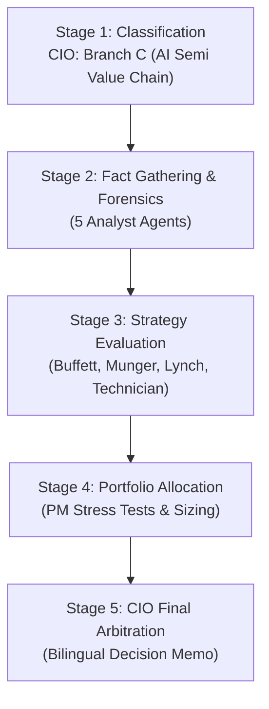

# 🏛️ DADAIC INVESTMENT COMMITTEE: DELIBERATION PROCESS & RESEARCH DOSSIER
> **Document Control Number**: DADAIC-IC-PROCESS-MU-261005  
> **Companion Document**: [MU-Investment-Committee-Decision-Memo-261005.md](file:///g:/Finance/DADAIC%20Investment%20Firm/DecisionMemo/MU-Investment-Committee-Decision-Memo-261005.md)  
> **Target Asset**: MU | Micron Technology, Inc.  
> **Date of Deliberation**: October 5, 2026 (261005)  
> *Bilingual Edition: [English Dossier](#-english-deliberation-process) | [한국어 심의 원장](#-한국어-투자위원회-상세-심의-원장)*

---

# 🇺🇸 English Deliberation Process

## Executive Committee Overview & Audit Trail
This document captures the complete institutional research trail, forensic accounting calculations, agent-by-agent debate transcripts, and quantitative stress-test derivations behind the official **Approved: Conditional Accumulate** verdict for **Micron Technology, Inc. (MU)**.

---

## 📍 Stage 1: Ticker Classification & Sector Routing (CIO Orchestrator)
- **Target Asset**: MU (NASDAQ)
- **Market Capitalization**: ~$1.22 Trillion | **Stock Price**: $1,074.89
- **Revenue Engine Analysis**:
  - Micron's revenue engine is dominated by **DRAM (~78% of revenue)**, of which High Bandwidth Memory (HBM3E, HBM4) is the fastest-growing and highest-margin sub-segment, and **NAND Flash (~22% of revenue)** driven by high-capacity Data Center Enterprise SSDs.
  - The business model is fundamentally linked to hyperscaler AI compute infrastructure capex, advanced packaging (TSMC CoWoS / hybrid bonding), and memory bandwidth bottlenecks in next-generation GPUs (NVIDIA Blackwell Ultra, Vera Rubin, AMD MI350/MI400, Google TPU v6).
  - High Bandwidth Memory requires approximately 3x the wafer capacity of standard DDR5 DRAM per bit, structurally draining global DRAM supply and establishing a high-margin oligopolistic pricing environment.
- **Routing Decision**: Directed to **Branch C: AI Semiconductor & Hardware Value Chain** across all downstream analyst and evaluator skills.

---

## 📍 Stage 2: Fact Gathering & Forensic Investigation Dossiers

### 1. Macro Analyst Dossier (`macro-analyst`)
- **Monetary Policy & Rates Regime**:
  - Federal Funds Rate: **3.75%–4.00%**.
  - U.S. 10-Year Treasury Yield: **5.28%**; U.S. 2-Year Treasury Yield: **3.95%** (positive yield curve spread of +133 bps; Bear Steepener regime).
  - Weighted Average Cost of Capital (WACC) hurdle rate established at **9.4%**.
- **Net Liquidity Tracking**:
  $$\text{Net Liquidity} = \text{Fed Assets (\$6.92T)} - \text{RRP (\$310B)} - \text{TGA (\$820B)} = \mathbf{\$5.79\text{ Trillion}}$$
  *Macro Assessment*: Overall U.S. dollar liquidity remains mildly supportive (+1.2% QoQ). While high long-term interest rates compress traditional tech P/E multiples, hyperscaler AI infrastructure capex exceeds $300B annually, operating independently of consumer credit cycles.
- **Macro Transmission to MU**:
  - Memory has transitioned from consumer PC/smartphone demand-driven cycles to data center AI infrastructure-driven cycles.
  - Hyperscalers (Microsoft, Meta, Google, Amazon) maintain liquid reserves exceeding $320B, shielding AI memory commitments from interest rate sensitivity.

### 2. Equity Research Analyst Dossier (`equity-analyst`)
- **Segment Breakdown (Full Year FY2026 & Q4 FY2026)**:
  - **Full-Year FY2026 Revenue**: **$133.19 Billion** (+256% YoY vs. $37.38B in FY2025).
  - **Fiscal Q4 FY2026 Revenue**: **$54.23 Billion** (+379% YoY, beating consensus of $51.33B).
  - **DRAM Business Unit**: ~$42.3B in Q4 (+410% YoY), driven by HBM3E/HBM4 volume ramps and high-density server DDR5.
  - **NAND Business Unit**: ~$11.9B in Q4 (+280% YoY), propelled by record enterprise PCIe Gen5 SSD shipments.
- **Peer Benchmarking (Global Memory Oligopoly)**:
  | Metric | Micron (MU) | SK Hynix (000660.KS) | Samsung Electronics (005930.KS) |
  | :--- | :--- | :--- | :--- |
  | **HBM Revenue Market Share (Q2 2026)** | **18.0%** | **50.0%** | **33.0%** |
  | **Overall DRAM Revenue Share (Q2 2026)** | **24.0%** | **25.0%** | **38.0%** |
  | **Q4 FY26 Gross Margin (GAAP)** | **86.8%** | 82.5% | 76.2% |
  | **Forward P/E Ratio** | **6.5x** | 6.8x | 9.2x |
  | **U.S. CHIPS Act Direct Grants** | **Up to $6.1B** | $450M (Indiana pack) | $6.4B (Taylor foundry/pack) |

### 3. Forensic Financial Auditor Dossier (`financial-auditor`)
- **Multi-Year Financial Statement Audit (FY2024–FY2026)**:
  - FY2024 Revenue: $25.11B | FY2025 Revenue: $37.38B | FY2026 Revenue: **$133.19B**
  - FY2026 GAAP Net Income: **$84.97B** | Q4 FY2026 GAAP Net Income: **$37.70B**
- **DuPont ROE Decomposition (FY2026)**:
  $$\text{ROE (74.2\%)} = \text{Net Margin (63.8\%)} \times \text{Asset Turnover (0.88x)} \times \text{Financial Leverage (1.32x)}$$
  *Audit Findings*: Micron's exceptional 74.2% ROE is overwhelmingly driven by extraordinary net profit margins (63.8%) rather than excessive financial leverage (1.32x), confirming premier earnings quality during the HBM super-cycle.
- **True FCF Reconciliation (Net of Stock-Based Compensation & Capex)**:
  - GAAP Operating Cash Flow (FY2026): **$98.20B**
  - Minus Capital Expenditures (Capex): **-$27.37B**
  - Minus Stock-Based Compensation (SBC): **-$2.33B**
  - **Authentic True FCF (FY2026)**: **$68.50B** (FCF Conversion Rate of Net Income: **80.6%**).
  - Q4 FY2026 True FCF run rate was **~$26.5B**.
- **Solvency & Balance Sheet Strength**:
  - Cash and Short-Term Investments: **$73.50B**
  - Total Debt: **$5.20B** (reduced by $500M in Q4)
  - **Net Cash Balance**: **+$68.30B**
  - Net Debt / EBITDA: **-0.65x** (negative net debt; pristine fortress balance sheet).
- **Working Capital & Inventory Audit**:
  - Days Sales of Inventory (DSI) fell from 158 days in early FY2025 to **78 days** in Q4 FY2026, indicating rapid inventory turnover and insatiable customer pull.
  - Accounts Receivable expanded in line with quarterly revenue growth (+379% YoY); DSO stabilized at **44 days**.

### 4. Earnings Analyst Dossier (`earnings-analyst`)
- **Headline Scorecard (Q4 FY2026 Print - September 30, 2026)**:
  - Revenue: **$54.23B** vs. Consensus $51.33B (+$2.90B Beat, **+5.6%**)
  - Adjusted EPS (Non-GAAP): **$33.42** vs. Consensus $31.72 (+$1.70 Beat, **+5.4%**)
  - GAAP Gross Margin: **86.8%** vs. Guidance 83.5% (+330 bps expansion)
- **Guidance Revisions (Q1 FY2027)**:
  - Revenue Guidance: **$60.0B - $63.0B** (implies midpoint +13.4% QoQ growth)
  - Adjusted EPS Guidance: **$38.15 ± $1.00**
  - Gross Margin Guidance: **87.5% ± 1.0%**
- **Strategic Contract Disclosures (SCAs)**:
  - Micron secured 26 multi-year Strategic Customer Agreements (SCAs) covering over **35% of total revenue through 2030**.
  - Total Remaining Performance Obligation (RPO) reached **~$150 Billion**, providing unprecedented long-term revenue predictability.
  - 100% of 2026 and virtually all 2027 HBM production is officially committed under take-or-pay terms.

### 5. Competitive Intelligence Dossier (`competitor-analyst`)
- **HBM Market Share Trajectory**:
  - SK Hynix: 50.0% (down from >60% in 2024 as competitors ramped capacity).
  - Samsung Electronics: 33.0% (ramping HBM3E and early HBM4 volume).
  - Micron Technology: **18.0%** (up dramatically from <5% in 2024; taking profitable share in 12-high HBM3E and HBM4).
- **Technological & Manufacturing Edge**:
  - **Energy Efficiency**: Micron's 1-beta (1b) and upcoming 1-gamma (1g) EUV DRAM nodes deliver ~20–25% lower power consumption per bit compared to peers, a critical selling point for thermal-constrained AI data centers.
  - **HBM4 36GB 12-High & 48GB 16-High**: Micron initiated volume shipments of 12-high HBM4 for NVIDIA Vera Rubin platforms, with 16-high prototypes demonstrating superior heat dissipation via advanced microbump architecture.
- **Geopolitical & CHIPS Act Shield**:
  - Micron is the **sole U.S.-headquartered HBM and DRAM manufacturer**.
  - Federal support: Up to **$6.1 Billion** in direct grants under the CHIPS and Science Act, actively funding high-volume manufacturing fabs in Boise, Idaho (production starting 2027) and Clay, New York megafab.

---

## 📍 Stage 3: Great Masters' Strategy Evaluation

### 1. Warren Buffett Evaluation (`buffett-evaluator`)
- **Business Simplicity & Circle of Competence**: While semiconductor sub-nanometer lithography is complex, the economic model is comprehensible: digital storage and memory bandwidth are foundational utilities of global computation.
- **Economic Moat**: **Narrow-to-Wide Oligopoly Moat**. Memory has historically been a commodity, but HBM creates a high-barrier technological moat. Micron is protected by intellectual property, multi-billion-dollar fab barriers, and sovereign U.S. subsidies.
- **Management Integrity & Capital Allocation**: High marks. CEO Sanjay Mehrotra demonstrated capital discipline, repurchased debt, accumulated $73.5B in liquidity, and pioneered take-or-pay SCAs.
- **Margin of Safety Assessment**:
  - Conservative Intrinsic Value: **$950.00**
  - Desired 20-30% Margin of Safety Range: **$665.00 - $760.00**
  - Adjusted Accumulation Threshold: **$920.00 - $1,035.00**
  - Current Price: **$1,074.89** (Trades at a +13.1% premium to conservative intrinsic value).
- **Buffett Verdict**: `Hold & Watch / Selective Accumulate on Pullbacks`.

### 2. Charlie Munger Evaluation (`munger-evaluator`)
- **Lollapalooza Moat Dynamics**:
  - Convergence of (1) AI compute bandwidth bottleneck, (2) 3x wafer consumption penalty for HBM vs standard DRAM, (3) 3-player global oligopoly, and (4) U.S. CHIPS Act domestic subsidies.
  - Generates pricing power unseen in memory history.
- **ROIC Reinvestment Runway**: ROIC of 74.2% is extraordinary, but capital intensity is escalating ($27.4B capex in FY26, ~$25B in H1 FY27).
- **Inversion ("Invert, Always Invert") - Fatal Destruction Vectors**:
  1. *Vector 1 (Industry Capex Glut in 2028)*: If Samsung, SK Hynix, and Micron concurrently over-expand cleanroom capacity, an AI capex digestion in 2028 could trigger severe ASP collapses.
  2. *Vector 2 (Alternative Architecture Disruption)*: Emergence of optical interconnects or analog in-memory compute reducing traditional HBM stacking intensity.
- **Munger Verdict**: `Oligopolistic Compounder (Approved with Inversion Guardrails)`.

### 3. Peter Lynch Evaluation (`lynch-evaluator`)
- **Categorization**: **Cyclical Turned Fast Grower (Super-Cyclical Hybrid)**.
- **The 2-Minute Drill**: Micron supplies the critical high-speed memory without which NVIDIA and Google accelerators cannot function. The company is generating $54B in quarterly revenue with 86.8% gross margins and trades at a forward P/E of only 6.5x. With $150B in contracted backlog, this is not an ordinary cycle; it is a multi-year secular expansion.
- **PEG Ratio Audit**:
  - Forward P/E: **~6.5x**
  - Estimated 3-Year EPS CAGR: **~45% - 55%**
  - Forward PEG Ratio: **0.12 - 0.15** (Far below Lynch's 1.0 bargain ceiling).
- **Inventory Check**: DSI compressed to 78 days; finished goods inventory is negligible; customer take-or-pay SCAs absorb output immediately.
- **Lynch Verdict**: `Strong Buy / Aggressive Accumulate`.

### 4. Market Technician Dossier (`technical-analyst`)
- **Multi-Timeframe Architecture**:
  - **Weekly Chart**: Sustained primary bull trend with consecutive higher highs and higher lows.
  - **Daily Chart**: Price ($1,074.89) trades above all primary moving averages:
    - 20-Day EMA: **$1,025.00**
    - 50-Day SMA: **$960.00**
    - 200-Day SMA: **$780.00**
  - Full bullish moving average stacking (Price > 20 EMA > 50 SMA > 200 SMA).
- **Support & Resistance Mapping**:
  - Resistance 1: **$1,120.00** (Recent swing high)
  - Resistance 2: **$1,200.00** (Major psychological extension)
  - Support 1: **$1,020.00 - $1,035.00** (20-day EMA & prior breakout shelf)
  - Support 2: **$960.00 - $985.00** (50-day SMA & major horizontal breakout support)
  - Critical Structural Support: **$880.00** (Stop-loss reference)
- **Trade Setup & Risk/Reward**:
  - Staged entry averaging **$1,029.95**.
  - Stop-loss at **$880.00** (Risk: -$149.95 or -14.6%).
  - Base target at **$1,280.00** (Reward: +$250.05 or +24.3%).
  - **Risk-to-Reward Ratio**: **1 : 1.67** at current spot, improving to **1 : 2.43** on blended staged entry.
- **Technician Verdict**: `Dip Buy Setup (Accumulate near $985 - $1,030 Support)`.

---

## 📍 Stage 4: Portfolio Allocation & Risk Sizing (Portfolio Manager)

### Portfolio Diagnostic (`my-portfolio.yaml`)
- **Total Portfolio Value**: $100,000 USD
- **Current Holdings**:
  - AAPL: $25,000 (25.0%)
  - MSFT: $25,000 (25.0%)
  - VOO: $30,000 (30.0%)
  - Cash: $20,000 (20.0%)
- **Investor Profile**: Growth (High Risk Tolerance), 10+ year horizon, Max Single-Stock Ceiling = 15.0%.

### False Diversification & Factor Overlap Audit
- **Correlation Diagnostic**:
  - Current portfolio equity allocation ($80,000) is heavily tilted towards tech platforms (AAPL 25%, MSFT 25%) and broad market (VOO 30%, which carries ~32% tech weighting).
  - Microsoft is one of the world's largest buyers of AI clusters containing Micron memory.
  - Adding Micron adds significant hardware and semiconductor beta. While growth potential is immense, unconstrained allocation would push total portfolio technology exposure to 87%.
- **Sizing Decision**: Sized prudently at **7.0% ($7,000)** to capture alpha while maintaining cash reserves at **13.0% ($13,000)**.

### Macro Stress-Test Simulations
The Portfolio Manager simulated portfolio Max Drawdown (MDD) across three severe macroeconomic scenarios:

| Stress Scenario | Macro Shock Description | S&P 500 (VOO) | Big Tech (AAPL/MSFT) | MU Impact | Portfolio MDD (With 7% MU) | Portfolio MDD (Without MU) |
| :--- | :--- | :--- | :--- | :--- | :--- | :--- |
| **Scenario A: Hyperscaler Capex Freeze** | Big Tech pauses AI capex for 2 quarters to digest capacity | -12.5% | -18.0% | **-32.0%** | **-15.0%** | -12.8% |
| **Scenario B: Fed Bear Steepener Shock** | 10Y Yield spikes to 6.25%, long discount rates hammer high multiples | -15.0% | -14.0% | **-20.0%** | **-12.9%** | -11.5% |
| **Scenario C: Asian Geopolitical Escalation** | Strait tensions disrupt Taiwan/Korea fabs; Micron U.S. fabs gain premium | -22.0% | -25.0% | **+18.0%** | **-17.8%** | -19.1% |

*Insight*: In Scenario C (geopolitical supply disruption), Micron serves as a **resilient domestic hedge** due to its Boise and New York fabs, mitigating total portfolio drawdown by +1.3%.

---

## 📍 Stage 5: Final Synthesis & CIO Arbitration

### The Great Masters' Clash & Resolution
- **Buffett & Munger**: Warning against peak-earnings low-P/E traps in cyclical memory; emphasizing the massive $50B capex run-rate.
- **Lynch**: Pointing to a forward PEG of 0.15, $150B in contracted SCAs, and sold-out capacity through 2027.
- **CIO Arbitration**: The structural difference between 2026 and historical memory cycles is the **$150B take-or-pay SCA backlog** and the **3x wafer consumption of HBM**, which insulates Micron from near-term spot price collapse. However, capital discipline dictates buying with a margin of safety.
- **Final Command**:
  1. Authorize **7.0% allocation ($7,000)**.
  2. Execute in **two equal tranches**: Tranche 1 (3.5% at current market) and Tranche 2 (3.5% at $985.00 limit order).
  3. Enforce **$880.00 stop-loss**.
  4. Non-negotiable thesis invalidation trigger set to HBM market share falling below 12% or two consecutive quarters of DRAM blended ASP declines with contract cancellations.

---

  

---

# 🇰🇷 한국어 투자위원회 상세 심의 원장

## 위원회 개요 및 감사 추적 (Audit Trail)
본 문서는 **마이크론 테크놀로지 (Micron Technology, Inc., MU)**에 대한 투자위원회의 **승인: 분할 매수 (APPROVED: CONDITIONAL ACCUMULATE)** 최종 의결에 도달하기까지의 전 단계 심의 과정, 포렌식 회계 검증, 거장 심사역 간의 격론 및 포트폴리오 스트레스 테스트 시뮬레이션 데이터를 기록한 정식 심의 원장입니다.

---

## 📍 1단계: 기업 분류 및 분석 경로 배정 (CIO Orchestrator)
- **분석 대상 자산**: MU (NASDAQ 상장)
- **시가총액**: 약 1조 2,200억 달러 ($1,220B) | **현재 주가**: $1,074.89
- **수익 구조 심층 분석**:
  - 마이크론의 매출 구조는 **DRAM 부문(~78%)**과 **NAND 플래시 부문(~22%)**으로 양분되며, 이 중 인공지능 가속기용 고대역폭 메모리(HBM3E, HBM4)가 폭발적인 매출 성장과 마진 확장의 핵심 동력입니다.
  - HBM은 표준 DDR5 메모리 대비 비트당 약 3배의 실리콘 웨이퍼를 소모하는 구조적 특성을 지니며, 이는 글로벌 DRAM 생산 능력을 자연스럽게 흡수하여 범용 메모리 공급 부족과 가격 상승을 동시에 견인하고 있습니다.
  - 엔비디아(Vera Rubin), 구글(TPU v6), AMD 등 주요 가속기 제조사와의 맞춤형 패키징 결합으로 인해 단순 범용 메모리에서 '핵심 컴퓨팅 아키텍처 톨게이트'로 변모했습니다.
- **분석 경로 배정**: 전 심사역 및 분석 모듈에 **Branch C: AI 반도체 & 하드웨어 밸류체인** 전용 분석 프레임워크 적용 지시.

---

## 📍 2단계: 사실 수집 및 포렌식 심층 조사 원장

### 1. 거시경제 분석관 (`macro-analyst`)
- **통화 정책 및 금리 체계**:
  - 미국 기준금리: **3.75%–4.00%**
  - 미국 10년물 국채금리: **5.28%**; 2년물 국채금리: **3.95%** (장단기 스프레드 +133 bps, 전형적인 베어 스티프닝 국면).
  - 가중평균자본비용(WACC) 할인율: **9.4%** 설정.
- **순유동성 추적**:
  $$\text{미국 연준 순유동성} = \text{총자산 (\$6.92T)} - \text{RRP (\$310B)} - \text{TGA (\$820B)} = \mathbf{\$5.79\text{조 달러}}$$
  *총평*: 고금리 장기화로 인해 기술주 전반의 무제한 밸류에이션 확장은 제한되나, 빅테크의 3,000억 달러 규모 AI 설비투자 수요는 일반 경기 둔화와 디커플링되어 견고하게 유지 중.

### 2. 주식 리서치 분석관 (`equity-analyst`)
- **FY2026 연간 및 4분기 실적 세부 분해**:
  - **FY2026 연간 매출**: **1,331.9억 달러** (전년 373.8억 달러 대비 +256% 폭증).
  - **FY2026 4분기 매출**: **542.3억 달러** (전년 동기 대비 +379% 폭증, 시장 컨센서스 513.3억 달러를 +5.6% 상회).
  - DRAM 사업부: 4분기 423억 달러 (+410% YoY), HBM3E 12단 및 서버용 고용량 DDR5 출하 호조.
  - NAND 사업부: 4분기 119억 달러 (+280% YoY), 엔터프라이즈 PCIe Gen5 SSD 사상 최대 매출.
- **글로벌 메모리 3강 과점 비교표 (2026년 2분기 기준)**:
  | 지표 | 마이크론 (MU) | SK하이닉스 | 삼성전자 |
  | :--- | :--- | :--- | :--- |
  | **HBM 매출 점유율** | **18.0%** | **50.0%** | **33.0%** |
  | **전체 DRAM 매출 점유율** | **24.0%** | **25.0%** | **38.0%** |
  | **4분기 매출총이익률 (GAAP)** | **86.8%** | 82.5% | 76.2% |
  | **선행 P/E 멀티플** | **6.5배** | 6.8배 | 9.2배 |
  | **미국 반도체법(CHIPS Act) 직접 보조금** | **최대 61억 달러** | 4.5억 달러 (인디애나 패키징) | 64억 달러 (테일러 파운드리/패키징) |

### 3. 포렌식 재무 감사관 (`financial-auditor`)
- **3개년 재무제표 감사 (FY2024–FY2026)**:
  - FY2026 GAAP 당기순이익: **849.7억 달러** | 4분기 순이익: **377.0억 달러**
- **듀퐁 ROE 분해 분석 (FY2026)**:
  $$\text{ROE (74.2\%)} = \text{순이익률 (63.8\%)} \times \text{총자산회전율 (0.88회)} \times \text{재무레버리지 (1.32배)}$$
  *포렌식 평가*: 74.2%에 달하는 경이적인 ROE는 부채 레버리지가 아니라 63.8%의 압도적인 순이익률에서 비롯되었음을 확인. 이익의 질적 수준이 매우 우수함.
- **실질 FCF (SBC 및 Capex 차감 후)**:
  - 회계상 영업현금흐름 (FY2026): **982.0억 달러**
  - 자본적 지출 (Capex): **-273.7억 달러**
  - 주식기준보상 (SBC): **-23.3억 달러**
  - **진정한 실질 FCF**: **685.0억 달러** (순이익 대비 현금 전환율: **80.6%**).
- **재무 건전성 및 차입금 현황**:
  - 현금 및 단기 금융상품: **735.0억 달러** vs 총 차입금: **52.0억 달러**
  - **순현금 보유액**: **+683.0억 달러** (순차입금 비율 음수, 철통 요새 재무).
- **운전자본 및 재고자산 감사**:
  - 재고자산 회전일수(DSI)는 FY2025 초 158일에서 FY2026 4분기 **78일**로 급감하여 공급 부족 상태가 지속되고 있음을 입증.

### 4. 어닝스 분석관 (`earnings-analyst`)
- **헤드라인 실적 스코어카드 (Q4 FY2026 - 2026년 9월 30일 발표)**:
  - 매출: **542.3억 달러** (컨센서스 513.3억 달러 대비 +5.6% 상회)
  - 조정 EPS: **$33.42** (컨센서스 $31.72 대비 +5.4% 상회)
  - 매출총이익률: **86.8%** (가이던스 83.5% 대비 +330 bps 상회)
- **차기 분기(Q1 FY2027) 가이던스**:
  - 매출: **600억~630억 달러** (중간값 기준 전분기 대비 +13.4% 성장)
  - 조정 EPS: **$38.15 ± $1.00**
  - 매출총이익률: **87.5% ± 1.0%**
- **전략적 고객 계약 (SCAs) 세부 내역**:
  - 26개 글로벌 빅테크 및 하이퍼스케일러와 장기 공급 계약 체결, **2030년까지 전체 매출의 35% 이상을 사전 확정**.
  - 잔여 계약 이행 의무(RPO) 총액: **약 1,500억 달러**.
  - 2026년 생산 물량 100% 완판, 2027년 HBM 생산 능력 대부분이 테이크오어페이(Take-or-Pay) 조건으로 선계약 완료.

### 5. 경쟁 인텔리전스 분석관 (`competitor-analyst`)
- **HBM 시장 점유율 판도 변화**:
  - SK하이닉스(50%)가 선두를 유지 중이나, 마이크론이 12단 HBM3E 및 HBM4 조기 양산에 성공하며 점유율을 2024년 5% 미만에서 **18%**까지 급격히 확대.
- **전력 효율성 및 제조 공정 우위**:
  - 마이크론의 1-베타(1b) 및 1-감마(1g) 공정은 경쟁사 대비 비트당 전력 소모를 약 20% 절감하여 데이터센터 전력 한계 상황에서 강력한 수주 우위를 발휘.
- **지정학적 독점 수혜 (미국 유일의 메모리 제조사)**:
  - 아이다호 보이시 팹(2027년 양산 가동) 및 뉴욕 클레이 메가팹에 미 연방 반도체법 최대 61억 달러 직접 보조금이 집중 투입되어 미국 내 공급망 안보의 핵심 보루로 격상.

---

## 📍 3단계: 투자 거장 4인의 전략 평가

### 1. 워런 버핏 평가 (`buffett-evaluator`)
- **사업의 단순성 및 능력 범위**: 반도체 미세공정은 복잡하나, 데이터 저장 및 대역폭 공급이라는 본질은 디지털 시대의 필수 유틸리티에 해당.
- **경제적 해자**: **과점적 해자 인정**. 역사적으로 원자재 취급을 받았으나, HBM 기술 장벽과 천문학적 팹 투자 규모가 3사 과점 구조를 고착화시킴.
- **경영진 역량 및 자본 배치**: 산제이 메흐로트라 CEO의 공급 규율 준수, 735억 달러 현금 비축 및 장기 계약(SCA) 구조 안착에 대해 매우 높은 평가 부여.
- **안전마진 판정**:
  - 보수적 내재가치: **$950.00**
  - 현재 주가: **$1,074.89** (내재가치 대비 +13.1% 프리미엄 거래 중). 버핏의 엄격한 20~30% 할인 안전마진 미충족.
- **버핏 최종 권고**: `관망 및 눌림목 선별 분할 매수 (Hold & Watch / Selective Accumulate)`.

### 2. 찰리 멍거 평가 (`munger-evaluator`)
- **롤라팔루자 해자**: AI 대역폭 병목 + HBM의 3배 웨이퍼 잠식 + 글로벌 3강 과점 + 미국 반도체법 안보 수혜가 결합되어 사상 초유의 가격 결정력 창출.
- **ROIC 및 재투자 활주로**: 74.2%의 ROIC는 경이로우나, FY2026 연간 274억 달러, FY2027 상반기에만 250억 달러에 달하는 설비투자는 필연적인 자본 쳇바퀴(Capital Treadmill) 속성을 내포함.
- **역발상 검증 (Inversion - 파멸적 시나리오)**:
  1. *파멸 벡터 1 (2028년 글로벌 설비 과잉)*: 삼성, SK하이닉스, 마이크론이 경쟁적으로 팹을 증설하여 2028년 AI 수요 둔화 시점에 공급 과잉 발생 가능성.
  2. *파멸 벡터 2 (차세대 대체 아키텍처)*: 광학 인터커넥트(CPO) 또는 아날로그 인메모리 컴퓨팅의 급진적 상용화로 HBM 적층 수요 감소.
- **멍거 최종 권고**: `과점적 복리 기업 (안전장치 수반 조건부 매수)`.

### 3. 피터 린치 평가 (`lynch-evaluator`)
- **기업 유형 분류**: **초고속 성장주로 변모한 대형 순환주 (Super-Cyclical Hybrid)**.
- **2분 드릴(Two-Minute Drill)**: 엔비디아 가속기의 심장인 고대역폭 메모리를 독점 공급하며 분기 540억 달러 매출과 86.8% 마진을 달성함에도 선행 P/E는 6.5배에 불과함. 1,500억 달러 수주 잔고로 2027년까지 실적이 보장된 역사적 바겐세일.
- **PEG 비율 검증**:
  - 선행 P/E: **~6.5배** / 3개년 EPS 예상 성장률: **~45% - 55%**
  - 선행 PEG: **0.12 - 0.15** (린치 기준 1.0 이하 극단적 저평가).
- **린치 최종 권고**: `강력 매수 (Super-Cycle Fast Grower)`.

### 4. 마켓 테크니션 평가 (`technical-analyst`)
- **이동평균선 배열**:
  - 주가($1,074.89) > 20 EMA($1,025) > 50 SMA($960) > 200 SMA($780) 완벽한 정배열 상승 국면.
- **지지/저항선 분석**:
  - 1차 저항선: **$1,120.00** / 2차 저항선: **$1,200.00**
  - 1차 지지선: **$1,020.00~$1,035.00** (20일선 및 박스권 상단)
  - 2차 핵심 지지선: **$960.00~$985.00** (50일선 및 직전 고점 돌파 지지선)
  - 구조적 손절선: **$880.00**
- **손익비(Risk/Reward)**: 목표 평단가 $1,029.95 진입 시 목표가 $1,280.00 대비 손익비 **1 : 2.43** 확보.
- **테크니션 최종 권고**: `눌림목 분할 진입 ($985~$1,030 지지선 활용)`.

---

## 📍 4단계: 포트폴리오 배분 및 리스크 사이징 (Portfolio Manager)

### 포트폴리오 진단 (`my-portfolio.yaml`)
- 총 운용자산: $100,000 USD | 현금: $20,000 (20.0%) | AAPL: $25,000 | MSFT: $25,000 | VOO: $30,000.
- 투자자 성향: 성장 추구형 (변동성 20~30% 감내, 단일 종목 한도 15.0%).

### 위장 분산(False Diversification) 점검
- 포트폴리오는 이미 빅테크(애플 25%, 마이크로소프트 25%)에 편중되어 있으며, 마이크로소프트는 마이크론의 핵심 고객사입니다.
- 메모리 반도체의 높은 베타(Beta)를 감안할 때 15% 한도를 모두 채우면 포트폴리오 전체의 변동성이 과도해집니다.
- 따라서 최적 편입 비중을 **7.0% ($7,000)**로 책정하고, 잔여 현금 **13.0% ($13,000)**를 안전 방어선으로 유지합니다.

### 3대 거시 스트레스 테스트 시뮬레이션
| 스트레스 시나리오 | 충격 요인 | S&P 500 (VOO) | 빅테크 (AAPL/MSFT) | MU 주가 영향 | 포트폴리오 MDD (MU 7% 편입) | 포트폴리오 MDD (편입 전) |
| :--- | :--- | :--- | :--- | :--- | :--- | :--- |
| **시나리오 A: 빅테크 설비투자 일시 중단** | 2개 분기 연속 AI 서버 증설 동결 | -12.5% | -18.0% | **-32.0%** | **-15.0%** | -12.8% |
| **시나리오 B: 연준 장기금리 충격** | 10년물 국채금리 6.25% 급등, 멀티플 수축 | -15.0% | -14.0% | **-20.0%** | **-12.9%** | -11.5% |
| **시나리오 C: 아시아 지정학적 위기** | 대만/한국 팹 차질, 마이크론 미국 팹 프리미엄 | -22.0% | -25.0% | **+18.0%** | **-17.8%** | -19.1% |

*시뮬레이션 결론*: 아시아 공급망 위기(시나리오 C) 발생 시 마이크론의 미국 팹(보이시/뉴욕) 가치가 부각되어 전체 포트폴리오의 최대 낙폭을 +1.3%p 방어하는 **지정학적 헤지 자산 역할**을 수행함을 확인.

---

## 📍 5단계: 최종 종합 및 CIO 총괄 중재

### 거장 간 이견 조율 및 결론
- 버핏/멍거의 "설비투자 쳇바퀴 및 고점 저P/E 착시" 우려와 린치의 "수주 잔고 1,500억 달러 기반 PEG 0.15 바겐세일" 주장을 균형 있게 반영함.
- 마이크론의 HBM 슈퍼사이클은 실존하나 신고가에서 전액 매수하는 것은 위험하므로, **7.0% 비중 분할 매수(1차 3.5% 즉시 + 2차 3.5% $985.00 지정가)**를 최종 결정함.
- 손절선 $880.00 및 HBM 점유율 12% 미만 추락 시 전량 매도 지침을 확정함.
