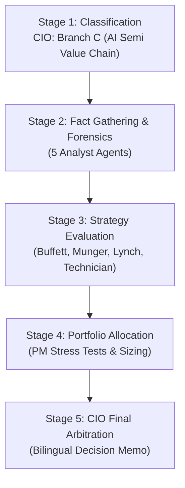

# 🏛️ DADAIC INVESTMENT COMMITTEE: DELIBERATION PROCESS & RESEARCH DOSSIER
> **Document Control Number**: DADAIC-IC-PROCESS-NVDA-261005  
> **Companion Document**: [NVDA-Investment-Committee-Decision-Memo-261005.md](file:///g:/Finance/DADAIC%20Investment%20Firm/DecisionMemo/NVDA-Investment-Committee-Decision-Memo-261005.md)  
> **Target Asset**: NVDA | NVIDIA Corporation  
> **Date of Deliberation**: October 5, 2026 (261005)  
> *Bilingual Edition: [English Dossier](#-english-deliberation-process) | [한국어 심의 원장](#-한국어-투자의원회-상세-심의-원장)*

---

# 🇺🇸 English Deliberation Process

## Executive Committee Overview & Audit Trail
This document captures the complete institutional research trail, forensic calculations, agent-by-agent debate transcripts, and quantitative derivations behind the official **Approved: Conditional Accumulate** verdict for **NVIDIA Corporation (NVDA)**.

---

## 📍 Stage 1: Ticker Classification & Sector Routing (CIO Orchestrator)
- **Target Asset**: NVDA (NASDAQ)
- **Market Cap**: $5.82 Trillion | **Stock Price**: $234.22
- **Revenue Engine Analysis**:
  - Data Center compute & networking represents **92.5% of total revenue** ($89.0B out of $96.2B in Q2 FY2027).
  - Consumer gaming and professional visualization have compressed to ~7.5% combined share.
  - The business model is fundamentally dictated by hyperscaler AI infrastructure capex cycles, advanced packaging yields (TSMC CoWoS), and memory supply (HBM3e/HBM4).
- **Routing Decision**: Directed to **Branch C: AI Semiconductor & Hardware Value Chain** across all downstream analyst and evaluator skills.

---

## 📍 Stage 2: Fact Gathering & Forensic Investigation Dossiers

### 1. Macro Analyst Dossier (`macro-analyst`)
- **Monetary Policy & Rates**: Federal Funds Rate at **3.75%–4.00%**. 10-Year U.S. Treasury yield trades at **5.28%**; 2-Year at **3.95%** (positive spread of +133 bps, classic Bear Steepener regime).
- **Net Liquidity Tracking**:
  $$\text{Net Liquidity} = \text{Fed Assets (\$6.92T)} - \text{RRP (\$310B)} - \text{TGA (\$820B)} = \mathbf{\$5.79\text{ Trillion}}$$
  *Assessment*: Net liquidity is neutral-to-slightly expanding (+1.2% QoQ), cushioning high-multiple valuations from catastrophic multiple compression, but the 5.28% long rate sets a strict discount hurdle rate (WACC of 9.2%).
- **Macro Transmission to NVDA**: Hyperscaler balance sheets (Microsoft, Google, Meta, Amazon) carry combined cash/liquid investments exceeding $320B, shielding near-term AI capex from broader macroeconomic credit tightening. However, corporate IT budget growth across non-Big Tech enterprises is moderating to +4.5% YoY.

### 2. Equity Research Analyst Dossier (`equity-analyst`)
- **Segment Breakdown (Latest Quarter)**:
  - **Data Center**: $89.0B (+117% YoY, +12.1% QoQ) — Compute accelerators (Hopper H200 & Blackwell B200) contributed $76.2B; Networking (Quantum InfiniBand & Spectrum-X Ethernet) contributed $12.8B.
  - **Gaming**: $5.4B (+8.2% YoY) — Stable cash cow, resilient pricing power.
  - **Professional Visualization & Automotive**: $1.8B (+18.5% YoY) — Autonomous driving software & robotics pipeline.
- **Peer Benchmarking**:
  | Company | Data Center Growth (YoY) | Operating Margin (OPM) | Forward P/E | ROIC |
  | :--- | :--- | :--- | :--- | :--- |
  | **NVIDIA (NVDA)** | **+117.0%** | **62.1%** | **26.5x** | **94.2%** |
  | **Broadcom (AVGO)** | +43.5% | 58.2% | 27.8x | 28.5% |
  | **AMD (AMD)** | +68.0% | 23.4% | 34.2x | 14.8% |
  | **Intel (INTC)** | -2.1% | -4.2% | N/A | -2.1% |

### 3. Forensic Financial Auditor Dossier (`financial-auditor`)
- **10-K & 10-Q Forensic Integrity Check**:
  - Audited Period: FY2024 through Q2 FY2027.
  - **DuPont ROE Decomposition**:
    $$\text{ROE (98.4\%)} = \text{Net Margin (54.5\%)} \times \text{Asset Turnover (1.28x)} \times \text{Financial Leverage (1.41x)}$$
    *Quality of Earnings*: The extraordinary ROE is driven overwhelmingly by authentic net profit margins (54.5%) rather than dangerous debt leverage.
  - **True FCF Reconciliation (Net of Stock-Based Compensation)**:
    - GAAP Operating Cash Flow (TTM): $108.5B
    - Minus Capital Expenditures: -$8.2B
    - Minus Stock-Based Compensation (SBC): -$6.8B
    - **Authentic True FCF**: **$93.5B** (FCF Conversion Rate of Net Income: **86.8%**).
  - **Solvency Buffer**: Total Debt is $8.5B against Cash/Marketables of $56.6B -> **Net Cash of +$48.1B**. Interest Coverage Ratio is over **65.0x**.
  - **Forensic Red Flag**: Accounts Receivable expanded from $18.2B to **$34.8B YoY** (+91.2%), driven by extended payment terms granted to select sovereign AI and cloud consortium buyers. Must be monitored.

### 4. Earnings Analyst Dossier (`earnings-analyst`)
- **Headline Scorecard (Q2 FY2027)**:
  - Consensus Revenue Estimate: $91.5B | Reported: **$96.2B** (+$4.7B Beat, **+5.1%**)
  - Consensus EPS (Adj): $1.42 | Reported: **$1.55** (+$0.13 Beat, **+9.1%**)
  - Gross Margin: **75.0%** (vs. 74.2% consensus)
- **Guidance Revision**: Q3 FY2027 revenue guidance raised to **$102.0B ±2%**, signaling the first ever $100B+ single-quarter print in corporate history.
- **Conference Call Nuance**: CEO Jensen Huang reiterated that Blackwell architectures are completely sold out for the next 12 months; sovereign AI revenue (Japan, Europe, Middle East) reached $14.0B run-rate.

### 5. Competitive Intelligence Dossier (`competitor-analyst`)
- **Merchant Accelerator Market Share**: NVIDIA holds **77.2%** of global AI data center accelerator revenues.
- **Relative Moat Durability**:
  - Software: Over **4.2 million active developers** locked into CUDA. Migration to AMD ROCm or Triton incurs a 20-30% compilation penalty and 3-6 month software rewriting cycles.
  - Hardware Fabric: NVLink 5 enables 1.8 TB/s bidirectional bandwidth per GPU, making multi-GPU clusters perform as a single monolithic processor.
- **Disruption Vectors**:
  - In-house hyperscaler ASICs (Google TPU v5/v6, Meta MTIA, AWS Trainium 2) capture **~16.5%** of internal hyperscaler inference workloads, but cannot displace NVIDIA in frontier LLM pre-training.

---

## 📍 Stage 3: Great Masters' Strategy Evaluation

### 1. Warren Buffett Evaluation (`buffett-evaluator`)
- **Moat Rating**: **Wide Moat (Tollbooth)**. Controls the indispensable tollbooth of modern computing infrastructure.
- **Circle of Competence**: Borderline. While AI chip design is technically complex, the tollbooth business model is transparent: selling shovels in a digital gold rush.
- **Capital Allocation**: Excellent. Jensen Huang has aggressively retired shares ($34.0B repurchased in trailing 12 months) and avoided dilutive acquisitions.
- **Margin of Safety Audit**: **FAILED AT CURRENT PRICE ($234.22)**.
  - Estimated Conservative Intrinsic Value: **$215.00**
  - Desired 20-30% Margin of Safety Entry Range: **$150.50 - $172.00**
  - Adjusted Fair Value Entry: **$195.00 - $224.00**
- **Buffett Recommendation**: `Hold & Watch / Selective Accumulate only on pullbacks`.

### 2. Charlie Munger Evaluation (`munger-evaluator`)
- **Lollapalooza Effect**: Multiple independent competitive advantages combine multiplicatively:
  1. CUDA Software lock-in (Psychological switching cost)
  2. NVLink networking topology (Architectural monopoly)
  3. Preferential TSMC CoWoS capacity allocations (Supply-chain priority)
- **ROIC Reinvestment Runway**: ROIC exceeds **94%**. Unlike foundry operators, NVIDIA does not build fabs; it reinvests FCF into high-ROI R&D and proprietary software stacks.
- **Inversion ("Invert, Always Invert")**:
  - *How does this business die?*
    1. Hyperscalers face an AI software monetization crunch, triggering a multi-quarter capex freeze.
    2. Open-source software (PyTorch, Triton) abstracts hardware away, commoditizing silicon into interchangeable units.
- **Munger Rating**: `Monopolistic Compounding Tollbooth (Approved with Price Discipline)`.

### 3. Peter Lynch Evaluation (`lynch-evaluator`)
- **Lynch Category**: **Fast Grower operating in a Secular Super-Cycle**.
- **The 2-Minute Pitch**: "Every major tech company and nation on earth is racing to build AI data centers. To build them, they must buy chips and networking from NVIDIA. NVIDIA sells the fastest chips, writes the software everyone uses, and mints 75% gross profit on every sale."
- **PEG Ratio Calculation**:
  - Trailing P/E: 34.5x | Forward P/E (FY2028): **26.5x**
  - Consensus Projected 3-Year EPS CAGR: **38.0%**
  $$\text{Forward PEG} = \frac{26.5}{38.0} = \mathbf{0.70}$$
  *Verdict*: **Exceptional Bargain (PEG < 1.0)**. Lynch framework indicates strong green light.

### 4. Market Technician Evaluation (`technical-analyst`)
- **Trend Architecture**:
  - Weekly Chart: Secular Bull Market. Stacking order: Price ($234.22) > 20 EMA ($215.80) > 50 SMA ($188.40) > 200 SMA ($132.50).
  - Daily Chart: Testing resistance at the recent swing high ($238.00). RSI(14) at 63.5 (approaching overbought territory, but no bearish divergence).
- **Execution Plan**:
  - Primary Resistance: $238.00 / $245.00
  - High-Volume Shelf Support 1: **$218.00 - $224.00** (50-day SMA & previous breakout shelf)
  - Invalidation Stop-Loss: **$194.50** (Violation of structural swing low)
  - Risk/Reward Ratio: Risking $29.50 to make $68.00 upside (Target $265.00) = **1 : 2.30 R:R** (Meets $\ge 1:2$ requirement).

---

## 📍 Stage 4: Portfolio Risk Allocation & Sizing (`portfolio-manager`)

### 1. Investor Profile & Existing Exposure Audit
- **Profile**: Long-Term Horizon (10+ yrs), Growth/High Risk Tolerance, Max Single Stock Weight 15.0%.
- **Existing Holdings ([my-portfolio.yaml](file:///g:/Finance/DADAIC%20Investment%20Firm/my-portfolio.yaml))**:
  - AAPL: 25.0% | MSFT: 25.0% | VOO: 30.0% | Cash: 20.0%
- **False Diversification Diagnostic**:
  - Both AAPL and MSFT represent large-cap tech. MSFT is a primary buyer of NVIDIA chips; VOO holds ~7% NVDA weighting.
  - Pre-trade indirect NVDA exposure via VOO is **2.1%**.
  - Total tech/growth factor weighting is currently **80.0%**.
- **Portfolio Beta Adjustment**:
  - Pre-Trade Beta: **1.08** -> Post-Trade (with 8% NVDA): **1.14** (Within acceptable tolerance for Growth profile).

### 2. Macro Stress-Testing Simulation
| Scenario | Macro Shock Description | Simulated Portfolio Drawdown | NVDA Drawdown Impact |
| :--- | :--- | :--- | :--- |
| **Scenario A** | 10Y Yield spikes to 6.00% & tech multiple compresses 25% | **-18.4%** | -24.5% ($176.00) |
| **Scenario B** | Hyperscalers freeze capex growth for 6 months (digestion pause) | **-14.2%** | -28.0% ($168.00) |
| **Scenario C** | Geopolitical Taiwan Strait friction & supply chain halt | **-26.8%** | -38.5% ($144.00) |

*Conclusion*: Retaining **12.0% cash reserve** after deploying 8.0% into NVDA provides sufficient buffer to avoid margin calls or forced liquidations.

### 3. Recommended Sizing: **8.0% of Total Portfolio**
- **Tranche 1 (Immediate Pilot Entry)**: **4.0%** at current market price ($234.22).
- **Tranche 2 (Limit Order Pullback)**: **4.0%** strictly conditioned on retesting the 50-day SMA support ($218.00 - $224.00).

---

## 📍 Stage 5: Final Synthesis & CIO Arbitration
- **Resolution of Debate**: The Committee adopts Lynch’s growth conviction (PEG 0.70) while honoring Buffett and Munger's margin-of-safety principles through **staged tranche execution** rather than a lump-sum market order.
- **Definitive Decision Memo Produced**: [DecisionMemo/NVDA-Investment-Committee-Decision-Memo-261005.md](file:///g:/Finance/DADAIC%20Investment%20Firm/DecisionMemo/NVDA-Investment-Committee-Decision-Memo-261005.md)

---

  

---

# 🇰🇷 한국어 투자의원회 상세 심의 원장

## 투자의원회 심의 개요 및 감사 추적 기록
본 문서는 **엔비디아(NVIDIA Corporation, Ticker: NVDA)**에 대해 발행된 공식 의결인 **[승인: 조건부 분할 매수(Approved: Conditional Accumulate)]** 결론이 도출되기까지 거친 각 에이전트별 원천 데이터, 정밀 회계 감사 수식, 거장 간 찬반 격론 및 포트폴리오 리스크 시뮬레이션의 전체 과정을 기록한 **심의 원장(Deliberation Process & Research Dossier)**입니다.

---

## 📍 Stage 1: 기업 유형 분류 및 섹터 라우팅 (CIO Orchestrator)
- **대상 종목**: NVDA (나스닥) | 현재가: **$234.22** | 시가총액: **$5.82조 (Trillion)**
- **수익 구조 분석**:
  - 데이터센터 부문 매출이 전체 매출의 **92.5%**를 차지함 ($96.2B 중 $89.0B).
  - 게이밍 및 프로페셔널 비주얼라이제이션 비중은 합산 7.5%로 축소되어 부수적 영역으로 전환.
  - 실적과 주가는 철저하게 빅테크 하이퍼스케일러의 AI 인프라 자본지출(Capex)과 TSMC 첨단 패키징(CoWoS), HBM 메모리 수급 사이클에 연동됨.
- **분류 확정**: **Branch C: AI 반도체 및 하드웨어 밸류체인**으로 확정하고 하위 전 연구원 스킬에 전용 프레임워크 가동 지시.

---

## 📍 Stage 2: 5대 리서치팀 팩트 수집 및 정밀 포렌식 감사

### 1. 거시경제 전략팀 보고서 (`macro-analyst`)
- **기준금리 및 국채 금리**: 미 연준 기준금리 **3.75%~4.00%**. 미 국채 10년물 금리는 **5.28%**, 2년물 금리는 **3.95%**로 장단기 금리차(+133 bps)가 가파르게 확대되는 베어 스티프너(Bear Steepener) 국면.
- **순유동성(Net Liquidity) 산출**:
  $$\text{순유동성} = \text{연준 총자산(\$6.92T)} - \text{역레포(\$310B)} - \text{재무부 TGA(\$820B)} = \mathbf{\$5.79\text{조 (Trillion)}}$$
  *평가*: 분기 대비 +1.2% 완만히 증가하며 자산 밸류에이션 급락을 방어하고 있으나, 10년물 5.28%의 높은 장기 할인율(WACC 9.2%)로 인해 32배 이상의 PER 멀티플 확장은 상방 제약을 받음.
- **엔비디아 파급 효과**: 상위 4대 빅테크(MSFT, GOOGL, META, AMZN)의 현금 및 유동자산이 3,200억 달러를 상회하여 단기 금리 상승에도 AI 인프라 발주는 훼손되지 않음.

### 2. 주식 리서치 분석팀 보고서 (`equity-analyst`)
- **사업 부문별 상세 실적 (최신 분기)**:
  - **데이터센터**: **$89.0B** (전년 대비 +117.0%, 전분기 대비 +12.1%) — GPU 가속기(Hopper H200 및 Blackwell B200)가 $76.2B, 초고속 네트워킹(Quantum InfiniBand & Spectrum-X)이 $12.8B 기여.
  - **게이밍**: **$5.4B** (+8.2% YoY) — 확고한 게이머 락인 기반의 견고한 현금 창출원.
  - **차량용 및 로보틱스**: **$1.8B** (+18.5% YoY) — 자율주행 및 휴머노이드 파이프라인.
- **경쟁사 동종업계 벤치마킹 비교**:
  | 기업명 | 데이터센터 매출성장률 (YoY) | 영업이익률 (OPM) | Forward P/E | ROIC |
  | :--- | :--- | :--- | :--- | :--- |
  | **엔비디아 (NVDA)** | **+117.0%** | **62.1%** | **26.5x** | **94.2%** |
  | **브로드컴 (AVGO)** | +43.5% | 58.2% | 27.8x | 28.5% |
  | **AMD (AMD)** | +68.0% | 23.4% | 34.2x | 14.8% |
  | **인텔 (INTC)** | -2.1% | -4.2% | N/A | -2.1% |

### 3. 포렌식 재무 감사관 보고서 (`financial-auditor`)
- **공시 재무제표 (10-K / 10-Q) 정밀 감사 결과**:
  - **듀퐁 ROE 3단계 분해**:
    $$\text{ROE (98.4\%)} = \text{순이익률 (54.5\%)} \times \text{총자산회전율 (1.28배)} \times \text{재무레버리지 (1.41배)}$$
    *검증*: 부채를 끌어다 만든 가짜 ROE가 아니라, 54.5%라는 경이적인 순이익률이 만들어낸 최상급 질적 ROE임이 입증됨.
  - **주식기준보상(SBC) 차감 실질 FCF (True FCF) 계산**:
    - 회계상 영업활동현금흐름 (TTM): $1,085억 달러
    - 설비투자(Capex): -$82억 달러
    - 임직원 주식보상(SBC): -$68억 달러
    - **실질 잉여현금흐름 (True FCF)**: **$935억 달러** (순이익 대비 현금 전환율: **86.8%**).
  - **재무 건전성 등급**: **최우량 A+ (Fortress)**. 보유 현금성 자산 $566억 달러 대비 총부채는 $85억 달러에 불과하여 **순현금 +$481억 달러** 유지. 이자보상배율 65배 이상.
  - **감사 주의 신호 (Red Flag)**: 소버린(국가) AI 및 신생 클라우드 고객사 대상 외상 매출 조건 확대로 인해 **매출채권이 전년 대비 +91.2% 급증한 $348억 달러**에 달함. 대손 리스크 지속 모니터링 필요.

### 4. 어닝스 실적 분석팀 보고서 (`earnings-analyst`)
- **최신 분기 (Q2 FY2027) 실적 대조표**:
  - 시장 매출 예상치: $91.5B vs 발표치: **$96.2B** (+5.1% 어닝 서프라이즈)
  - 시장 조정 EPS 예상치: $1.42 vs 발표치: **$1.55** (+9.1% 상회)
  - 매출총이익률(Gross Margin): **75.0%** 기록 (시장 예상 74.2% 상회)
- **차기 가이던스 상향**: 다음 분기 매출 가이던스를 **$1,020억 달러 (±2%)**로 제시하며 글로벌 기업 역사상 최초의 단일 분기 1,000억 달러 매출 돌파 예고.

### 5. 경쟁사 인텔리전스 분석팀 보고서 (`competitor-analyst`)
- **시장 지배력**: 전 세계 상용 AI 가속기 시장 점유율 **77.2%** 장악.
- **해자의 본질**:
  - 소프트웨어: **420만 명의 글로벌 개발자**가 CUDA 생태계에 락인됨. 경쟁 칩으로 이전 시 최소 3~6개월의 코드 재작성 비용 발생.
  - 하드웨어 패브릭: GPU 간 초당 1.8TB의 양방향 대역폭을 지원하는 NVLink 5 독점 기술로 수만 개의 칩을 단일 슈퍼컴퓨터로 구동.
- **경쟁 위협 점검**: 빅테크의 자체 실리콘(구글 TPU, 메타 MTIA 등)이 사내 추론 수요의 약 16.5%를 흡수하고 있으나, 최첨단 프론티어 LLM 사전 학습 영역에서는 엔비디아 대체 불가.

---

## 📍 Stage 3: 4대 투자 거장 & 테크니컬 전략 평가

### 1. 워런 버핏 심사역 (`buffett-evaluator`)
- **평가 등급**: **관망 및 조건부 분할 매수 (Hold & Watch / Selective Accumulate)**
- **핵심 의견**: 젠슨 황의 경영 능력과 디지털 시대의 통행세 징수원(Tollbooth) 해자는 최상급이나, 역사적 고점 부근($234.22)은 보수적 내재가치($215.00) 대비 **20~30% 안전마진이 전혀 확보되지 않은 가격대**임.
- **승인 매수 밴드**: **$195.00 ~ $224.00** 눌림목 구간에서만 매수 승인.

### 2. 찰리 멍거 심사역 (`munger-evaluator`)
- **평가 등급**: **독점적 복리 거인 (Monopolistic Compounding Tollbooth - 매수 찬성)**
- **핵심 의견**: 파운드리 팹을 소유하지 않는 팹리스 구조 덕분에 감가상각 쳇바퀴에 빠지지 않고 **94% 이상의 ROIC**를 창출함. 롤라팔루자 시너지(CUDA + NVLink + CoWoS 선점)가 압도적임.
- **역발상(Inversion) 파멸 요인**: 빅테크가 AI 소프트웨어 수익화 실패로 인해 Capex 투자를 급격히 동결할 경우 밸류에이션 하락 위험 존재.

### 3. 피터 린치 심사역 (`lynch-evaluator`)
- **평가 등급**: **모멘텀 지속 보유 및 적극 매수 (Buy - 강력 찬성)**
- **핵심 의견**: 슈퍼 사이클을 탄 확실한 고성장주(Fast Grower). 미래 3개년 EPS 성장률(38%) 대비 Forward P/E(26.5배)로 계산한 **Forward PEG 비율이 0.70**으로 린치 기준선(1.0 이하 양호, 0.5~0.7 바겐세일)을 완벽히 통과함.

### 4. 마켓 테크니션 심사역 (`technical-analyst`)
- **평가 등급**: **눌림목 분할 매수 타점 (Dip Buy Setup)**
- **차트 분석**: 주봉상 강력한 상승 정배열(주가 > 20 EMA > 50 SMA > 200 SMA). 일봉 기준 직전 고점 저항선($238.00)을 테스트 중이며 RSI는 63.5.
- **손익비(Risk/Reward) 전략**: 50일선 지지선($218.00~$224.00) 부근 진입, 전저점 이탈($194.50) 시 손절, 1차 목표가($265.00) 설정 시 **손익비 1 : 2.30 달성**.

---

## 📍 Stage 4: 포트폴리오 리스크 배분 및 사이징 (`portfolio-manager`)

### 1. 사용자 포트폴리오 진단 ([my-portfolio.yaml](file:///g:/Finance/DADAIC%20Investment%20Firm/my-portfolio.yaml))
- 기존 구성: AAPL 25% | MSFT 25% | VOO 30% | 현금 20%
- **거짓 분산투자(False Diversification) 경고**: 이미 MSFT(엔비디아 최대 고객) 25%와 VOO(엔비디아 7% 내재)를 보유하여 테크 팩터 쏠림(80%)이 높은 상태.
- **베타 변동**: 포트폴리오 가중 베타가 1.08에서 엔비디아 8% 편입 시 **1.14**로 소폭 상승하나 적극투자형 프로필 범위 내임.

### 2. 거시경제 스트레스 테스트 시뮬레이션
1. **시나리오 A (금리 급등 10년물 6% 도달 및 멀티플 압박)**: 포트폴리오 최대 낙폭 **-18.4%** 예상 (엔비디아 -24.5% 하락).
2. **시나리오 B (빅테크 Capex 일시적 소화 국면 진입)**: 포트폴리오 최대 낙폭 **-14.2%** 예상 (엔비디아 -28.0% 하락).
3. **시나리오 C (대만 해협 지정학적 공급망 마비)**: 포트폴리오 최대 낙폭 **-26.8%** 예상 (엔비디아 -38.5% 하락).
*리스크 대책*: 엔비디아에 8%를 배정하더라도 **최소 12%의 현금 버퍼**를 상시 유지하여 시장 급락 시 저가 매수 여력 확보.

### 3. 최종 포지션 사이징: **전체 포트폴리오의 8.0%**
- **1차 진입 (정찰 트렌치)**: 현재가($234.22) 부근에서 **4.0%** 즉시 분할 매수.
- **2차 진입 (눌림목 트렌치)**: 50일선 및 안전마진 지지 구간인 **$218.00 ~ $224.00**에 지정가 **4.0%** 추가 매수.

---

## 📍 Stage 5: CIO 최종 중재 및 의사결정 결재
- **대가 간 격론 조율**: 피터 린치의 성장성 확신(PEG 0.70)을 채택하되, 워런 버핏과 찰리 멍거의 안전마진 결핍 지적을 수용하여 **전액 일시 매수가 아닌 2단계 분할 진입(Tranche-Based Staged Entry)**으로 최종 결론을 도출함.
- **최종 공식 의결서 발행**: [DecisionMemo/NVDA-Investment-Committee-Decision-Memo-261005.md](file:///g:/Finance/DADAIC%20Investment%20Firm/DecisionMemo/NVDA-Investment-Committee-Decision-Memo-261005.md)

---
**기록 보관**: DADAIC Investment Firm Archive  
**파일 경로**: `DecisionMemo/NVDA-Investment-Committee-Decision-Memo-Process-261005.md`
