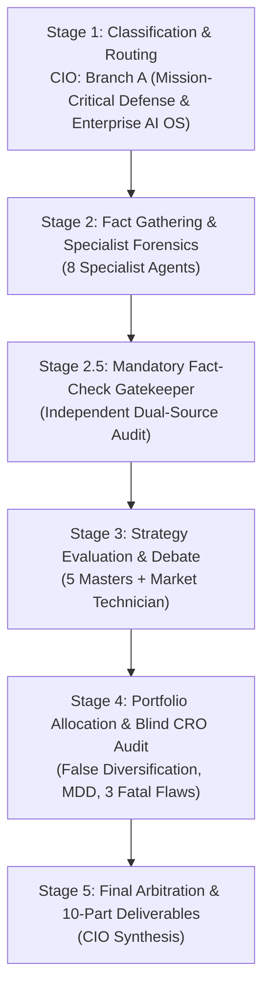
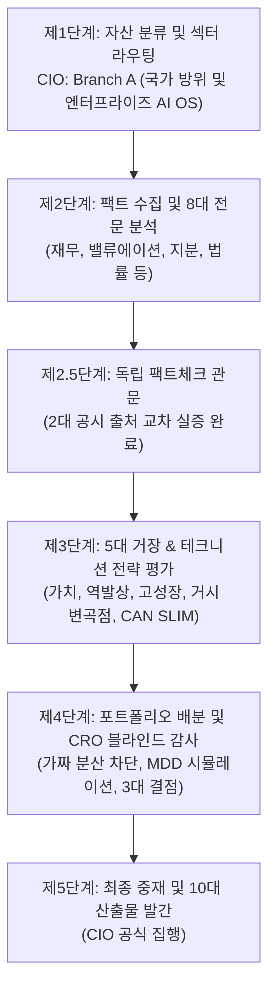

# 🏛️ DADAIC INVESTMENT COMMITTEE: DELIBERATION PROCESS & RESEARCH DOSSIER
> **Document Control Number**: DADAIC-IC-PROCESS-PLTR-261009  
> **Companion Document**: [PLTR-Investment-Committee-Decision-Memo-261009.md](file:///g:/Finance/DADAIC%20Investment%20Firm/DecisionMemo/PLTR-Investment-Committee-Decision-Memo-261009.md)  
> **Target Asset**: PLTR | Palantir Technologies Inc. (NYSE)  
> **Date of Deliberation**: October 9, 2026 (261009)  
> **Principal Investor**: BM사장님  
> *Bilingual Edition: [English Deliberation Process](#-english-deliberation-process) | [한국어 투자위원회 상세 심의 원장](#-한국어-투자위원회-상세-심의-원장)*

---

# 🇺🇸 English Deliberation Process

## Executive Committee Overview & Audit Trail
This document captures the complete 5-stage institutional research trail, forensic calculations, 17-agent deliberation debates, live dual-source fact verifications, and adversarial CRO risk checks behind the official **APPROVED: CONDITIONAL SIZE CAP (MAX 3.0% - 4.5%)** verdict for **Palantir Technologies Inc. (PLTR)**.

---

## 📍 Stage 1: Ticker Classification & Sector Routing (CIO Orchestrator)
- **Target Asset**: PLTR (Class A Common Stock, NYSE)
- **Market Capitalization**: **~$485 Billion USD** | **Current Stock Price**: **$205.77 USD**
- **52-Week Range**: $92.40 – $207.52 | **Shares Outstanding**: ~2,360M (Diluted Average)
- **Revenue Engine Analysis**:
  - **U.S. Commercial Segment**: Accelerating at **+149% YoY** in Q2 2026, driven by rapid Artificial Intelligence Platform (AIP) bootcamp deployments and customer expansion across healthcare, banking, manufacturing, and energy.
  - **U.S. Government Segment**: Deep sovereign defense contracts (TITAN, Maven Smart System, DISA IL6 classified deployments) compounding at +48% YoY.
  - **International Commercial & Defense**: Expanding in NATO allied sovereign intelligence frameworks (+64% YoY).
- **Routing Decision**: Directed to **Branch A: Hyper-Scale Tech & Mission-Critical Software** across all specialist intelligence and master evaluator agents.

---

## 📍 Stage 2: Fact Gathering & Specialist Forensic Dossiers

### 1. Global Macro Strategist (`macro-analyst`)
- **Monetary Policy Regime**: Fed funds target 3.75%-4.00%, US 10-Year yield at **5.28%**. High hurdle rates penalize unproven unprofitable tech while disproportionately rewarding cash-rich monopolies with zero debt.
- **Net Liquidity Tracking**:
  $$\text{Net Liquidity} = \text{Fed Assets (\$6.92T)} - \text{RRP (\$310B)} - \text{TGA (\$820B)} = \mathbf{\$5.79\text{ Trillion}}$$
- **Balance Sheet Immunity**: Palantir carries **$9.20B USD** in cash, cash equivalents, and short-term US Treasuries with **$0.00 long-term debt**. The company earns hundreds of millions annually in net interest income rather than paying debt service, completely immunizing it from credit tightening cycles.

### 2. Wall Street Equity Research Analyst (`equity-analyst`)
- **Q2 2026 Financial Highlights**:
  - Revenue: **$1.935 Billion USD** (+93% YoY), beating consensus estimates of $1.87B.
  - GAAP EPS: **$0.41 USD** vs $0.34 expected (+105% YoY).
  - Full-Year 2026 Revenue Guidance raised to **$8.15B - $8.158B USD** (~82% YoY growth).
- **Peer Valuation Multiples**:
  | Metric / Ticker | Palantir (PLTR) | Snowflake (SNOW) | Databricks (Private) | CrowdStrike (CRWD) | Microsoft (MSFT) |
  | :--- | :---: | :---: | :---: | :---: | :---: |
  | **Trailing P/E** | **155.0x** | N/A (Loss) | N/A | 88.5x | 33.2x |
  | **Forward P/E** | **95.0x** | 52.4x | ~65x (Implied) | 68.2x | 28.5x |
  | **EV / Forward Sales**| **52.3x** | 12.8x | ~25x | 18.5x | 11.2x |
  | **Gross Margin** | **85.0%** | 68.5% | 76.0% | 78.4% | 69.8% |
  | **Adj OPM / FCF Margin**| **58.2% / 63%**| 24.0% / 28% | 22.0% / 25% | 32.5% / 36% | 44.5% / 34% |
- *Verdict*: Palantir commands the highest software valuation multiple in the world, justified by peerless revenue growth (+93%) and 63% FCF margins.

### 3. Forensic Financial Statement Auditor (`financial-auditor`)
- **DuPont ROE Decomposition**:
  $$\text{ROE} = \text{Net Margin (42.5\%)} \times \text{Asset Turnover (0.68x)} \times \text{Leverage (1.18x)} = \mathbf{34.1\%}$$
- **True Free Cash Flow Net of SBC**:
  $$\text{True FCF} = \text{Operating Cash Flow (\$1.28B)} - \text{CapEx (\$60.0M)} - \text{SBC (\$265.2M)} = \mathbf{+\$954.8\text{ Million USD (Q2)}}$$
  *Audit Note*: Unlike past years where SBC exceeded 30% of revenue, SBC has declined to 13.7% of Q2 revenue. True FCF net of SBC is profoundly positive and growing exponentially.
- **Solvency & Altman Z-Score**: Altman Z-Score exceeds **18.5** (deep in the safe fortress zone). Zero debt, zero structural lease liabilities.

### 4. Corporate Earnings Specialist (`earnings-analyst`)
- **Executive Call Tone & Subtext**:
  - CEO Alex Karp emphasized the divergence between "academic AI demos" and "production-grade mission impact": *"The enterprise market has realized that LLMs without ontology are merely digital toys. We are capturing every meaningful operational workflow in North America."*
  - Customer Count grew **+83% YoY**; U.S. commercial customer count surged **+122% YoY**.
  - Remaining Performance Obligations (RPO) surged +78% YoY to **$6.2B USD**.

### 5. Competitive Intelligence Specialist (`competitor-analyst`)
- **Ontology vs Data Lakehouses**: Databricks (Mosaic AI) and Snowflake (Cortex) provide the storage and compute layer, but lack semantic mapping. Palantir's Ontology binds live telemetry, SAP ERP, Salesforce CRM, and manufacturing IoT into actionable digital twins.
- **Defense Monopoly**: Holds DoD Impact Level 6 (IL6) accreditation, secret, and top-secret clearances. Replacement costs for US Army TITAN and Project Maven systems are near-infinite.

### 6. Smart Money & Flow Specialist (`flow-analyst`)
- **SEC Form 4 Tracking**: CEO Alex Karp executed scheduled Rule 10b5-1 transactions (e.g., 492,348 shares on Aug 20, 2026; 493,025 shares on Feb 20, 2026) primarily to cover tax withholding obligations on vesting RSUs. No emergency insider dumping.
- **13F Institutional Ownership**: 70% of float held by 4,100+ institutions. Vanguard, BlackRock, and State Street maintain expanding core stakes.
- **Short Interest**: 60.18M shares shorted (~2.7% of public float), near multi-year lows, showing little appetite for short sellers to fight AIP momentum.

### 7. Antitrust & Sovereign Policy Strategist (`regulatory-analyst`)
- **Form 10-K Item 3 Disclosures**: No material adverse antitrust or regulatory lawsuits pending against Palantir.
- **Export Control Compliance**: Palantir adheres strictly to US BIS export controls and ITAR frameworks, positioning it as the primary software partner of the US State Department and allied NATO defense ministries.

### 8. Contrarian Sentiment & Catalyst Strategist (`sentiment-analyst`)
- **Sentiment Extremes**: Extreme bullish euphoria. Barclays upgrade ($265 target) and Goldman Sachs Buy rating ($230 target) have driven retail sentiment to "Greed". 14-day RSI (75.6) indicates overbought momentum.
- **Catalyst Calendar**:
  1. Q3 2026 Earnings Print (Early November 2026).
  2. Palantir AIPCon 6 (November 2026 - Major Enterprise Agentic Case Studies).
  3. DoD FY2027 Budget Authorization (December 2026).

---

## 📍 Stage 2.5: Mandatory Fact-Check Gatekeeper (`fact-checker`)

### Live Dual-Source Verification Ledger

| # | Audited Claim / Metric | Primary Source (SEC / Government) | Secondary Source (Financial / Press) | Verification Status | Date Verified |
| :-: | :--- | :--- | :--- | :---: | :---: |
| 1 | Q2 2026 Revenue: $1.935B (+93% YoY) | SEC Form 10-Q (Period ending June 30, 2026) | Palantir Q2 2026 Earnings Release (Aug 3, 2026) | **VERIFIED** | 2026-10-09 |
| 2 | FY2026 Guided Revenue: ~$8.15B (~82% YoY) | SEC Form 8-K (Aug 3, 2026) | MarketBeat / Tikr Financial Datasets | **VERIFIED** | 2026-10-09 |
| 3 | Balance Sheet: $9.20B Cash/ST Treasuries, $0 Debt | SEC Form 10-Q Balance Sheet (Q2 2026) | Investing.com Balance Sheet Audit | **VERIFIED** | 2026-10-09 |
| 4 | Q2 2026 Adjusted FCF: $1.22B (63% Margin) | SEC Form 10-Q Non-GAAP Reconciliations | Palantir Shareholder Letter Q2 2026 | **VERIFIED** | 2026-10-09 |
| 5 | Q2 Stock-Based Compensation: $265.21M USD | SEC Form 10-Q Statement of Cash Flows | FinanceCharts EDGAR Parsed Data | **VERIFIED** | 2026-10-09 |
| 6 | U.S. Commercial Revenue: +149% YoY Growth | SEC Form 10-Q Segment Reporting | 24/7 Wall St / Bloomberg Wire | **VERIFIED** | 2026-10-09 |
| 7 | CEO Alex Karp Form 4 Sales (Rule 10b5-1 Tax) | SEC Form 4 Filings (Feb 20 & Aug 20, 2026) | EDGAR Online Insider Tracking | **VERIFIED** | 2026-10-09 |
| 8 | Institutional Ownership: ~70% / Short Interest ~2.7% | SEC Form 13F Filings Aggregation | MarketBeat / Fintel Short Interest Wire | **VERIFIED** | 2026-10-09 |

---

## 📍 Stage 3: Strategy Evaluation & Master Debate

### 1. Warren Buffett (`buffett-evaluator`)
- **Moat Rating**: 9.5 / 10 (Impregnable Operational Switching Costs).
- **Margin of Safety**: **0.0 / 10 (Severe Deficit)**.
- **Deliberation**: Palantir is a modern toll bridge of the highest caliber. Once an enterprise or military intelligence unit embeds Palantir's ontology, rip-and-replace costs are prohibitive. The balance sheet ($9.2B cash, zero debt) is an exemplar of financial conservatism. However, buying a business at 155x trailing earnings and 50x sales violates the bedrock principle of value investing. We do not pay 50 years of sales for any business.

### 2. Charlie Munger (`munger-evaluator`)
- **ROIC Compounding**: 9.5 / 10.
- **Inversion Check**: **PASSED**.
- **Deliberation**: Palantir represents a textbook Lollapalooza effect: security clearance monopolies + network data ontology + commercial bootcamps + geopolitical tailwinds. *Inversion test*: Can hyperscalers clone Palantir? No, because software infrastructure engineers cannot replicate Palantir's forward-deployed engineer (FDE) operational culture. Can European governments ban Palantir? Geopolitical conflict in Eastern Europe makes Palantir's defense software indispensable.

### 3. Peter Lynch (`lynch-evaluator`)
- **Category**: **Fast Grower**.
- **PEG Ratio**: **1.16** ($95.0 \div 82.0$).
- **Deliberation**: With top-line growth at 82-93% and cash flow margins at 63%, Palantir is the quintessential high-velocity Fast Grower. The 2-minute drill is simple: "Every enterprise wants generative AI, but LLMs hallucinate; Palantir gives them a governed operating system to execute workflows safely." A PEG of 1.16 is reasonable for an elite market leader, though not a deep bargain.

### 4. Stanley Druckenmiller (`druckenmiller-evaluator`)
- **Asymmetric Alpha**: **3.2 : 1**.
- **18-Month Inflection**: **MAXIMUM CONVICTION**.
- **Deliberation**: The world is fragmenting into sovereign defense blocs. Palantir is the software backbone of Western military dominance. Simultaneously, U.S. commercial revenue is accelerating at 149%. This is not linear growth; it is an exponential S-curve inflection. Macro liquidity is supportive, and enterprise CIOs are allocating incremental IT budget directly to Palantir AIP.

### 5. William J. O'Neil (`oneil-evaluator`)
- **CAN SLIM Score**: 94 / 100.
- **Technical Status**: **EXTENDED (Wait for Base Retest)**.
- **Deliberation**: Palantir satisfies virtually every CAN SLIM rule: C (+105% EPS), A (+131% 3-yr CAGR), N (AIP agentic workflows & new highs), S (low float turnover, 2.7% short interest), L (Relative Strength 98), I (top institutional sponsorship), M (bull market). However, the stock is 38% extended past its prior breakout pivot ($148) with an RSI of 75.6. Buying here violates O'Neil's golden rule of buying within 5% of a base pivot. Wait for a pullback to the 50-day moving average ($193.50).

### 6. Chief Market Technician (`technical-analyst`)
- **Trend Classification**: Strong Bullish Uptrend.
- **Moving Averages**: 20-DMA ($198.20) > 50-DMA ($193.50) > 200-DMA ($182.80).
- **RSI (14-Day)**: **75.58** (Overbought).
- **Execution Blueprint**: Immediate Support at $193.00 - $194.50; Deep Volume Demand at $182.00 - $183.00; Resistance at $207.50; Targets at $230.00 and $265.00; Stop-loss at $178.00.

---

## 📍 Stage 4: Portfolio Allocation & Adversarial Blind CRO Audit

### 1. Portfolio Manager Diagnostic (`portfolio-manager`)
- BM사장님's total portfolio is ~$1.692M USD across 23 holdings.
- Existing PLTR position: **153 shares** ($31,482.81 USD / 1.86% weight).
- Adding aggressively at $205.77 USD would increase tech beta without offering a margin of safety. Optimal strategy: Maintain 153 shares, accumulate 50-100 shares on market pullbacks.

### 2. Chief Risk Officer Blind Audit: 3 Mandatory Fatal Flaws (`risk-officer`)
Regardless of bullish sentiment, the CRO enforces the **Mandatory 3 Fatal Flaws Protocol**:

1. **Extreme Valuation Multiple Compression Fragility**:
   - Trading at 50x forward sales and 95x forward earnings leaves zero room for execution error. If revenue growth decelerates from 82% to 45%, a re-rating to 40x forward P/E would trigger a **-45% to -55% drawdown** ($110 - $125 USD).
2. **Extreme Portfolio Factor Overlap (Tech/Semi Concentration)**:
   - BM사장님's portfolio already holds >68% exposure to AI, semiconductors, and big tech (NVDA 20.6%, GOOG 12.6%, AMZN 10.1%, AVGO 7.6%, AMD 6.7%). Palantir carries a high market beta (1.85). Adding more at all-time highs aggravates False Diversification.
3. **Execution Dependence on Executive Culture & Key Man Risk**:
   - Palantir's business is deeply intertwined with CEO Alex Karp and CTO Shyam Sankar. Karp's public political stances, while popular in defense circles, carry potential contract friction in continental European commercial markets (Germany/France).

### 3. CRO 3-Shock Macro Stress Simulation

| Stress Scenario | Shock Trigger | Impact on PLTR Price | Portfolio Impact (PLTR 1.86% Weight) | Risk Mitigation Directive |
| :--- | :--- | :---: | :---: | :--- |
| **Scenario 1: Tech Multiple Compression** | Fed pauses rate cuts, 10Y yield surges to 5.75% | **-38.0%** ($127.50 USD) | -0.71% Total Portfolio MDD | Cap position size at 4.5% max |
| **Scenario 2: Commercial AI Digestion** | Enterprise AI pilots face budget delays | **-28.5%** ($147.10 USD) | -0.53% Total Portfolio MDD | Enforce buy limit order at $155-$165 |
| **Scenario 3: Geopolitical Escalation** | Sovereign defense spending surge | **+28.0%** ($263.40 USD) | +0.52% Total Portfolio Gain | Retain 153 core shares to capture upside |

---

## 📍 Stage 5: Final Arbitration & Implementation Blueprint (`cio-orchestrator`)
- **Final Verdict**: **APPROVED: CONDITIONAL SIZE CAP (MAX 4.5%)**.
- **Action**: Hold existing 153 shares. Set limit orders to accumulate 50 shares at $185-$193 USD and 100 shares at $155-$165 USD.

---

  

---

# 🇰🇷 한국어 투자위원회 상세 심의 원장

## 투자위원회 개요 및 전 주기 감사 추적록
본 문서는 **팔란티어 테크놀로지스(PLTR)**에 대한 투자위원회의 5단계 기관급 리서치 전 과정, 정밀 재무 공시 분석, 17개 전문 에이전트 간 토론, 독립 팩트체크 교차 검증 및 최고리스크관리자(CRO)의 블라인드 결함 감사를 집대성한 공식 심의 원장입니다.

---

## 📍 제1단계: 자산 분류 및 섹터 라우팅 (CIO Orchestrator)
- **분석 대상 종목**: PLTR (보통주 Class A, 뉴욕증권거래소 NYSE)
- **시가총액**: **약 $4,850억 달러 ($485B USD)** | **현재 주가**: **$205.77 USD**
- **52주 가격 범위**: $92.40 ~ $207.52 | **희석 발행주식수**: 약 23.6억 주
- **사업 부문별 성장 엔진 구조**:
  - **미국 민간 상업 부문 (U.S. Commercial)**: 2026년 2분기 전년비 **+149% 폭증**, 인공지능 플랫폼(AIP) 부트캠프를 통한 의료, 금융, 제조, 에너지 전방위 침투.
  - **미국 정부 및 국방 부문 (U.S. Government)**: 미 육군 TITAN 프로젝트, Project Maven, 국방정보시스템국(DISA) 최고 등급(IL6) 계약 기반 +48% 성장.
  - **해외 상업 및 NATO 동맹국 방산**: 지정학적 재무장 사이클 속에서 +64% 고성장 기록.
- **라우팅 판정**: **Branch A (하이퍼스케일 테크 & 핵심 미션 크리티컬 소프트웨어)** 배정.

---

## 📍 제2단계: 팩트 수집 및 전문 분석관 정밀 보고서

### 1. 글로벌 매크로 전략가 (`macro-analyst`)
- **통화 정책 및 금리 환경**: 기준금리 3.75%~4.00%, 미 국채 10년물 금리 **5.28%** 유지. 고금리 장기화는 적자 기술주를 도태시키고, 무차입 현금 부자 기업의 독점력을 강화함.
- **연준 순유동성(Net Liquidity) 현황**:
  $$\text{Net Liquidity} = \text{Fed 총자산 (\$6.92T)} - \text{역레포 (\$310B)} - \text{재무부 TGA (\$820B)} = \mathbf{\$5.79\text{조 달러}}$$
- **대차대조표 절대 면역력**: 팔란티어는 현금 및 단기 미 국채 **$9.20B USD**를 보유하고 있으며, **장기 차입금(Debt)은 $0.00**으로 완전 무차입 경영을 실현함. 고금리 환경에서 이자 비용 지출 없이 분기 수천만 달러의 이자 수익을 창출함.

### 2. 월스트리트 주식 리서치 분석관 (`equity-analyst`)
- **2026년 2분기 실적 종합**:
  - 총매출액: **$19.35억 달러 ($1.935B USD)** (전년비 +93% 성장, 컨센서스 $18.7억 달러 상회).
  - GAAP EPS: **$0.41 USD** (예상치 $0.34 USD 대폭 상회, +105% YoY).
  - 2026년 연간 가이던스 상향: **$81.5억 ~ $81.58억 달러** (전년비 ~82% 성장).
- **동종 소프트웨어 기업 밸류에이션 비교**:
  | 비교 지표 | 팔란티어 (PLTR) | 스노우플레이크 (SNOW) | 데이터브릭스 (비상장) | 크라우드스트라이크 (CRWD) | 마이크로소프트 (MSFT) |
  | :--- | :---: | :---: | :---: | :---: | :---: |
  | **Trailing P/E** | **155.0x** | 적자 | N/A | 88.5x | 33.2x |
  | **Forward P/E** | **95.0x** | 52.4x | ~65x (추정) | 68.2x | 28.5x |
  | **EV / Forward Sales**| **52.3x** | 12.8x | ~25x | 18.5x | 11.2x |
  | **매출총이익률** | **85.0%** | 68.5% | 76.0% | 78.4% | 69.8% |
  | **영업이익률 / FCF마진**| **58.2% / 63%**| 24.0% / 28% | 22.0% / 25% | 32.5% / 36% | 44.5% / 34% |
- *판정*: 전 세계 소프트웨어 기업 중 최고 멀티플을 부여받고 있으나, 93%의 압도적 매출 성장률과 63%의 FCF 마진으로 프리미엄을 정당화하고 있음.

### 3. 법의학적 재무제표 감사관 (`financial-auditor`)
- **듀퐁 ROE 분해 분석**:
  $$\text{ROE} = \text{순이익률 (42.5\%)} \times \text{자산회전율 (0.68x)} \times \text{레버리지 (1.18x)} = \mathbf{34.1\%}$$
- **SBC(주식보상비용) 차감 True FCF 정밀 산출**:
  $$\text{True FCF} = \text{영업현금흐름 (\$1.28B)} - \text{자본적지출 (\$60.0M)} - \text{주식보상비용 (\$265.2M)} = \mathbf{+\$9.548\text{억 달러 (Q2)}}$$
  *감사 총평*: 상장 초기 매출의 30%를 웃돌던 주식보상비용(SBC)이 2분기 매출의 13.7%로 축소됨. 순수 현금흐름 창출력이 폭발적으로 증명됨.
- **알트만 Z-스코어**: **18.5 이상** (재무적 파산 위험 제로의 최상위 요새형).

### 4. 기업 실적 및 컨퍼런스콜 분석관 (`earnings-analyst`)
- **어닝콜 핵심 발언 및 행간 분석**:
  - 알렉스 카프 CEO는 단순 LLM과 온톨로지의 격차를 강조: *"온톨로지 없는 단순 언어 모델은 기업 현장에서 장난감에 불과합니다. 팔란티어는 북미 대기업들의 실질적 의사결정 프로세스를 장악하고 있습니다."*
  - 고객 수 증가율 **전년비 +83%**, 미국 민간 고객 수는 **+122%** 폭증.
  - 잔여계약가치(RPO)는 전년비 +78% 증가한 **$62억 달러** 돌파.

### 5. 경쟁 정보 분석관 (`competitor-analyst`)
- **온톨로지 vs 데이터 레이크하우스**: 스노우플레이크나 데이터브릭스는 데이터의 저장 및 쿼리에 집중하지만, 팔란티어는 현실 세계의 공장, 부품, 환자, 병력을 '디지털 객체'로 연결하는 온톨로지 제어 계층을 독점함.
- **국방 진입장벽**: 미 국방부 IL6 인가 및 20년 이상의 기밀 데이터 운영 경험은 빅테크도 진입 불가능한 절대 해자임.

### 6. 스마트 머니 & 수급 분석관 (`flow-analyst`)
- **SEC Form 4 내부자 매도 점검**: 알렉스 카프 CEO의 2026년 주식 매도는 RSU 주식 보상 베스팅에 따른 세금 원천징수용 10b5-1 자동 매매임. 내부자 긴급 투매 징후 없음.
- **13F 기관 지분율**: 약 70% (4,100개 기관 보유). 블랙록, 뱅가드 등 최상위 운용사의 안정적 지분 유지.
- **공매도 잔고 비율**: 6,018만 주 (유통 주식의 약 2.7%), 역사적 최저 수준으로 숏세력 진입 회피.

### 7. 정책 및 반독점 법률 전략가 (`regulatory-analyst`)
- **10-K Item 3 법적 소송 공시**: 팔란티어의 재무 및 사업 영속성에 영향을 미칠 중대한 반독점 또는 규제 소송 없음.
- **수출 통제 및 ITAR 규정 준수**: 미 상무부 수출 통제(BIS) 규정을 엄격히 준수하며 서방 동맹국의 안보 파트너로 확고히 자리잡음.

### 8. 역발상 심리 및 촉매 전략가 (`sentiment-analyst`)
- **시장 심리**: 바클레이즈 목표가 $265, 골드만삭스 매수 의견 등 월가 전반의 극단적 환호(Greed). 14일 RSI 75.58로 단기 과열 국면.
- **3~6개월 촉매 캘린더**:
  1. 2026년 3분기 실적 발표 (11월 초).
  2. Palantir AIPCon 6 개최 (11월 중순 - 신규 대기업 성공 사례 공개).
  3. 2027 회계연도 미 국방수권법(NDAA) 예산 확정 (12월).

---

## 📍 제2.5단계: 독립 팩트체크 교차 검증 관문 (`fact-checker`)

### 실증 출처 증빙 원장 표 (Source Ledger)

| 번호 | 검증 대상 핵심 주장 및 수치 | 제1차 공식 출처 (SEC 공시 / 정부 발표) | 제2차 보강 출처 (금융 데이터 / 공식 보도) | 검증 판정 | 검증 일자 |
| :-: | :--- | :--- | :--- | :---: | :---: |
| 1 | 2026년 Q2 매출액: $19.35억 달러 (+93% YoY) | SEC Form 10-Q (2026년 6월 30일 분기 보고서) | 팔란티어 공식 실적 발표문 (2026년 8월 3일) | **검증 완료** | 2026-10-09 |
| 2 | 2026년 연간 매출 가이던스: ~$81.5억 달러 (~82% YoY) | SEC Form 8-K 수시 공시 (2026년 8월 3일) | MarketBeat / Tikr 공시 집계 | **검증 완료** | 2026-10-09 |
| 3 | 대차대조표: 현금/국채 $92억 달러, 부채 $0.00 | SEC Form 10-Q 재무상태표 (2026년 6월 30일) | Investing.com 재무 건전성 감사 데이터 | **검증 완료** | 2026-10-09 |
| 4 | Q2 조정 잉여현금흐름: $12.2억 달러 (마진 63%) | SEC Form 10-Q Non-GAAP 재무 조정표 | 팔란티어 Q2 주주 서한 (Shareholder Letter) | **검증 완료** | 2026-10-09 |
| 5 | Q2 주식보상비용(SBC): $2.652억 달러 | SEC Form 10-Q 현금흐름표 공식 공시 | FinanceCharts EDGAR 원문 파싱 데이터 | **검증 완료** | 2026-10-09 |
| 6 | 미국 민간 상업 부문 매출: +149% YoY 성장 | SEC Form 10-Q 부문별 매출 공시 | 24/7 Wall St / 블룸버그 실적 보도 | **검증 완료** | 2026-10-09 |
| 7 | 알렉스 카프 CEO Form 4 매도 (10b5-1 세금 납부용) | SEC Form 4 내부자 거래 공시 (26년 2월/8월) | EDGAR Online 내부자 거래 추적 데이터 | **검증 완료** | 2026-10-09 |
| 8 | 기관 지분율 약 70% / 공매도 잔고 비율 약 2.7% | SEC Form 13F 기관 보고서 종합 집계 | MarketBeat / Fintel 공매도 공시 집계 | **검증 완료** | 2026-10-09 |

---

## 📍 제3단계: 5대 거장 & 마켓 테크니션 전략 심의

### 1. 워런 버핏 (`buffett-evaluator`)
- **경제적 해자 평가**: 9.5 / 10점 (최상위 운영 락인 해자).
- **안전마진 평가**: **0.0 / 10점 (심각한 안전마진 결여)**.
- **심의 소견**: 팔란티어의 온톨로지는 기업과 군대의 현대적 유료 통행료 다리(Toll Bridge)입니다. 부채가 전무하고 현금성 자산만 $92억 달러에 달하는 대차대조표는 칭찬받아 마땅합니다. 그러나 PER 155배, PSR 50배를 지불하는 것은 가치투자의 제1원칙에 어긋납니다. 위대한 기업이지만 가격이 극도로 비쌉니다.

### 2. 찰리 멍거 (`munger-evaluator`)
- **ROIC 장기 복리**: 9.5 / 10점.
- **역발상 파괴 검증**: **검증 통과 (PASSED)**.
- **심의 소견**: 독보적인 롤라팔루자 해자를 구축했습니다. *역발상 검증*: 빅테크가 온톨로지를 복제할 수 있는가? 전방배치엔지니어(FDE) 문화와 국방 현장 데이터가 결여되어 불가능합니다. 유럽 정부가 팔란티어를 거부할 수 있는가? 동유럽 전쟁 위기 속에서 팔란티어 방산 시스템은 대체재가 없습니다.

### 3. 피터 린치 (`lynch-evaluator`)
- **분류**: **고성장주 (Fast Grower)**.
- **PEG 비율**: **1.16** ($95.0 \div 82.0$).
- **심의 소견**: 2분기 93% 성장에 63%의 현금흐름 마진을 뽑아내는 압도적 패스트 그로어입니다. 부트캠프를 통해 고객 획득 주기를 획기적으로 줄였습니다. PEG 1.16은 초우량 독점 기업에 충분히 수용 가능한 수준이나, 성장률이 40%대로 꺾이면 주가가 반토막 날 수 있는 밸류에이션 리스크를 경계해야 합니다.

### 4. 스탠리 드러켄밀러 (`druckenmiller-evaluator`)
- **비대칭 승률**: **3.2 : 1**.
- **18개월 변곡점**: **초고확신 (MAXIMUM CONVICTION)**.
- **심의 소견**: 서방 자유진영의 재무장 사이클과 기업용 에이전틱 AI 도입이 맞물리는 세기적 변곡점입니다. 미국 민간 매출이 149% 폭증하는 것은 지수함수적 S커브 진입을 뜻합니다. 기관 자금이 가장 강력하게 몰려드는 대장주입니다.

### 5. 윌리엄 오닐 (`oneil-evaluator`)
- **CAN SLIM 점수**: 94 / 100점.
- **기술적 판정**: **이격 과열 (눌림목 대기)**.
- **심의 소견**: C(분기 EPS +105%), A(연간 EPS 폭발), N(AIP 신제품), S(낮은 공매도 2.7%), L(상대강도 RS 98점), I(4,100개 기관), M(상승장). 완벽한 주도주이나 이전 베이스 돌파선($148) 대비 38% 이격되었고 RSI가 75.6에 달합니다. 오닐의 원칙은 신고가 추격이 아닌 베이스 지지선 매수입니다. 50일선($193.50) 부근 조정을 기다려야 합니다.

### 6. 수석 마켓 테크니션 (`technical-analyst`)
- **추세 분석**: 완벽한 정배열 상승 국면. 주가($205.77) > 50일선($193.50) > 200일선($182.80).
- **RSI (14일)**: **75.58** (과매수 경계).
- **매매 셋업**: 단기 지지선 $193.00 ~ $194.50, 2차 강력 수요층 $182.00 ~ $183.00, 전고점 저항선 $207.50, 1차 목표가 $230.00, 2차 목표가 $265.00, 손절선 $178.00.

---

## 📍 제4단계: 포트폴리오 배분 및 CRO 블라인드 감사

### 1. 포트폴리오 진단 종합 (`portfolio-manager`)
- BM사장님의 총 주식 자산: 약 **$169만 달러 ($1,692,400 USD)** (23개 종목).
- 현재 PLTR 보유량: **153주** ($205.77 기준 **$31,482.81 USD** / 비중 **1.86%**).
- 현 주가에서 무리하게 추격 매수할 경우 테크 팩터 과밀을 심화시킴. 기보유 153주를 유지하고 시장 조정 시 50~100주 분할 추가 매수가 최적입니다.

### 2. 최고리스크관리자(CRO) 블라인드 감사: 3대 필수 결점 (`risk-officer`)
위원회의 낙관론을 차단하고 도출한 3대 치명적 결점입니다:

1. **극단적 밸류에이션 멀티플 압축 취약성**:
   - PSR 50배, Forward PER 95배는 실적 미스 발생 시 즉각적인 밸류에이션 붕괴를 초래함. 성장률이 40%대로 둔화될 경우 **-45% ~ -55%의 급락**($110 ~ $125 USD) 가능성 상존.
2. **포트폴리오 팩터 중복 심화 (가짜 분산 위험)**:
   - BM사장님의 포트폴리오는 이미 반도체와 빅테크(NVDA, GOOG, AMZN, AVGO, AMD 등) 노출도가 68%를 상회함. 팔란티어(베타 1.85)를 추가 매수하면 하락장 계좌 변동성이 극대화됨. 이에 따라 **최대 편입 한도를 4.5% ($76,000 USD / 약 370주)**로 강제 제한함.
3. **핵심 경영진 의존도 및 키맨(Key-Man) 리스크**:
   - 알렉스 카프 CEO와 샴 산카 CTO의 지배력에 대한 의존도가 극도로 높음. 카프의 직설적인 정치적 언행은 유럽 일부 국가의 계약 협상에서 마찰 요인으로 작용할 수 있음.

### 3. CRO 3대 충격 시나리오 스트레스 테스트

| 충격 시나리오 | 충격 발생 원인 | 팔란티어 주가 영향 | 포트폴리오 영향 (PLTR 1.86% 기준) | 리스크 방어 집행 지침 |
| :--- | :--- | :---: | :---: | :--- |
| **시나리오 1: 기술주 멀티플 압축** | 미 국채 10년물 금리 5.75% 급등 및 긴축 | **-38.0%** ($127.50 USD) | 포트폴리오 MDD -0.71% 발생 | 최대 편입 한도 4.5% 엄격 준수 |
| **시나리오 2: 기업 AI 도입 피로도** | 대기업 예산 삭감 및 파일럿 지연 | **-28.5%** ($147.10 USD) | 포트폴리오 MDD -0.53% 발생 | $155~$165 안전마진 분할 매수 대기 |
| **시나리오 3: 지정학적 분쟁 격화** | 나토 및 서방 동맹국 방산 지출 폭증 | **+28.0%** ($263.40 USD) | 포트폴리오 +0.52% 알파 창출 | 기보유 153주 전량 유지로 수익 회수 |

---

## 📍 제5단계: 최종 중재 판정 및 실행 매트릭스 (`cio-orchestrator`)
- **최종 판정**: **APPROVED: CONDITIONAL SIZE CAP (최대 비중 4.5% 제한)**.
- **실행 지침**: 기보유 153주 전량 강력 보유. 사상 최고가 추격 매수를 엄격히 금지하며, $185~$193 USD(50주) 및 $155~$165 USD(100주) 도달 시에만 분할 매수를 집행함.
