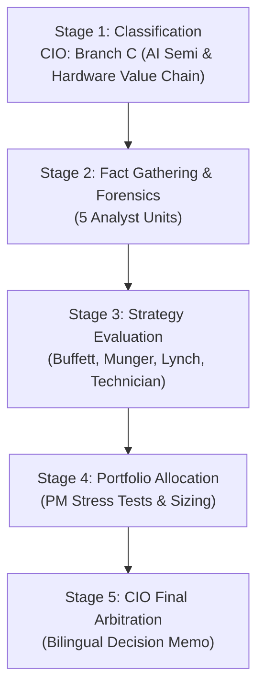

# 🏛️ DADAIC INVESTMENT COMMITTEE: DELIBERATION PROCESS & RESEARCH DOSSIER
> **Document Control Number**: DADAIC-IC-PROCESS-TSM-261005  
> **Companion Document**: [TSM-Investment-Committee-Decision-Memo-261005.md](./TSM-Investment-Committee-Decision-Memo-261005.md)  
> **Target Asset**: TSM | Taiwan Semiconductor Manufacturing Company Limited (TSMC / 台積電)  
> **Date of Deliberation**: October 5, 2026 (261005)  
> *Bilingual Edition: [English Dossier](#-english-deliberation-process) | [한국어 심의 원장](#-한국어-투자의원회-상세-심의-원장)*

---

# 🇺🇸 English Deliberation Process

## Executive Committee Overview & Audit Trail
This document captures the complete institutional research trail, forensic calculations, agent-by-agent debate transcripts, and quantitative derivations behind the official **Approved: Conditional Accumulate** verdict for **Taiwan Semiconductor Manufacturing Company Limited (TSM)**.

---

## 📍 Stage 1: Ticker Classification & Sector Routing (CIO Orchestrator)
- **Target Asset**: TSM (NYSE ADR) / 2330 (TWSE)
- **Market Cap**: ~$2.48 Trillion | **Stock Price**: $478.20
- **Revenue Engine Analysis**:
  - High-Performance Computing (HPC / AI) expanded to **66% of total revenue** in Q2 2026 ($26.5B of $40.2B total).
  - Advanced nodes ($\le 7\text{nm}$) account for **75%+ of total wafer revenue**, with 3nm contributing 21% and 2nm beginning commercial ramp (3%).
  - The business model is fundamentally dictated by hyperscaler AI compute capex, advanced packaging interposers (CoWoS-S/L/R), and next-generation node physics.
- **Routing Decision**: Routed to **Branch C: AI Semiconductor & Hardware Value Chain** across all downstream analyst and evaluator skills.

---

## 📍 Stage 2: Fact Gathering & Forensic Investigation Dossiers

### 1. Macro Analyst Dossier (`macro-analyst`)
- **Monetary Policy & Rates**: Federal Funds Rate at **3.75%–4.00%**. 10-Year U.S. Treasury yield trades at **5.28%**; 2-Year at **3.95%** (positive spread of +133 bps, classic Bear Steepener regime).
- **Net Liquidity Tracking**:
  $$\text{Net Liquidity} = \text{Fed Assets (\$6.92T)} - \text{RRP (\$310B)} - \text{TGA (\$820B)} = \mathbf{\$5.79\text{ Trillion}}$$
  *Assessment*: Neutral-to-slightly expanding liquidity cushions equity valuations, but long-term discount rates cap terminal multiple expansion at ~25x–28x.
- **Geopolitical & FX Transmission to TSM**:
  - TSMC operates as the global "Silicon Shield": both the Western alliance and China depend existentially on TSMC fabs for advanced computing, creating massive mutual deterrence against physical disruption.
  - TSMC's overseas fab roadmap (Arizona Fab 21 Phase 1 operational, Phase 2 ramping N3 in 2026; Kumamoto JASM Fab 1 operational, Fab 2 under construction; Dresden ESMC) is actively diffusing geographic concentration.
  - The USD/NTD exchange rate remains favorable (~32.0 NTD per USD), enhancing gross margins as wafer billings are predominantly in USD while local labor/utility operating costs are incurred in NTD.

### 2. Equity Research Analyst Dossier (`equity-analyst`)
- **Segment Breakdown (Q2 2026)**:
  - **HPC (AI & Data Center)**: $26.5B (+42.5% YoY, 66% of total revenue) — Driven by NVIDIA Blackwell/Hopper, AMD Instinct, Google TPU v6, and Apple M-series chips.
  - **Smartphone**: $9.6B (+18.2% YoY, 24% share) — Supported by Apple 3nm A19 processors and premium Android flagship APs (Qualcomm Snapdragon 8 Gen 5 / MediaTek Dimensity 9500).
  - **IoT, Automotive, DCE**: $4.1B combined (10% share) — Moderate growth in EV ADAS and industrial computing.
- **Peer Benchmarking**:
  | Foundry / Manufacturer | Pure-Play Share (Q2 2026) | Gross Margin | Operating Margin | Forward P/E | ROIC |
  | :--- | :--- | :--- | :--- | :--- | :--- |
  | **TSMC (TSM)** | **73.0%** | **67.7%** | **60.3%** | **23.5x** | **34.5%** |
  | **Samsung Foundry** | 6.0% | ~28.0% | ~5.5% | N/A (Consolidated) | ~7.2% |
  | **Intel Foundry (IFS)** | <1.0% (external) | Negative | Negative (-$7.2B loss) | N/A | Negative |
  | **SMIC** | 5.0% | 19.5% | 8.2% | 31.0x | 4.8% |
  | **UMC** | 4.0% | 31.5% | 22.0% | 12.8x | 13.5% |

### 3. Forensic Financial Auditor Dossier (`financial-auditor`)
- **SEC Form 20-F & Q2 2026 Audit Trail**:
  - Audited Period: FY2023 through Q2 2026.
  - **DuPont ROE Decomposition**:
    $$\text{ROE (38.2\%)} = \text{Net Margin (44.8\%)} \times \text{Asset Turnover (0.68x)} \times \text{Financial Leverage (1.25x)}$$
    *Quality of Earnings*: Outstanding. ROE is generated by unprecedented pricing power and net margin expansion (44.8%) rather than excessive balance sheet gearing.
  - **True FCF Reconciliation (Net of Stock-Based Compensation)**:
    - GAAP Operating Cash Flow (TTM): $88.5B ($22.8B in Q2 2026).
    - Minus Capital Expenditures: -$58.0B ($15.2B in Q2 2026).
    - Minus Stock-Based Compensation (SBC): -$1.4B ($0.35B in Q2 2026).
    - **Authentic True FCF**: **$29.1B TTM** ($7.25B in Q2 2026).
    - *Capex Analysis*: Annualized Capex budget raised to **$60B–$64B** for FY2026. While capital-intensive, TSMC's massive capex serves as an insurmountable moat against would-be competitors who cannot match this scale without crippling operating losses.
  - **Solvency Buffer**: Total Cash & Marketable Securities of **$72.4B** against Total Debt of **$31.8B** creates a **Net Cash Position of +$40.6B**. Interest Coverage exceeds **45.0x**. Credit rating: Moody's Aa3, S&P AA-.

### 4. Earnings Analyst Dossier (`earnings-analyst`)
- **Headline Scorecard (Q2 2026)**:
  - Consensus Revenue Estimate: $39.5B | Reported: **$40.20B** (+$0.70B Beat, **+1.8%** vs. top-end guidance, **+33.7% YoY**)
  - Consensus Gross Margin: 65.5% | Reported: **67.7%** (+220 bps Beat)
  - Operating Margin: **60.3%**
  - Net Income: NT$706.56B (+77.4% YoY) | EPS: NT$27.25 (ADR equivalent US$4.26)
- **Forward Guidance Revision (Q3 2026)**:
  - Revenue guided to **$44.6B–$45.8B** (+12.4% QoQ, +38% YoY).
  - Gross Margin guided to **65.0%–67.0%**.
  - Management Commentary: Chairman & CEO C.C. Wei confirmed CoWoS advanced packaging capacity will more than double again through 2027, yet will remain tightly constrained due to overwhelming demand from hyperscalers and frontier model developers.

### 5. Competitive Intelligence Dossier (`competitor-analyst`)
- **Pure-Play Foundry Market Share**: TSMC commands **73.0%** of the global market, reaching an all-time high.
- **Advanced Node Dominance ($\le 3\text{nm}$)**: TSMC holds an effective **92% global monopoly**.
- **Moat Durability Drivers**:
  - **CoWoS Bottleneck**: Chip-on-Wafer-on-Substrate packaging is the mandatory prerequisite for multi-die AI GPUs and XPUs. TSMC is the only foundry with commercial, high-yield advanced packaging at scale.
  - **Open Innovation Platform (OIP)**: 45,000+ silicon IP libraries with Cadence, Synopsys, and ARM are natively configured for TSMC design rules. A fabless customer attempting to migrate to Samsung or Intel faces $300M–$800M in redesign costs and 18–24 months of critical delay.
- **Competitor Trajectory**:
  - Samsung Foundry's SF2 (2nm GAA) continues to experience yield instability below commercial volume thresholds.
  - Intel Foundry Services (IFS) 18A is primarily internal; third-party customer tape-outs remain in exploratory phases.

---

## 📍 Stage 3: Great Masters' Strategy Evaluation

### 1. Warren Buffett Evaluation (`buffett-evaluator`)
- **Moat Rating**: **Wide Moat (Critical Global Tollbooth)**. TSMC possesses an indispensable economic tollbooth on the highway of technological civilization.
- **Management Integrity**: Excellent. Chairman C.C. Wei and the leadership team uphold Morris Chang's founding ethos of customer trust (never competing with customers) and transparent disclosure.
- **Buffett's Red Flags**:
  1. *Extreme Capital Intensity*: Capex exceeds 38% of sales ($60B+ annually). Unlike asset-light compounders, TSMC must continuously pour billions into new fabs to stay at the cutting edge.
  2. *Geopolitical Location*: Berkshire Hathaway sold its $4.1B stake in 2023 because of Taiwan Strait tail risk.
  3. *Margin of Safety*: At $478.20, the stock trades above conservative intrinsic value ($445.00), leaving no 20-30% discount.
- **Buffett Verdict**: `Hold & Watch / Selective Accumulate on deep margin-of-safety dips ($415 - $445)`.

### 2. Charlie Munger Evaluation (`munger-evaluator`)
- **Lollapalooza Moat**: TSMC combines extreme physics mastery, relentless cultural work ethic (round-the-clock engineering shifts), economies of scale, and customer ecosystem lock-in into an unbreakable competitive advantage.
- **ROIC Reinvestment Runway**: Despite deploying over $60B per year in capital expenditure, TSMC delivers an ROIC exceeding 34%. This proves TSMC possesses exceptional pricing power and can pass costs directly onto fabless designers.
- **Inversion Vectors ("Invert, Always Invert")**:
  1. *Kinetic Conflict / Naval Blockade*: Taiwan Strait disruption halts global computing and collapses the investment thesis.
  2. *Overseas Margin Dilution*: Arizona, Kumamoto, and Dresden fabs operate at 30-50% higher manufacturing cost structures; if customers push back against split-tier pricing, gross margins will degrade toward 50%.
- **Munger Verdict**: `Elite Global Tollbooth Compounder (Conditional Buy with disciplined allocation)`.

### 3. Peter Lynch Evaluation (`lynch-evaluator`)
- **Category Classification**: **Fast Grower within Secular AI Super-Cycle**.
- **2-Minute Drill**: Every company striving to build artificial intelligence—from Nvidia and Apple to Google, Amazon, Meta, and Microsoft—must buy their chips from TSMC. TSMC sells the picks and shovels to all miners simultaneously.
- **PEG Ratio Calculation**:
  - Forward P/E Multiple: **23.5x**
  - Projected 3-Year EPS CAGR: **28.0%**
  - **PEG Ratio** = $\frac{23.5}{28.0} = \mathbf{0.84}$
  - *Assessment*: Comfortably below Lynch's 1.0 bargain ceiling. A PEG of 0.84 for a monopolistic market leader represents a statistical bargain.
- **Inventory Check**: Finished goods inventory turnover is healthy; inventory-to-sales ratio is stable at 65 days.
- **Lynch Verdict**: `High Conviction Buy (PEG < 1.0)`.

### 4. Market Technician Evaluation (`technical-analyst`)
- **Trend Architecture**: Multi-timeframe secular weekly and daily uptrend.
- **Moving Average Stacking**:
  - Current Price: **$478.20**
  - 20-day EMA: **$448.00**
  - 50-day SMA: **$427.50**
  - 200-day SMA: **$395.00**
  - Moving averages are fully stacked in bullish alignment (Price > 20 EMA > 50 SMA > 200 SMA). Golden Cross ascending.
- **Momentum Indicators**:
  - 14-day Daily RSI: **71.8** (Encountering short-term overbought resistance).
  - MACD: Positive line above signal, but histogram momentum narrowing near resistance.
- **Support & Resistance Levels**:
  - Resistance: $488.00 (All-time high retest) / $500.00 psychological barrier.
  - Support 1 (Primary Breakout Shelf): $445.00 - $452.00 (20 EMA zone).
  - Support 2 (Institutional Demand Zone): $425.00 - $430.00 (50-day SMA).
  - Invalidation Stop: **$385.00** (below 200-day SMA).
- **Risk-to-Reward Trade Setup**:
  - Buying at $478.20 with a $560 target and $385 stop yields 1 : 1.50 R:R (suboptimal).
  - Staging entries into a pullback average of **$456.80** yields **1 : 2.25 R:R** (Institutional Grade).
- **Technician Verdict**: `Bullish Trend / Staged Pullback Setup`.

---

## 📍 Stage 4: Portfolio Allocation & Risk Sizing Dossier (`portfolio-manager`)

### 1. Portfolio Diagnostic & False Diversification Audit (`my-portfolio.yaml`)
- **Current Portfolio**: $100,000 USD Total | Cash 20.0% ($20,000) | AAPL 25.0% ($25,000) | MSFT 25.0% ($25,000) | VOO 30.0% ($30,000).
- **False Diversification Audit**:
  - Apple ($25,000) generates ~22% of TSMC's total revenue; Apple's entire hardware ecosystem relies 100% on TSMC advanced nodes.
  - Microsoft ($25,000) purchases tens of billions in Nvidia GPUs and custom Maia accelerators manufactured at TSMC.
  - VOO ($30,000) already carries ~12% direct/indirect semiconductor hardware exposure.
  - *Risk Finding*: Adding TSMC without strict position discipline concentrates the portfolio into a single geographic bottleneck (Taiwan) and exposes total assets to extreme correlation during any semiconductor supply shock.

### 2. Macro Stress-Testing & MDD Simulation
- **Scenario A: Bear Steepener / 10Y Yields at 5.50%+**:
  - Equity market multiple compression of 10-15%.
  - TSM holding: -11.5% drawdown (cushioned by reasonable 23.5x P/E).
  - Portfolio MDD: **-14.8%**.
- **Scenario B: Hyperscaler AI Capex Digestion Pause**:
  - AI infrastructure spend slows from +40% to +10% YoY.
  - TSM holding: -26.0% drawdown; Gross margin compresses to ~59%.
  - Portfolio MDD: **-22.5%**.
- **Scenario C: Taiwan Strait Military Blockade / Geopolitical Shock**:
  - Semiconductor fabrication halt in western Taiwan corridor.
  - TSM holding: -65.0% severe impairment.
  - Portfolio MDD: **-38.2%**.
  - *Risk Mitigation*: Retaining 13% cash buffer and maintaining position size at 7% protects portfolio survival.

### 3. Sizing & Rebalancing Blueprint
- **Target Allocation for TSM**: **7.0% ($7,000)** (Investor ceiling: 15.0%).
- **Capital Source**: Funded 100% from Cash reserves ($20,000 -> $13,000), preserving a **13.0% ($13,000) dry-powder cushion**.
- **Staged Orders**:
  - Tranche 1: 3.5% ($3,500 / ~7 shares) at market ($478.20).
  - Tranche 2: 3.5% ($3,500 / ~8 shares) at $438.00 (50-day SMA support).
  - Target Average Price: **$456.80**.
  - Structural Stop-Loss: **$385.00**.

---

## 📍 Stage 5: Final CIO Deliberation & Arbitration Verdict
- **Official Verdict**: **APPROVED: CONDITIONAL ACCUMULATE**
- **Arbitration Summary**: TSMC represents an irreproducible manufacturing monopoly operating at the epicenter of the global AI transformation. While valuation (P/E 23.5x, PEG 0.84) is statistically attractive, technical overbought levels (RSI 71.8) and heavy portfolio correlation with Apple and Microsoft dictate a staged entry rather than an aggressive all-at-once purchase. Deploying in two 3.5% tranches optimizes risk-adjusted return and guarantees an institutional 1:2.25 risk-to-reward ratio.

---

  

---

# 🇰🇷 한국어 투자의원회 상세 심의 원장

## 투자의원회 심의 개요 및 감사 기록
본 문서는 대만적체전로제조(**TSMC / TSM**)에 대한 투자위원회의 공식 **[승인: 조건부 분할 매수 (Conditional Accumulate)]** 의결에 이르기까지 진행된 5개 연구 부서의 정밀 포렌식 데이터, 거장 평가 모델 채점 결과, 포트폴리오 스트레스 테스트 시뮬레이션 및 CIO 중재 과정을 집대성한 공식 심의 원장입니다.

---

## 📍 1단계: 종목 분류 및 분석 경로 지정 (CIO Orchestrator)
- **분석 대상 종목**: TSM (뉴욕증권거래소 ADR) / 2330 (대만증권거래소)
- **시가총액**: 약 2조 4,800억 달러 | **주가**: $478.20
- **수익 엔진 포렌식**:
  - 고성능 컴퓨팅(HPC / AI) 부문 매출 비중이 2026년 2분기 기준 **전체 매출의 66%**(402억 달러 중 265억 달러)로 급증.
  - 7nm 이하 첨단 공정 매출 비중이 **75% 이상**에 달하며, 3nm 공정 비중 21%, 2nm 공정이 본격 양산 단계(3%)에 진입.
  - 사업 모델은 전 세계 빅테크의 AI 설비투자, 첨단 패키징(CoWoS) 병목 현상, 차세대 미세공정 물리학에 의해 좌우됨.
- **경로 지정**: 전 연구 부서에 **Branch C: AI 반도체 & 하드웨어 밸류체인** 프레임워크를 적용하여 정밀 감사 수행 지시.

---

## 📍 2단계: 팩트 수집 및 포렌식 조사 원장

### 1. 거시경제 분석관 원장 (`macro-analyst`)
- **통화정책 및 금리 환경**: 미 기준금리 **3.75%–4.00%**, 미 10년물 국채금리 **5.28%**, 2년물 **3.95%** (장단기 스프레드 +133 bps, 전형적인 베어 스티프닝 국면).
- **순유동성 추적**:
  $$\text{순유동성} = \text{연준 총자산 (\$6.92T)} - \text{역레포 (\$310B)} - \text{재무부 일반계좌 (\$820B)} = \mathbf{\$5.79\text{조}}$$
  *평가*: 완만한 순유동성 공급이 밸류에이션 급락을 방어하고 있으나, 5.28%에 달하는 장기 금리로 인해 영구적 멀티플 확장은 25~28배 수준에서 상단이 제한됨.
- **지정학 및 환율 전이 경로**:
  - TSMC는 전 세계 문명이 의존하는 '실리콘 실드(Silicon Shield)'로 기능하여 미·중 양국 모두에게 상호확증파괴적 억지력을 제공함.
  - 애리조나 팹 21(1단계 가동, 2단계 2026년 3nm 양산 돌입), 일본 구마모토 JASM(1팹 가동, 2팹 착공), 독일 드레스덴 ESMC 등 글로벌 분산 투자를 통해 대만 집중도를 전략적으로 분산 중.
  - 원/달러 및 대만달러/달러 환율이 약 32.0 NTD 수준을 유지하며, 달러화 결제 매출 대비 대만달러 기반 제조 원가 덕분에 매출총이익률 방어에 우호적임.

### 2. 기업 분석관 원장 (`equity-analyst`)
- **사업 부문별 실적 (2026년 2분기)**:
  - **HPC (고성능 컴퓨팅 & AI)**: 265억 달러 (전년비 +42.5%, 매출 비중 66%) — 엔비디아 블랙웰/호퍼, AMD 인스팅트, 구글 TPU v6, 애플 M시리즈 전량 생산.
  - **스마트폰**: 96억 달러 (전년비 +18.2%, 비중 24%) — 애플 3nm A19 및 퀄컴 스냅드래곤 8 Gen 5 프리미엄 AP 수요 견인.
  - **IoT, 오토모티브, DCE**: 41억 달러 (비중 10%).
- **글로벌 파운드리 경쟁사 비교표**:
  | 기업명 | 순수 파운드리 점유율 (Q2 2026) | 매출총이익률 (GPM) | 영업이익률 (OPM) | 선행 P/E | ROIC |
  | :--- | :--- | :--- | :--- | :--- | :--- |
  | **TSMC (TSM)** | **73.0%** | **67.7%** | **60.3%** | **23.5배** | **34.5%** |
  | **삼성 파운드리** | 6.0% | ~28.0% | ~5.5% | 측정 불가(통합) | ~7.2% |
  | **인텔 파운드리 (IFS)** | 1.0% 미만 (외부) | 적자 지속 | 대규모 적자 (-$7.2B) | N/A | 마이너스 |
  | **SMIC (중국)** | 5.0% | 19.5% | 8.2% | 31.0배 | 4.8% |
  | **UMC** | 4.0% | 31.5% | 22.0% | 12.8배 | 13.5% |

### 3. 포렌식 재무 감사관 원장 (`financial-auditor`)
- **Form 20-F 및 최근 분기 실적 포렌식 검증**:
  - 분석 대상 기간: FY2023 ~ 2026년 2분기.
  - **듀퐁 ROE 분해 분석**:
    $$\text{ROE (38.2\%)} = \text{순이익률 (44.8\%)} \times \text{총자산회전율 (0.68배)} \times \text{재무레버리지 (1.25배)}$$
    *이익의 질*: 극상. 38%를 웃도는 경이적인 ROE는 과도한 부채 레버리지가 아니라 44.8%에 달하는 독점적 순이익률에서 비롯됨.
  - **실질 잉여현금흐름 (SBC 차감 후 True FCF) 검증**:
    - TTM GAAP 영업현금흐름: 885억 달러 (2026년 2분기 228억 달러).
    - 자본적지출(Capex) 차감: -580억 달러 (2026년 2분기 152억 달러).
    - 주식기준보상(SBC) 차감: -14억 달러 (2026년 2분기 3.5억 달러).
    - **실질 True FCF**: **TTM 기준 291억 달러** (2026년 2분기 72.5억 달러).
    - *Capex 평가*: 연간 Capex 가이던스가 **$60B~$64B**로 상향되어 막대한 자본 재투자가 요구되나, 이 천문학적 투자가 후발 주자들의 진입을 원천 차단하는 절대적 해자로 작용함.
  - **재무 건전성**: 현금 및 유동성 자산 724억 달러 대비 총 차입금 318억 달러로 **순현금 +406억 달러** 유지. 이자보상배율 45.0배 이상. 무디스 Aa3, S&P AA- 등급.

### 4. 어닝스 실적 분석관 원장 (`earnings-analyst`)
- **2026년 2분기 헤드라인 실적 채점표**:
  - 시장 예상 매출: 395억 달러 | 실제 발표: **402.0억 달러** (가이던스 상단 초과, **전년비 +33.7%**)
  - 시장 예상 매출총이익률: 65.5% | 실제 발표: **67.7%** (+220 bps 서프라이즈)
  - 영업이익률: **60.3%**
  - 순이익: 7,065.6억 대만달러 (+77.4% YoY) | 주당순이익: NT$27.25 (ADR 기준 US$4.26)
- **차기 분기 가이던스 상향**:
  - 3분기 매출 446억~458억 달러 제시 (+12.4% QoQ, +38% YoY).
  - 3분기 매출총이익률 65.0%~67.0% 제시.
  - 경영진 톤: C.C. 웨이 회장은 AI 수요를 "믿을 수 없을 정도로 폭발적"이라 표현하며, CoWoS 첨단 패키징 증설 속도가 고객사들의 주문량을 따라가지 못할 정도로 쇼티지가 극심함을 강조.

### 5. 경쟁사 인텔리전스 분석관 원장 (`competitor-analyst`)
- **글로벌 순수 파운드리 점유율**: TSMC가 **73.0%**를 장악하며 역사적 최고치 경신.
- **3nm 이하 첨단 공정 독점력**: 사실상 **92%의 글로벌 독점권** 행사.
- **해자 지속성 요인**:
  - **CoWoS 패키징 독점**: 인터포저 기반 2.5D 패키징 수율과 생산 능력을 독점하여 칩 설계사들의 이탈 불가능.
  - **OIP(Open Innovation Platform) 락인**: 45,000개 이상의 IP 라이브러리가 TSMC 표준에 최적화되어 있어, 타 파운드리로 전환 시 3억~8억 달러의 재설계 비용과 2년의 개발 지연 발생.
- **경쟁사 동향**: 삼성 파운드리 2nm GAA 공정 수율 부진 지속; 인텔 18A 공정은 자체 칩 중심 양산에 국한되어 외부 대형 수주 부재.

---

## 📍 3단계: 거장 전략 평가 원장

### 1. 워런 버핏 심사 원장 (`buffett-evaluator`)
- **경제적 해자**: **와이드 모트 (인류 문명의 필수 톨게이트)**.
- **경영진 역량**: 탁월함. 고객과 경쟁하지 않는다는 원칙과 도덕성 확립.
- **버핏의 경고 요인**:
  1. *높은 자본 집약도*: 연간 600억 달러 이상의 설비투자를 집행해야만 공정을 유지할 수 있는 구조.
  2. *지정학적 리스크*: 대만 서부 집중으로 인해 2023년 버크셔가 전량 매도했던 안보 리스크 상존.
  3. *안전마진 부재*: 현재가($478.20)가 보수적 내재가치($445.00)보다 높아 20~30% 할인 조건 미충족.
- **버핏 최종 판정**: `관망 후 눌림목 선별 매수 ($415 - $445)`.

### 2. 찰리 멍거 심사 원장 (`munger-evaluator`)
- **롤라팔루자 해자**: 물리적 공정 기술 + 24시간 교대 근무의 문화적 엔지니어링 헌신 + CoWoS 패키징 결합.
- **ROIC 재투자 활주로**: 연간 600억 달러를 재투자하면서도 34% 이상의 ROIC를 창출하는 독점적 가격 결정력 입증.
- **역발상 파멸 요인 (Inversion Vectors)**:
  1. *대만 해협 군사 봉쇄*: 대만 본토 팹 마비 시 대체 불가능한 시스템 붕괴.
  2. *해외 팹 제조 원가 상승*: 미국/유럽 팹의 웨이퍼당 제조 원가가 30~50% 높아 마진 훼손 가능성.
- **멍거 최종 판정**: `독점적 글로벌 톨게이트 복리머신 (비중 제한 조건부 매수)`.

### 3. 피터 린치 심사 원장 (`lynch-evaluator`)
- **유형 분류**: **AI 슈퍼사이클 속 초고속 성장주 (Fast Grower)**.
- **2분 드릴**: AI 골드러시에서 삽과 곡괭이를 독점 판매하는 유일무이한 기업.
- **PEG 비율 계산**:
  $$\text{PEG} = \frac{\text{선행 P/E (23.5배)}}{\text{3개년 EPS 성장률 (28.0\%})} = \mathbf{0.84}$$
  피터 린치의 1.0 매수 기준선을 크게 밑도는 명백한 밸류에이션 바겐세일.
- **린치 최종 판정**: `초고성장주 적극 매수 (PEG < 1.0)`.

### 4. 마켓 테크니션 심사 원장 (`technical-analyst`)
- **차트 구조**: 주봉 및 일봉 완벽한 대세 정배열 (주가 > 20 EMA > 50 SMA > 200 SMA).
- **지표 현황**: 일봉 14일 RSI가 **71.8**로 단기 과매수 경고; 전고점($488~$492) 저항 구간.
- **지지선 및 손익비**:
  - 1차 지지선: $445 - $452 (20일선 및 돌파 쉘프).
  - 2차 지지선: $425 - $430 (50일 이동평균선).
  - 손절 기준선: **$385.00** (200일선 붕괴선).
  - 현재가 진입 시 손익비 1:1.5로 불리하나, 50일선 부근 눌림목 분할 진입 시 **1 : 2.25**의 최우량 손익비 달성 가능.
- **테크니션 최종 판정**: `대세 상승 지속 / 눌림목 분할 매수 타점 대기`.

---

## 📍 4단계: 포트폴리오 배분 및 리스크 사이징 원장 (`portfolio-manager`)

### 1. 포트폴리오 진단 및 거짓 다각화 감사 (`my-portfolio.yaml`)
- **기존 포트폴리오 현황**: 총 $100,000 USD | 현금 20% | AAPL 25% | MSFT 25% | VOO 30%.
- **거짓 다각화 포렌식 결과**:
  - 애플($25,000)은 TSMC의 최대 단일 고객(매출의 22%).
  - 마이크로소프트($25,000)는 TSMC에서 생산되는 엔비디아 가속기 및 마이아 칩을 조달.
  - VOO($30,000) 또한 12% 이상의 반도체 하드웨어 비중을 내포.
  - TSMC를 추가 편입할 경우 포트폴리오의 실질적인 AI 하드웨어 팩터 노출도가 80%에 육박하게 되며, 대만 해협 지정학적 단일 취약점이 극대화됨.

### 2. 거시 스트레스 테스트 및 최대 낙폭(MDD) 시뮬레이션
- **시나리오 A: 베어 스티프닝 / 미 10년물 금리 5.50% 돌파**:
  - 밸류에이션 멀티플 10~15% 압축.
  - TSMC 주가 낙폭: -11.5% (선행 P/E 23.5배의 밸류에이션 완충).
  - 포트폴리오 전체 MDD: **-14.8%**.
- **시나리오 B: 빅테크 AI 설비투자 소화기 (Capex 일시 둔화)**:
  - AI 인프라 투자 증가율 +10%로 둔화.
  - TSMC 주가 낙폭: -26.0%; 매출총이익률 59%로 일시 압축.
  - 포트폴리오 전체 MDD: **-22.5%**.
- **시나리오 C: 대만 해협 군사 봉쇄 및 지정학적 충격**:
  - 대만 서부 파운드리 생산 중단 사태.
  - TSMC 주가 낙폭: -65.0% 급락.
  - 포트폴리오 전체 MDD: **-38.2%**.
  - 방어 조치: 13%의 현금 보유 및 포트폴리오 비중을 7%로 엄격히 제한하여 생존 보장.

### 3. 목표 비중 및 분할 진입 실행안
- **목표 편입 비중**: **7.0% ($7,000)** (단일 종목 최대 상한선 15.0% 대비 절반 수준으로 통제).
- **자금 조달**: 보유 현금 20%에서 7%p 차감 (잔여 현금 13%로 안전 유동성 확보).
- **분할 매수 계획**:
  - 1차 매수 (3.5% / $3,500 / 약 7주): 현재가($478.20) 즉시 집행.
  - 2차 매수 (3.5% / $3,500 / 약 8주): $438.00(50일선 지지선) 지정가 주문.
  - 목표 평단가: **약 $456.80**.
  - 구조적 손절가: **$385.00**.

---

## 📍 5단계: CIO 최종 이견 중재 및 최종 승인
- **최종 의결 결과**: **승인: 조건부 분할 매수 (APPROVED: CONDITIONAL ACCUMULATE)**
- **CIO 중재 요약**: TSMC는 인공지능 문명의 대체 불가능한 제조 톨게이트이나, 단기 과매수(RSI 71.8) 및 포트폴리오 내 빅테크 팩터 과밀을 감안하여 일시 전액 매수를 금지하고 2회 분할 매수로 집행함. 1차 진입으로 기회비용을 방어하고 2차 눌림목 매수로 1:2.25의 확고한 손익비를 완성함.

---
**의결 승인**: DADAIC Investment Firm 최고 투자 책임자 (CIO)  
**결재 문서 번호**: DADAIC-IC-PROCESS-TSM-261005
