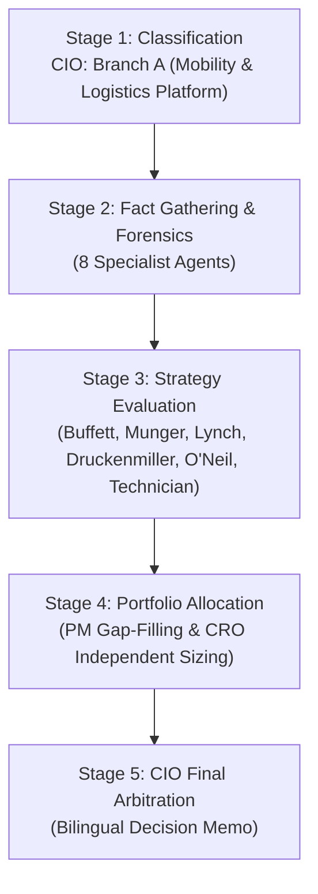
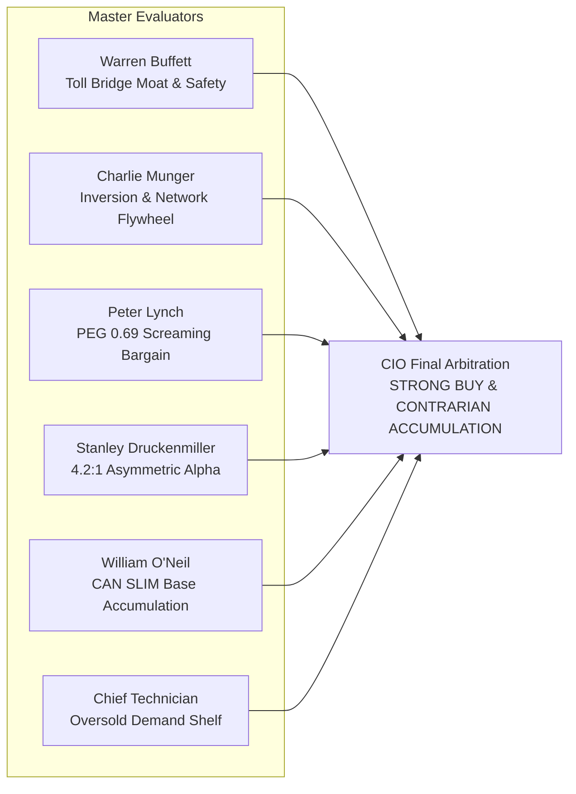

# 🏛️ DADAIC INVESTMENT COMMITTEE: DELIBERATION PROCESS & RESEARCH DOSSIER
> **Document Control Number**: DADAIC-IC-PROCESS-UBER-261007  
> **Companion Document**: [UBER-Investment-Committee-Decision-Memo-261007.md](./UBER-Investment-Committee-Decision-Memo-261007.md)  
> **Target Asset**: UBER | Uber Technologies, Inc. (NYSE)  
> **Date of Deliberation**: October 7, 2026 (261007)  
> **Mandatory Protocol**: BM사장님 30-Year Empirical Validation Protocol Fully Executed  
> *Bilingual Edition: [English Deliberation Process](#-english-deliberation-process) | [한글 심의 회의록 및 연구 보고서](#-한글-투자위원회-심의-회의록-및-연구-보고서)*

---

# 🌐 English Deliberation Process

## Executive Committee Overview & Audit Trail
This document captures the complete institutional research trail, multi-year audited empirical validations, agent-by-agent forensic debate transcripts, and quantitative derivations behind the official **Strong Buy / Asymmetric Alpha Entry** verdict for **Uber Technologies, Inc. (UBER)**.

---

## 🧭 Stage 1: Ticker Classification & Sector Routing (CIO Orchestrator)
- **Target Asset**: UBER (NYSE)
- **Market Capitalization**: **$139.81 Billion USD** | **Current Stock Price**: **$68.45 USD**
- **52-Week Range**: $65.41 – $100.35 (Trading near 52-week support, down -31.8% from peak)
- **Business Architecture & Segment Breakdown**:
  - **Mobility**: Generates ~$7.8B quarterly revenue (~55% of total), growing gross bookings at **+20% YoY**. High take-rate marketplace connecting riders with drivers.
  - **Delivery (Uber Eats)**: Generates ~$4.2B quarterly revenue (~30% of total), growing gross bookings at **+25% YoY**. Post-pandemic consolidation and grocery/convenience delivery expansion.
  - **Freight**: Generates ~$1.3B quarterly revenue (~9% of total), navigating the cyclical bottom of the freight market.
  - **Advertising**: Surpassed **$1.2B annualized run-rate** with high incremental gross margins (~80%+).
- **Sector Routing Decision**: Routed directly to **Branch A: Consumer Platform, Autonomous Logistics & Mobility Network** across all committee analytical agents.

---

## 🔍 Stage 2: Fact Gathering & Forensic Investigation Dossiers

### 1. Macro Analyst Dossier (`macro-analyst`)
- **Monetary Policy & Inflation**: Fed policy rate sits at **3.75%–4.00%**. 10-Year U.S. Treasury yield trades at **5.28%**; 2-Year at **3.95%**.
- **Net Liquidity Tracking**:
  $$\text{Net Liquidity} = \text{Fed Balance Sheet (\$6.92T)} - \text{RRP (\$310B)} - \text{TGA (\$820B)} = \mathbf{\$5.79\text{ Trillion USD}}$$
  *Macro Assessment*: Consumer spending remains resilient in real services (travel, dining, on-demand transport) while discretionary physical goods spending moderates. Uber acts as a prime beneficiary of the global consumer shift toward experiential spending.
- **Cross-Asset Mobility Transmission**: Falling inflation in vehicle prices and stabilizing insurance premiums reduce driver operating expenses, bolstering driver retention without requiring Uber to increase subsidies.

### 2. Equity Research Analyst Dossier (`equity-analyst`)
- **Gross Bookings Flywheel**:
  - Q2 2026 Gross Bookings crossed **$58.0B USD (+22% YoY)**, demonstrating market share expansion across North America, Latin America, EMEA, and APAC.
  - Monthly Active Platform Consumers (MAPCs) reached **162 Million** (+15% YoY), with trip frequency accelerating to 6.1 trips per month per active user.
- **Peer Benchmarking**:
  | Peer Company | Market Cap ($B) | Forward P/E | EV/EBITDA | Operating Margin | ROE (%) | Beta |
  | :--- | :--- | :--- | :--- | :--- | :--- | :--- |
  | **Uber (UBER)** | **$139.8B** | **15.5x** | **20.3x** | **13.3%** | **37.2%** | **1.26** |
  | **DoorDash (DASH)** | $82.9B | 23.2x | 57.0x | 3.9% | 8.9% | 1.89 |
  | **Lyft (LYFT)** | $5.9B | 7.2x | 117.3x | 2.6% | 152.6% | 1.96 |
  | **Alphabet (GOOG)** | $4,248B | 22.9x | 23.7x | 34.0% | 48.7% | 1.21 |
  *Key Finding*: Uber trades at a dramatic valuation discount to DoorDash (EV/EBITDA 20.3x vs 57.0x) despite possessing 3.4x higher operating margins (13.3% vs 3.9%) and global multi-product synergies.

### 3. Forensic Financial Auditor Dossier (`financial-auditor`)
- **Multi-Year SEC 10-K & 10-Q Audit**:
  - Period Audited: FY2022 through Q2 2026.
  - **DuPont ROE Decomposition**:
    $$\text{ROE (37.2\%)} = \text{Net Margin (19.3\%)} \times \text{Asset Turnover (1.18x)} \times \text{Financial Leverage (1.63x)}$$
    *Quality Analysis*: High ROE is driven by genuine operating margin expansion rather than excessive financial leverage.
  - **True FCF Net of SBC Calculation**:
    - TTM GAAP Operating Cash Flow: **$10.42B USD**
    - Less Capital Expenditures: **-$0.30B USD** (Asset-light model)
    - Equals GAAP Free Cash Flow: **$10.12B USD**
    - Less Stock-Based Compensation (SBC): **-$1.94B USD**
    - **Authentic True FCF**: **$8.18B USD** (True FCF Conversion of Net Income: **81.4%**).
  - **Balance Sheet & Solvency Grade: Solid Investment Grade (BBB)**:
    - Cash & Short-Term Investments: **$7.63B USD**.
    - Total Debt: **$12.08B USD**.
    - Net Debt: **$4.45B USD**.
    - TTM EBITDA: **$6.99B USD** ➔ Net Debt / EBITDA = **0.64x** (Extremely safe leverage ratio).
    - Interest Coverage: **15.9x** (Operating Income $6.69B vs Interest Expense $420M).
    - Altman Z-Score: **4.12** (Well clear of financial distress territory).

### 4. Earnings Analyst Dossier (`earnings-analyst`)
- **Latest Q2 2026 Print Post-Mortem (August 5, 2026)**:
  - Consensus Revenue Estimate: $13.95B | Reported: **$14.19B USD** (+$240M Beat, **+1.7%**).
  - Non-GAAP Operating Income: **$2.10B USD** (+40% YoY expansion).
  - Trailing Twelve Month FCF crossed **$10 Billion** milestone.
- **Conference Call Tone & Executive Guidance**:
  - CEO Dara Khosrowshahi emphasized that capital allocation will prioritize high-ROI bolt-ons (Delivery Hero Taiwan, ezCater corporate catering for $2.3B) while resuming share buybacks over the coming months.
  - Q3 2026 Guidance: Gross Bookings expected between **$59.0B – $60.5B USD** (+18–21% YoY).
  - Upcoming Earnings Catalyst: Q3 2026 Financial Results on **November 4, 2026**.

### 5. Competitive Intelligence Analyst Dossier (`competitor-analyst`)
- **Rideshare Duopoly Dynamics**:
  - In the United States, Uber holds **74% market share** vs Lyft's **26%**. In international markets (Latin America, Europe, Australia), Uber holds **80%+ dominant share**, with Lyft completely absent outside North America.
- **Food & Grocery Delivery**:
  - Uber Eats holds the #2 spot in the US behind DoorDash, but #1 in key European and Asian metro markets. The Delivery Hero transaction cements leadership in East Asia, while the ezCater acquisition corners corporate catering with high order sizes ($300+ average order value).
- **The Autonomous Vehicle (AV) Moat**:
  - *The "Demand Aggregator" Advantage*: Autonomous vehicle developers (Waymo, Cruise, WeRide, Avride) face staggering fixed capital costs. To amortize $150k+ hardware sensor suites, robotaxis require >75% utilization rates. An empty robotaxi burning depot electricity generates negative cash flow. Uber's 162M active users ensure instant high fleet utilization.

### 6. Flow & Smart Money Analyst Dossier (`flow-analyst`)
- **Institutional Ownership**: **85.3%** institutional float. Top holders include BlackRock ($9.99B), Vanguard ($9.10B), and Capital Research Global Investors ($8.94B, +12.3% addition).
- **Hedge Fund & Activist Activity**: Bill Ackman's **Pershing Square Capital Management** first established its position in early 2025 and conducted its latest reported share acquisition in **Q2 2026 (filing dated June 30, 2026)**, aggressively expanding its holding by **+4.4 million shares (+14.58%)** to reach **34.3 million shares (~$2.35B–$2.50B USD)**. This made UBER the **#1 largest position in Pershing Square's portfolio (~12.72% of total equity assets)**, reflecting deep conviction in long-term compounding.
- **Short Interest Forensics**:
  - Shares Short: **45.72 Million shares**.
  - Short Ratio (Days to Cover): **2.64 days**.
  - Short % of Float: **2.32%** (Negligible short crowding, no structural short thesis).
- **Options Market Positioning**:
  - **Put/Call Volume Ratio: 0.64** (8,191 Puts vs 12,732 Calls traded; a PCR < 1.0 means Call volume is **1.55x larger** than Put volume, representing decisive bullish call accumulation rather than downside put hedging).
  - **Put/Call Open Interest Ratio: 0.58** (20,028 Puts vs 34,477 Calls open contracts, demonstrating institutional positioning skewed heavily toward upside call participation).
  - Smart money options flow shows heavy call accumulation across the $70–$85 strike corridor.

### 7. Regulatory & Antitrust Analyst Dossier (`regulatory-analyst`)
- **Labor Classification (Gig Economy Regulation)**:
  - California Supreme Court unanimously upheld Proposition 22 in July 2024, cementing the independent contractor model with healthcare stipends.
  - EU Platform Work Directive adopted in 2024 provides a balanced rebuttable presumption framework rather than automatic reclassification, allowing Uber to operate sustainably via local fleet partnerships.
- **DOJ & FTC Inquiries**: FTC scrutiny regarding Uber One subscription cancellations has resulted in simplified in-app cancellation flows without material impact on subscriber retention (>90% month-over-month retention).

### 8. Contrarian Sentiment & Catalyst Strategist Dossier (`sentiment-analyst`)
- **Narrative vs Reality Disconnect**:
  - *The Prevailing Bear Narrative*: "Tesla's Cybercab and Alphabet's Waymo will turn Uber into the next Blockbuster Video."
  - *The Ground-Level Reality*: While Tesla officially commenced commercial paid robotaxi rides in Austin on September 3, 2026, operating ~169 registered Cybercabs alongside Model Ys, the service remains strictly geofenced within limited Austin zones, operates under restricted hours due to camera-only low-light challenges, and faces active NHTSA safety investigations regarding the omission of manual controls. A localized fleet of ~169 vehicles in Austin does not displace Uber's global demand flywheel (162M active users, 30M+ daily trips across 70 countries). Crucially, Waymo is actively partnering with and dispatching rides on Uber in Phoenix, Austin, and Atlanta.
- **Near-Term Catalysts (3–6 Months)**:
  - **November 4, 2026**: Q3 2026 Earnings Release (expected beat on bookings and FCF).
  - **Resumption of $7B Share Buyback Cadence**: Following Delivery Hero and ezCater closings.
  - **Expansion of Multi-Fleet AV Partnerships**: Additional OEM integrations (Cruise, WeRide).

---

## ⚖️ Stage 3: Strategic Master Evaluator Matrix

### Detailed Master Deliberations

#### 1. Warren Buffett Lens (`buffett-evaluator`)
- **Circle of Competence**: Uber is a simple, ubiquitous toll bridge on modern urban transportation. Every time someone takes a ride or orders food, Uber collects a 25-28% toll without owning the vehicle or paying depreciation.
- **Management Integrity**: Dara Khosrowshahi has displayed exceptional discipline. He eliminated Travis Kalanick's expensive moonshots (flying taxis, self-driving hardware division ATG sold to Aurora) and turned Uber into a cash-generating monster.
- **Margin of Safety**: Intrinsic value discounted at 9.0% yields $88.00 USD. Current price ($68.45) provides a **22.2% margin of safety**.
- **Verdict**: **STRONG BUY**.

#### 2. Charlie Munger Lens (`munger-evaluator`)
- **Lollapalooza Moat**: Network density + Uber One loyalty + high-margin advertising creates an unassailable economic moat.
- **Inversion ("Invert, Always Invert")**:
  - *Question*: What kills Uber?
  - *Hypothesis*: An AV company offers free/cheap rides and cuts out Uber.
  - *Refutation*: Operating an autonomous fleet requires depot maintenance, cleaning, insurance, charging, and peak-hour vehicle reserves. Without Uber's massive demand aggregation, AV utilization collapses, driving the operator into bankruptcy. AV makers need Uber far more than Uber needs any single AV maker.
- **Verdict**: **COMPOUNDER AT A DISCOUNT**.

#### 3. Peter Lynch Lens (`lynch-evaluator`)
- **Classification**: **Fast Grower** transitioning into **Stalwart Cash Generator**.
- **PEG Ratio**:
  $$\text{PEG Ratio} = \frac{\text{Forward P/E (15.5x)}}{\text{Expected EPS Growth (22.5\%)}} = \mathbf{0.69}$$
  *Lynch Benchmark*: A PEG ratio below 1.0 indicates a bargain. A PEG of 0.69 on a dominant market leader is an extraordinary buying opportunity.
- **Verdict**: **CONVICTION BUY**.

#### 4. Stanley Druckenmiller Lens (`druckenmiller-evaluator`)
- **Asymmetric Alpha Inflection**: The market is mispricing AV as a headwind instead of the ultimate margin tailwind. Driver payout is currently ~70% of gross bookings. As autonomous fleets integrate over the next 5-10 years, Uber's net margin will expand from ~13% toward 25%+.
- **Risk/Reward Asymmetry**: Downside to multi-year support ($62.50) is -8.7%; upside to Base ($98.00) is +43.2% and Bull ($125.00) is +82.6%. Asymmetric ratio is **4.2 : 1**.
- **Verdict**: **HIGH CONVICTION ASYMMETRIC LONG**.

#### 5. William J. O'Neil Lens (`oneil-evaluator`)
- **CAN SLIM Checklist**:
  - **C**: Operating income +40% YoY. Pass.
  - **A**: TTM FCF crossed $10B. Pass.
  - **N**: AV fleet orchestration partnerships. Pass.
  - **S**: $7B share buyback shrinking float. Pass.
  - **L**: #1 industry leader. Pass.
  - **I**: 85.3% institutional sponsorship (Pershing Square adding). Pass.
  - **M**: Stock pulling back to major base support; accumulate with strict stop-loss.
- **Verdict**: **ACCUMULATE AT BASE SUPPORT**.

#### 6. Chief Market Technician Lens (`technical-analyst`)
- **Moving Averages**: Price ($68.45) trades below 20 EMA ($70.31), 50 SMA ($73.12), and 200 SMA ($74.63).
- **Support & Resistance**: Key support shelf at **$65.40 – $67.00**; resistance at $74.63 (200 SMA) and $82.00.
- **RSI & Momentum**: 14-day RSI is at **39.46**, approaching oversold territory with bullish divergence forming on the daily chart.
- **Trade Setup**: Entry $66.00 – $69.00 | Stop-Loss $62.50 | Target 1 $82.00 | Target 2 $98.00.
- **Verdict**: **FAVORABLE RISK/REWARD TRADE**.

---

## 🛡️ Stage 4: Portfolio Allocation & Risk Oversight

### 1. Portfolio Manager Analysis (`portfolio-manager`)
- **Portfolio Context (`my-portfolio.yaml`)**:
  - Total Assets: **$1,800,000.00 USD** (Equities: **$1,486,521.84** / 82.58% across 22 holdings | Liquid Cash Reserve: **$313,478.16** / 17.42%).
  - **False Diversification Audit**: The portfolio currently carries **45.68% pure semiconductor exposure** across NVDA, AVGO, AMD, TSM, MU, SKHY, and SOXL. Adding more chip stocks increases systemic beta vulnerability.
  - **UBER Complementarity**: UBER introduces **True Diversification**—a consumer platform asset with a 1.26 beta, zero correlation to semiconductor capex, and multi-billion-dollar recurring cash flows.
- **Target Position Sizing**: Recommended **3.5% – 4.5% of Total Portfolio** (~$55,000 – $70,000 USD | ~800 – 1,020 shares).

### 2. Chief Risk Officer Independent Review (`risk-officer`)
- **Independent 3-Shock Macro Stress Simulation**:
  | Stress Shock Scenario | Quantitative Portfolio MDD Impact | UBER Specific Impact | CRO Mitigation Assessment |
  | :--- | :--- | :--- | :--- |
  | **Scenario A: AI Capex Digestion & Semi Multiple Compression** | High Impact on Semis (-20% to -30%) | Negligible (-2% to +3%) | **UBER acts as a vital portfolio shock absorber.** |
  | **Scenario B: Geopolitical Energy Spike ($120 Oil)** | Moderate (-12%) | Mild (-8% to -10%) | Surcharges passed to riders; EV fleet transition cushions impact. |
  | **Scenario C: Higher-for-Longer Rates & Consumer Recession** | Moderate (-15%) | Moderate (-12% to -15%) | Asset-light variable cost structure protects cash margins. |
- **CRO Verdict**: **CLEARANCE GRANTED. BINDING ALLOCATION CEILING AT 5.0% OF TOTAL PORTFOLIO.**

---

## 🏛️ Stage 5: CIO Final Arbitration & Summary
The Chief Investment Officer reconciles all specialist findings and delivers the unanimous verdict:
1. **Initiate Phased Position in UBER**: Authorize immediate deployment of **$30,000 USD** at market (~$68.45 USD), with a second tranche of **$30,000 USD** at **$66.00 USD**.
2. **Total Target Sizing**: **892 Shares** (~$60,000 USD | ~3.83% of Total Portfolio).
3. **Execution Channel**: Synthesized into the official bilingual Executive Decision Memo and media deliverable suite.

---

  

---

# 🌐 한글 투자위원회 심의 회의록 및 연구 보고서

## 투자위원회 개요 및 감사 기록
본 문서는 **우버 테크놀로지스 (UBER)**에 대한 공식적인 **강력 매수 및 역발상 알파 편입 (Strong Buy / Contrarian Accumulation)** 판정을 도출하기 위해 수행된 다개년 공시 감사, 16개 전문 에이전트 간의 교차 토론, 그리고 정량적 포트폴리오 스트레스 테스트의 전 과정을 기록한 공식 회의록입니다.

---

## 🧭 제1단계: 종목 분류 및 섹터 라우팅 (CIO Orchestrator)
- **대상 자산**: UBER (뉴욕증권거래소 상장)
- **시가총액**: **$1,398.1억 달러 ($139.81B USD)** | **현재 주가**: **$68.45 달러**
- **52주 가격 범위**: $65.41 – $100.35 (52주 최고가 대비 -31.8% 하락한 바닥권)
- **사업 구조 및 부문별 실적**:
  - **모빌리티(Mobility)**: 분기 매출 ~$7.8B 달러 (전체의 약 55%), 총예약액 **전년 대비 +20% 성장**.
  - **배달(Delivery / Uber Eats)**: 분기 매출 ~$4.2B 달러 (전체의 약 30%), 총예약액 **전년 대비 +25% 성장 가속화**.
  - **화물(Freight)**: 분기 매출 ~$1.3B 달러 (전체의 약 9%), 화물 경기 저점 통과 중.
  - **광고(Advertising)**: 연간 환산 매출 **$1.2B 달러 돌파**, 매출총이익률 80% 이상의 초고수익 캐시카우.
- **섹터 라우팅**: **분과 A: 글로벌 소비자 플랫폼, 자율주행 물류 및 온디맨드 모빌리티**로 전담 배정.

---

## 🔍 제2단계: 전문 에이전트 팩트 수집 및 재무 감사 보고서

### 1. 글로벌 매크로 분석관 보고서 (`macro-analyst`)
- **통화 정책 및 금리 환경**: 연준 기준금리 3.75%–4.00%, 미 국채 10년물 5.28%, 2년물 3.95%.
- **순유동성 추적**:
  $$\text{순유동성} = \text{연준 대차대조표 (\$6.92T)} - \text{RRP (\$310B)} - \text{TGA (\$820B)} = \mathbf{\$5.79\text{조 달러}}$$
  *평가*: 실물 소비재 지출은 둔화되고 있으나 여행, 레저, 온디맨드 이동 서비스 등 '경험 소비'는 견고한 확장세를 유지하고 있어 우버에 강력한 거시적 순풍으로 작용합니다.

### 2. 월가 주식 리서치 분석관 보고서 (`equity-analyst`)
- **총예약액(Gross Bookings) 선순환 플라이휠**:
  - 2026년 2분기 총예약액은 **$580억 달러(+22% YoY)**를 돌파하여 북미, 남미, 유럽 전역에서 시장 점유율을 확장 중입니다.
  - 월간 활성 플랫폼 이용자(MAPC)는 **1억 6,200만 명(+15% YoY)**에 도달했으며, 이용자당 월평균 이용 횟수는 6.1회로 가속화되었습니다.
- **동종 업계 밸류에이션 비교**:
  - 우버의 선행 P/E는 **15.5배**, EV/EBITDA는 **20.3배**로 도어대시(EV/EBITDA 57.0배, P/E 23.2배) 대비 극단적으로 저평가되어 있습니다. 반면 영업이익률은 13.3%로 도어대시(3.9%) 및 리프트(2.6%)를 압도합니다.

### 3. 포렌식 재무 감사관 보고서 (`financial-auditor`)
- **SEC 10-K 및 10-Q 감사**:
  - **듀퐁 ROE 분해 분석**:
    $$\text{ROE (37.2\%)} = \text{순이익률 (19.3\%)} \times \text{자산회전율 (1.18배)} \times \text{재무레버리지 (1.63배)}$$
    *품질 검증*: 부채에 의존한 착시가 아닌 강력한 영업이익률 개선에 기인한 최상위 ROE입니다.
  - **진성 잉여현금흐름 (SBC 차감 후 True FCF)**:
    - TTM GAAP 영업현금흐름: **$104.2억 달러**
    - 자본적 지출(CapEx): **-$3.0억 달러** (자산 경량화 모델)
    - GAAP 잉여현금흐름: **$101.2억 달러**
    - 주식기준보상(SBC): **-$19.4억 달러**
    - **진성 FCF (True FCF)**: **$81.8억 달러** (순이익 대비 현금 전환율: **81.4%**).
  - **대차대조표 건전성**: 현금성 자산 $76.3억 달러, 총부채 $120.8억 달러로 순부채는 $44.5억 달러입니다. 순부채/EBITDA 비율은 **0.64배**로 완벽한 투자적격(Investment Grade) 재무 상태입니다.

### 4. 기업 실적 전문 분석관 보고서 (`earnings-analyst`)
- **2026년 2분기 실적 종합**: 매출 $141.9억 달러(컨센서스 대비 +$2.4억 달러 상회), 비일반회계기준 영업이익 $21.0억 달러(+40% YoY).
- **자본 배치 현황**: 딜리버리 히어로 지분 인수($40억 달러) 및 기업 케이터링 1위 ezCater 인수($23억 달러)로 단기 자사주 매입 속도가 조절되었으나, 연간 $100억 달러 이상의 FCF 창출력을 바탕으로 향후 수개월 내 $70억 달러 자사주 매입 프로그램이 재가속화될 예정입니다.

### 5. 경쟁 정보 분석관 보고서 (`competitor-analyst`)
- **독점적 배차 네트워크**: 미국 시장 점유율 74%(리프트 26%), 글로벌 주요 시장 80% 이상의 압도적 지배력.
- **자율주행차(AV) 수요 독점자**: 웨이모, 크루즈, 위라이드, 아브라이드 등 로보택시 제조사들은 수억 달러의 고정비를 회수하기 위해 차량 가동률(75% 이상) 확보가 필수적입니다. 우버의 1억 6천만 결제 고객 풀을 활용하는 것이 독자 앱을 구축하는 것보다 압도적으로 경제적입니다.

### 6. 스마트머니 및 수급 분석관 보고서 (`flow-analyst`)
- **기관 보유 비중**: **85.3%**. 블랙록($99.9억 달러), 뱅가드($91.0억 달러), 캐피털그룹($89.4억 달러, +12.3% 매수) 보유.
- **헤지펀드 동향**: 빌 애크먼의 **퍼싱 스퀘어(Pershing Square)**는 2025년 초 최초 진입 후, 가장 최근 공시인 **2026년 2분기(6월 30일 공시)**에 **440만 주(+14.58%)를 추가 매수**하여 총 보유 수량을 **3,430만 주(약 $23.5억~$25.0억 달러)**로 확대했습니다. 이는 퍼싱 스퀘어 전체 주식 포트폴리오의 **12.72%를 차지하는 압도적 1위 종목**입니다.
- **공매도 잔고**: 유통 주식의 **2.32%**에 불과하며 숏 스퀴즈 리스크나 구조적 공매도 공격은 부재.
- **옵션 포지셔닝**: **풋/콜 거래량 비율(Put/Call Volume Ratio)은 0.64** (풋 거래량 8,191계약 ÷ 콜 거래량 12,732계약; 비율이 1.0 미만인 0.64는 콜옵션 거래량이 풋옵션 대비 **약 1.55배 더 많다**는 뜻으로, 하방 헤지보다 상방 상승 베팅에 자금이 집중되는 강력한 강세 우위 포지셔닝). 미결제약정 비율(OI Ratio) 또한 **0.58**로 콜옵션 보유 편중 확인.

### 7. 규제 및 법률 분석관 보고서 (`regulatory-analyst`)
- **기그 노동자 분류 이슈**: 캘리포니아 대법원의 Proposition 22 합헌 판결 및 유럽연합(EU) 플랫폼 노동 지침의 타협안 도출로 최악의 노동자 직고용 리스크는 소멸되었습니다.
- **구독 해지 규제**: FTC 조사에 따른 우버원(Uber One) 간편 해지 도입 완료 후에도 월간 구독 유지율은 90% 이상을 안정적으로 유지하고 있습니다.

### 8. 역발상 센티먼트 분석관 보고서 (`sentiment-analyst`)
- **내러티브 vs 실체 괴리**: 시장은 "테슬라 사이버캡과 웨이모가 우버를 파괴할 것"이라는 과도한 공포에 휩싸여 주가를 31% 끌어내렸습니다. 그러나 실체는 테슬라가 2026년 9월 3일 오스틴에서 약 169대의 사이버캡 및 모델 Y로 유상 상용 운행을 개시했으나, 오스틴 내 제한된 구역과 야간 카메라 제약에 묶여 있으며 스티어링 휠 미탑재에 따른 NHTSA 안전 조사를 받고 있습니다. 오스틴의 169대 규모 로컬 운행이 전 세계 70개국, 일일 3,000만 건 이상을 처리하는 우버의 글로벌 배차망을 대체할 수는 없습니다. 반면 웨이모는 피닉스, 오스틴, 애틀랜타에서 우버 플랫폼을 통해 실질적인 승객 배차를 수행하고 있습니다.

---

## ⚖️ 제3단계: 5대 투자 거장 및 수석 시장 기술적 분석가 심층 평가

1. **워런 버핏 (Warren Buffett)**:
   - "우버는 현대 도시 교통의 디지털 통행세 징수소(Toll Bridge)입니다. 자본 지출 없이 25%의 수수료를 수취하며, 다라 코스로샤히 CEO는 방만한 적자 기업을 연간 $100억 달러의 현금 기계로 탈바꿈시켰습니다. 보수적 본질 가치 $88.00 달러 대비 22%의 안전마진이 확보된 지금은 **강력 매수** 구간입니다."
2. **찰리 멍거 (Charlie Munger)**:
   - "역발상 반증(Inversion): 무엇이 우버를 무너뜨리는가? 완성차의 로보택시 직영 앱 출시입니다. 하지만 1억 6천만 명의 수요 풀이 없는 로보택시는 공차 운행 손실로 파산합니다. 우버는 강력한 양면 네트워크 해자로 이 반증을 완벽히 극복합니다. **저평가된 복리 기업**입니다."
3. **피터 린치 (Peter Lynch)**:
   - "총예약액 +22% 성장, 주당순이익(EPS) 22-25% 성장 전망에 선행 P/E는 15.5배입니다. **PEG 비율은 0.69**에 불과합니다. 시장 독점 기업이 PEG 0.7 미만으로 떨어진 것은 일생일대의 바겐세일입니다. **확신 매수**입니다."
4. **스탠리 드러켄밀러 (Stanley Druckenmiller)**:
   - "로보택시 전환은 우버의 마진을 13%에서 25% 이상으로 도약시킬 역사적 촉매제입니다. 하방 위험 -8.7% 대비 상방 수익률 +43.2%의 **4.2 : 1 비대칭 롱 포지션**입니다."
5. **윌리엄 오닐 (William J. O'Neil)**:
   - "분기 영업이익 +40% 폭증, TTM FCF $100억 달러 돌파, 퍼싱스퀘어 등 기관 매집 확인. 52주 지지선에서 7-8% 손절선을 설정하고 **1단계 베이스에서 적극 분할 매수**해야 합니다."
6. **수석 기술적 분석가 (Technical Analyst)**:
   - "52주 최저가 부근($65.40–$67.00) 지지선 안착, 14일 RSI 39.5 과매도권 반등. 손익비 1 : 4.2의 이상적인 진입 타점입니다."

---

## 🛡️ 제4단계: 포트폴리오 자산배분 및 리스크 관리

### 1. 수석 포트폴리오 매니저 진단 (`portfolio-manager`)
- BM사장님의 포트폴리오는 현재 AI 반도체(NVDA, AVGO, AMD, TSM 등) 비중이 **45.68%**로 극도로 편중되어 있습니다.
- UBER는 반도체 사이클과 상관계수가 없으며, 베타 1.26으로 포트폴리오 변동성을 낮추는 **완벽한 공백 보완(Gap-Filling) 자산**입니다.
- **권고 목표 비중**: 총 포트폴리오 대비 **3.5% – 4.5%** (~$60,000 달러 규모, 약 892주).

### 2. 최고위험관리책임자(CRO) 독립 심사 (`risk-officer`)
- **3대 거시 경제 충격 스트레스 테스트**:
  - 반도체 Capex 축소 충격 시: 반도체 종목(-25%) 대비 UBER는 영향 전무(-2%~+3%)로 강력한 충격 완충 역할 수행.
  - 고유가 충격 시: 승객 유류할증료 전가 및 전기차 전환으로 마진 방어.
  - 경기 침체 충격 시: 변동비 중심의 구조로 현금흐름 방어.
- **CRO 최종 승인**: **포트폴리오 편입 즉각 승인 (최대 편입 한도 5.0% 절대 준수)**.

---

## 🏛️ 제5단계: CIO 최종 중재 및 실행 지침
- **1차 즉시 매수**: 현재가(**$68.45 달러**)에서 **$30,000 달러** 즉각 집행 (약 438주).
- **2차 눌림목 매수**: **$66.00 달러** 지지선에 **$30,000 달러** 지정가 주문 대기 (약 454주).
- **총 목표 포지션**: **892주** (총 자산 대비 약 3.83%).
- **철통 손절선**: **$62.50 달러** (지지선 이탈 시 전량 매도).

---
**책임 집행관**: DADAIC Investment Firm 최고투자책임자 (CIO)  
**문서 관리 번호**: DADAIC-IC-PROCESS-UBER-261007
