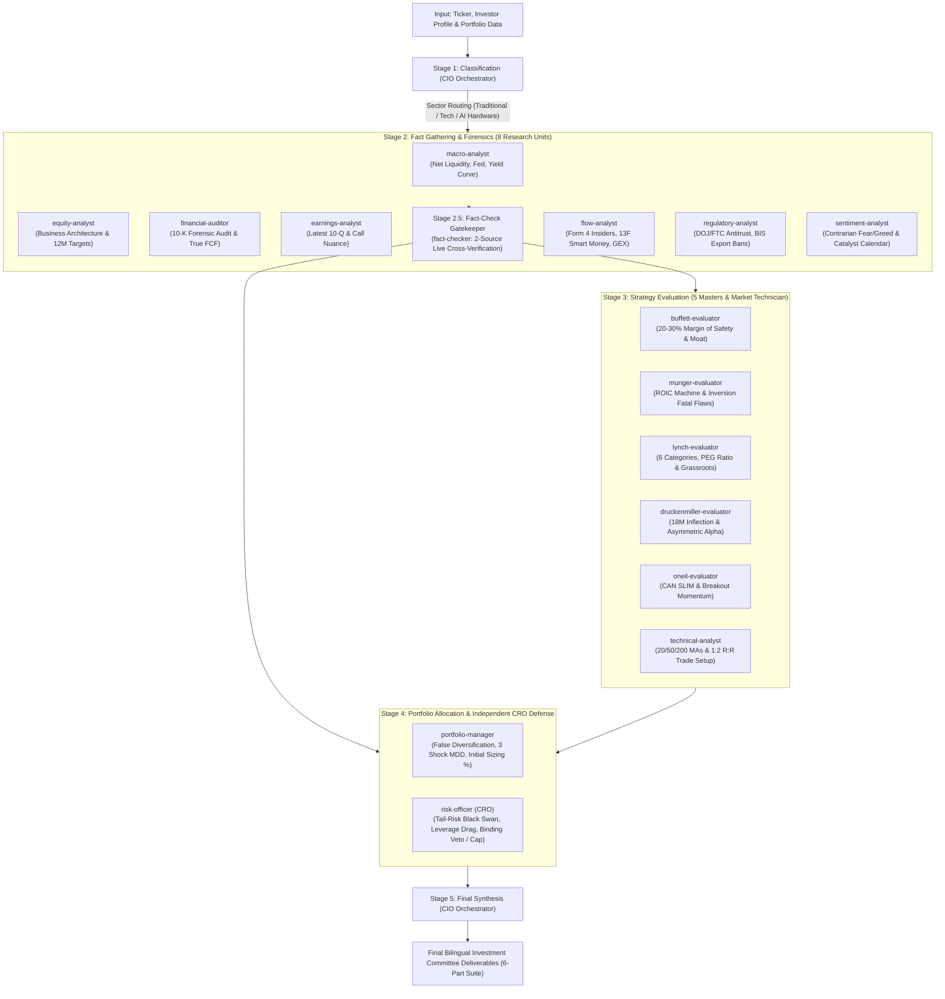

# 🏛️ DADAIC Investment Firm - Autonomous Equity Pipeline
> **Institutional AI Investment Firm Architecture**  
> *Bilingual Edition: [English](#-english-version) | [한국어](#-한국어-버전)*

---

# 🇺🇸 English Version

## 1. Overview
**DADAIC Investment Firm** is an institutional-grade **Autonomous AI Investment Firm** built on the Google Antigravity framework.  
It combines the rigorous multi-disciplinary underwriting principles of Wall Street investment banks (Goldman Sachs, Morgan Stanley), quantitative proprietary desks, and the legendary triumvirate of value investing—**Warren Buffett, Charlie Munger, and Peter Lynch**. The system autonomously executes an end-to-end Investment Committee pipeline, from forensic SEC statement audits to portfolio factor stress-testing and decision memo generation.

---

## 🚀 Quick Start Guide

### Step 1. Configure Portfolio & Profile
Open [`my-portfolio.yaml`](file:///g:/Finance/DADAIC%20Investment%20Firm/my-portfolio.yaml) in the workspace root. Define your investment horizon, risk tolerance, target allocation ceiling, current holdings, and cash allocation. (Pre-filled with default sample assets: AAPL, MSFT, VOO, Cash).

### Step 2. Trigger Autonomous Protocols via Shorthand Commands
In the Antigravity chat, interact directly with the CIO using high-efficiency shorthand commands or natural language:

| Command | Action | Output / Deliverable |
| :--- | :--- | :--- |
| **`CIO <TICKER>`** (or `ICP`) | Full 5-Stage Investment Committee Pipeline on target asset | Streamlined 6-part suite in `DecisionMemo/` & `Media/` |
| **`CIO REVIEW`** | Portfolio health diagnostic, live valuation, beta, & false diversification audit | `DecisionMemo/Portfolio-Review-YYMMDD.md` |
| **`CIO REBALANCE`** | Tactical rebalancing matrix aligning with portfolio limits and cash targets | `DecisionMemo/Portfolio-Rebalance-YYMMDD.md` |
| **`CIO STRESS`** | 3-scenario macro stress test (AI pause, rates, geopolitics) & portfolio MDD | `DecisionMemo/Portfolio-StressTest-YYMMDD.md` |
| **`CIO ASK <QUERY>`** | One-point CIO strategic consultation grounded in `my-portfolio.yaml` | Direct institutional verdict in chat |
| **`CIO PICKS [MODE]`** | Autonomous stock screening & idea generation (Buffett, GARP, Defense, Themes) | `DecisionMemo/CIO-Picks-YYMMDD.md` |

#### 📞 1:1 Direct Agent Hotline Suite (Instant Specialist Consultation)
You do NOT need to run the entire 5-stage pipeline for quick inquiries. Consult any of the 16 individual specialists directly:
- **Master Evaluators**: `BUFFETT <TICKER>` (Moat & 20-30% Safety Margin) \| `MUNGER <TICKER>` (Inversion & Fatal Flaws) \| `LYNCH <TICKER>` (PEG & 2-Minute Drill) \| `DRUCK <TICKER>` (18M Inflection & $\ge 3:1$ Asymmetry) \| `ONEIL <TICKER>` (CAN SLIM & Breakout) \| `CHART <TICKER>` (1:2 R:R Trade Setup)
- **Forensic & Flow Specialists**: `MACRO [QUERY]` (Fed & Liquidity) \| `EQUITY <TICKER>` (Business Architecture & 12M Targets) \| `AUDIT <TICKER>` (10-K & True FCF net of SBC) \| `EARNINGS <TICKER>` (10-Q & Call Nuance) \| `PEERS <TICKER>` (Market Share & Margins) \| `FLOW <TICKER>` (Form 4 Insiders, 13F & GEX) \| `LEGAL <TICKER>` (DOJ Antitrust & BIS Sanctions) \| `SENTIMENT <TICKER>` (Contrarian Sentiment & Catalysts)
- **Portfolio & Risk Defense**: `PM <TICKER>` (False Diversification & Target Sizing %) \| `CRO CHECK` / `CRO <QUERY>` (Tail-Risk & Binding Veto)

*Natural language is always supported as well (e.g. "Run the Investment Committee Pipeline for NVDA", "Ask Charlie Munger about TSLA", "Have Financial Auditor review AAPL's True FCF").*

### Step 3. Receive the Comprehensive Bilingual & Visual Deliverables (6-Part Suite + On-Demand Export)
The CIO Orchestrator executes all 5 stages in parallel and sequence, delivering two coordinated written documents in **both English and Korean** along with four institutional interactive HTML visual media assets (large-type zero-dead-space layout in a **bright, lively modern light theme**), automatically archived in the `DecisionMemo/` and `DecisionMemo/Media/` folders:
1. **Executive Decision Memo**:  
   `DecisionMemo/[TICKER]-Investment-Committee-Decision-Memo-YYMMDD.md`
2. **Complete Deliberation Process & Research Dossier**:  
   `DecisionMemo/[TICKER]-Investment-Committee-Decision-Memo-Process-YYMMDD.md`
3. **Institutional Visual Slide Deck (English, Interactive HTML, High Legibility)**:  
   `DecisionMemo/Media/[TICKER]-Investment-Committee-Decision-Memo-Slide-EN-YYMMDD.html`
4. **Institutional Visual Slide Deck (Korean, Interactive HTML, High Legibility)**:  
   `DecisionMemo/Media/[TICKER]-Investment-Committee-Decision-Memo-Slide-KR-YYMMDD.html`
5. **Strategic Interactive Infographic (English, Interactive HTML, Portrait)**:  
   `DecisionMemo/Media/[TICKER]-Investment-Committee-Decision-Memo-Infographic-EN-YYMMDD.html`
6. **Strategic Interactive Infographic (Korean, Interactive HTML, Portrait)**:  
   `DecisionMemo/Media/[TICKER]-Investment-Committee-Decision-Memo-Infographic-KR-YYMMDD.html`
*(On-Demand Media Export: Whenever PDF or PNG files are needed, simply request "PDF로 뽑아줘" or "PNG 변환해줘" to immediately render them via headless Chrome).*  
### Step 4. Run Standalone CLI Utility Scripts Directly
Beyond chatting with the CIO, you can directly execute institutional analytical scripts from your terminal (`PowerShell` or `bash`):

1. **Live Portfolio Valuation & Equity Weight Diagnostic**:
   Fetches real-time prices for all holdings in `my-portfolio.yaml`, computes total gross equity valuation, dynamic asset weights, and flags concentration limit breaches:
   ```powershell
   python scripts/verify_portfolio.py
   ```

2. **Historical Decision Performance Tracker (Scorecard)**:
   Loads `DecisionMemo/decision-log.csv`, queries live market prices, and tracks return performance, win rate, and 12-month price target progression across past recommendations:
   ```powershell
   python scripts/track_decisions.py
   ```

3. **Autonomous Top-of-Funnel Stock & ETF Screener (`CIO PICKS`)**:
   Runs quantitative factor scoring, true ROIC audits, and anti-concentration filters across institutional equity/ETF universes:
   ```powershell
   # Default balanced screening (top 5 candidates)
   python scripts/cio_screener.py --top 5

   # Warren Buffett Quality & Moat mode (High ROIC, Low Debt)
   python scripts/cio_screener.py --mode buffett

   # Peter Lynch GARP mode (PEG < 1.0, EPS growth acceleration)
   python scripts/cio_screener.py --mode garp

   # Low-Beta Defensive Compounder & Hedge mode
   python scripts/cio_screener.py --mode defense

   # Institutional Asset Allocation ETF screening
   python scripts/cio_screener.py --mode etf
   ```

4. **Strategic Retirement & Cash Flow Portfolio Generators**:
   Generate institutional perpetual income and multi-asset retirement blueprints:
   ```powershell
   # 4% Rule Perpetual Cash Flow Portfolio
   python scripts/generate_4percent_rule_portfolio.py

   # CIO Ultimate-9 Multi-Asset Retirement Portfolio
   python scripts/generate_cio_ultimate9_portfolio.py

   # Total Return Income Compounder Portfolio
   python scripts/generate_total_return_income_portfolio.py
   ```

---

## 🔄 5-Stage Investment Committee Pipeline



---

## 👥 17 Specialized Agents & Skills Matrix

All skills are packaged according to official Antigravity standards in [`.agent/skills/`](file:///g:/Finance/DADAIC%20Investment%20Firm/.agent/skills):

| Skill Name | Role & Wall Street Persona | Core Evaluation & Deliverables |
| :--- | :--- | :--- |
| **[`macro-analyst`](file:///g:/Finance/DADAIC%20Investment%20Firm/.agent/skills/macro-analyst/SKILL.md)** | Chief Global Macro Strategist | Fed policy trajectory, Net Liquidity, yield curves, tri-scenario probabilities |
| **[`equity-analyst`](file:///g:/Finance/DADAIC%20Investment%20Firm/.agent/skills/equity-analyst/SKILL.md)** | Senior Wall Street Equity Analyst | Revenue architecture, peer benchmarking, 3-scenario 12M price targets |
| **[`financial-auditor`](file:///g:/Finance/DADAIC%20Investment%20Firm/.agent/skills/financial-auditor/SKILL.md)** | PE Institutional Forensic Auditor | Multi-year 10-K audit, DuPont ROE, True FCF (net of SBC), solvency testing |
| **[`earnings-analyst`](file:///g:/Finance/DADAIC%20Investment%20Firm/.agent/skills/earnings-analyst/SKILL.md)** | Earnings & Call Post-Mortem Specialist | Beat/Miss scorecard, forward guidance shifts, management call tone |
| **[`competitor-analyst`](file:///g:/Finance/DADAIC%20Investment%20Firm/.agent/skills/competitor-analyst/SKILL.md)** | Lead Competitive Intelligence Specialist | Top 3 rival market share, relative moat durability, margin spreads, bundling risks |
| **[`flow-analyst`](file:///g:/Finance/DADAIC%20Investment%20Firm/.agent/skills/flow-analyst/SKILL.md)** | Senior Smart Money & Flow Specialist | Form 4 insider cluster buys/sales, 13F hedge fund crowding, short squeeze, options GEX/skew |
| **[`regulatory-analyst`](file:///g:/Finance/DADAIC%20Investment%20Firm/.agent/skills/regulatory-analyst/SKILL.md)** | Antitrust & Sovereign Policy Strategist | DOJ/FTC/DMA antitrust cases, BIS national security export bans, patent cliffs, subsidy durability |
| **[`sentiment-analyst`](file:///g:/Finance/DADAIC%20Investment%20Firm/.agent/skills/sentiment-analyst/SKILL.md)** | Contrarian Sentiment & Catalyst Strategist | Crowd psychology, fear/greed extremes, narrative vs reality divergence, 3-6M catalyst calendar |
| **[`fact-checker`](file:///g:/Finance/DADAIC%20Investment%20Firm/.agent/skills/fact-checker/SKILL.md)** | Forensic Fact-Checker & Verifier | Gatekeeper: independent 2-source cross-verification of industry narratives, competitor status, and filings |
| **[`buffett-evaluator`](file:///g:/Finance/DADAIC%20Investment%20Firm/.agent/skills/buffett-evaluator/SKILL.md)** | Warren Buffett Quality Evaluator | Business simplicity, durable moat, management candor, **20-30% Margin of Safety** |
| **[`munger-evaluator`](file:///g:/Finance/DADAIC%20Investment%20Firm/.agent/skills/munger-evaluator/SKILL.md)** | Charlie Munger Inversion Evaluator | Lollapalooza moats, ROIC runway, **Inversion (fatal vulnerabilities to destroy thesis)** |
| **[`lynch-evaluator`](file:///g:/Finance/DADAIC%20Investment%20Firm/.agent/skills/lynch-evaluator/SKILL.md)** | Peter Lynch Growth Evaluator | 6 categories classification, 2-minute drill, **PEG ratio ($\le 1.0$)**, inventory flags |
| **[`druckenmiller-evaluator`](file:///g:/Finance/DADAIC%20Investment%20Firm/.agent/skills/druckenmiller-evaluator/SKILL.md)** | Stanley Druckenmiller Asymmetric Alpha Lens | 18-24M inflection catalysts, **$\ge 3:1$ Asymmetry**, macro liquidity tailwinds, aggressive sizing |
| **[`oneil-evaluator`](file:///g:/Finance/DADAIC%20Investment%20Firm/.agent/skills/oneil-evaluator/SKILL.md)** | William J. O'Neil CAN SLIM Momentum Lens | EPS surges ($\ge 25-50\%$), RS $\ge 80$, breakout volume, **strict 7-8% hard stop-loss** |
| **[`technical-analyst`](file:///g:/Finance/DADAIC%20Investment%20Firm/.agent/skills/technical-analyst/SKILL.md)** | Chief Market Technician | 20/50/200 MA alignment, volume profiles, support/resistance, **$\ge 1:2$ R:R entry** |
| **[`portfolio-manager`](file:///g:/Finance/DADAIC%20Investment%20Firm/.agent/skills/portfolio-manager/SKILL.md)** | Senior Portfolio Manager | **False Diversification audit**, 3 macro stress simulations (MDD), **Target Sizing %** |
| **[`risk-officer`](file:///g:/Finance/DADAIC%20Investment%20Firm/.agent/skills/risk-officer/SKILL.md)** | Chief Risk Officer (CRO) & Tail-Risk Guardian | Systemic black-swan shocks, leverage drag, liquidity runway, **Independent CRO Sizing Cap & Veto** |

---

## 🎯 3 Sector-Adaptive Routing Branches
The CIO dynamically categorizes the target asset into one of three operational frameworks:
1. **Traditional, Consumer & Industrial** (Brand pricing power, 10-year ROIC consistency, cash conversion cycle, debt coverage)
2. **Tech Platforms, Cloud & SaaS Growth** (NRR, ARR, SBC-adjusted True FCF, Rule of 40, switching friction)
3. **AI Semiconductor & Hardware Value Chain** (Compute stack chokepoint, hyperscaler capex, CoWoS/HBM packaging yields, inventory cycles)

---

## 📁 Directory Structure

```text
g:/Finance/DADAIC Investment Firm/
├── .agent/
│   ├── workflows.yaml              # 5-Stage Institutional Pipeline Definition
│   └── skills/                     # Antigravity Official Standard Skills (17 Specialists)
├── cache/                          # [Local Cache] SEC EDGAR filings, market data & macro series
│   ├── sec_filings/                # 10-K, 10-Q raw filings & parsed financial line items (TTL: 90d)
│   ├── market_data/                # Historical OHLCV, volume profiles & quant metrics (TTL: 24h)
│   └── macro/                      # Fed Net Liquidity, Treasury yield spreads & RRP (TTL: 24h)
├── scripts/                        # [Quantitative Engines] Screener, Backtesters & Media Generators
│   ├── cio_screener.py             # Autonomous Top-of-Funnel Screener (CIO PICKS)
│   └── ...
├── DecisionMemo/                   # [Archive] Investment Committee Decision Memos & Research Dossiers
│   └── Media/                      # [Visual Assets] Large-type bilingual visual media (PDF, PNG, HTML)
├── my-portfolio.yaml               # [User Config] Portfolio & Investor Profile (Bilingual)
├── cio-orchestrator.md             # CIO Orchestration & Bilingual Decision Memo Specification
└── README.md                       # Bilingual User Guide (This Document)
```

---

## 🛡️ Core Institutional Data Principles

1. **Bilingual Completeness**: Every decision memo is rendered in **both English and Korean** within the same document to serve both global institutional investors and domestic partners seamlessly.
2. **Zero Hallucination / Verified Numbers**: All financial statements and pricing data originate strictly from audited SEC filings (Form 10-K/10-Q) and verified market data APIs.
3. **Intellectual Honesty Over Consensus**: Legendary philosophies often conflict (e.g. Lynch growth vs. Munger capital treadmill); the CIO transparently arbitrates these tensions with quantitative rigor.
4. **Non-Negotiable Thesis Invalidation**: Every allocation specifies the single definitive operational breakdown event that triggers a mandatory 100% exit.

---

<br><br>

---

# 🇰🇷 한국어 버전

## 1. 시스템 개요
**DADAIC Investment Firm**은 Google Antigravity 프레임워크 기반의 **기관급 자율형 AI 투자 운용사**입니다.  
골드만삭스, 모건스탠리 등 월가 최고의 투자은행(IB) 리서치 프로세스와 사모펀드(PE)의 정밀 회계 감사, 그리고 전설적인 5대 투자 거장(**워런 버핏, 찰리 멍거, 피터 린치, 스탠리 드러켄밀러, 윌리엄 오닐**)의 철학을 통합하여, 단일 종목의 팩트 수집부터 포트폴리오 최적화 리스크 사이징까지 완벽한 투자의원회(Investment Committee) 전 과정을 자율 수행합니다.

---

## 🚀 빠른 시작 가이드 (Quick Start)

### Step 1. 포트폴리오 및 투자 성향 설정
루트 폴더의 [`my-portfolio.yaml`](file:///g:/Finance/DADAIC%20Investment%20Firm/my-portfolio.yaml) 파일을 열어 투자 기간, 위험 성향, 단일 종목 한도, 보유 종목, 현금 비중을 설정합니다. (기본 샘플 데이터: AAPL, MSFT, VOO, 현금).

### Step 2. 채팅창에서 전용 단축 명령어 또는 자연어로 간편 실행
Antigravity 채팅창에 고효율 단축 명령어 하나만 입력하면 CIO와 투자의원회가 즉시 전문 분석을 수행합니다:

| 명령어 | 실행 동작 | 결과물 및 보고서 파일 |
| :--- | :--- | :--- |
| **`CIO <티커>`** (또는 `ICP`) | 단일 종목 대상 5단계 투자의원회 파이프라인 전면 가동 | `DecisionMemo/` 및 `Media/` 내 6종 핵심 산출물 (HTML/MD) |
| **`CIO REVIEW`** | 보유 포트폴리오 종합 건강검진, 실시간 가치/비중, 베타, 가짜 분산투자 감사 | `DecisionMemo/Portfolio-Review-YYMMDD.md` |
| **`CIO REBALANCE`** | 포트폴리오 한도 및 현금 비중 준수를 위한 구체적 리밸런싱 실행 계획서 | `DecisionMemo/Portfolio-Rebalance-YYMMDD.md` |
| **`CIO STRESS`** | 3대 거시충격(AI Capex 축소, 금리, 지정학) 시뮬레이션 및 포트폴리오 MDD 산출 | `DecisionMemo/Portfolio-StressTest-YYMMDD.md` |
| **`CIO ASK <질문>`** | `my-portfolio.yaml`에 기반한 CIO 1:1 심층 전략 자문 | 채팅창 즉시 답변 |
| **`CIO PICKS [모드]`** | 자율 주식 발굴 및 유망주 스크리닝 (버핏형, 린치형, 방어형 밸러스트, 테마별) | `DecisionMemo/CIO-Picks-YYMMDD.md` |

#### 📞 1:1 개별 에이전트 직통 핫라인 단축키 (원포인트 심층 자문)
항상 5단계 파이프라인 전체를 돌리지 않고도, 16명의 전문 에이전트와 즉각 1:1 단독 심층 자문을 진행할 수 있습니다:
- **5대 투자 거장 & 마켓 테크니션**: `BUFFETT <티커>` (경제적 해자 & 20~30% 안전마진) \| `MUNGER <티커>` (역발상 Inversion & 파멸요인 감사) \| `LYNCH <티커>` (PEG 비율 & 2분 스피치) \| `DRUCK <티커>` (18개월 변곡점 & $\ge 3:1$ 비대칭 알파) \| `ONEIL <티커>` (CAN SLIM & 신고가 돌파 모멘텀, 7~8% 손절) \| `CHART <티커>` (이평선 정배열 & 1:2 손익비 타점)
- **8대 팩트 & 포렌식/수급/규제/심리**: `MACRO [질문]` (금리 & 유동성) \| `EQUITY <티커>` (사업모델 & 12M 목표가) \| `AUDIT <티커>` (10-K & SBC 차감 실질 FCF) \| `EARNINGS <티커>` (실적 Beat/Miss & 컨콜 톤) \| `PEERS <티커>` (점유율 & 마진 비교) \| `FLOW <티커>` (Form 4 내부자 매매, 13F & 감마) \| `LEGAL <티커>` (DOJ 반독점 & BIS 수출규제) \| `SENTIMENT <티커>` (대중 공포/탐욕 극단값 & 3~6M 촉매)
- **포트폴리오 & 독립 리스크 방어선**: `PM <티커>` (가짜 분산투자 & 편입 비중 산출) \| `CRO CHECK` / `CRO <질문>` (블랙스완 테일리스크 & 독립 거부권 행사)

*자연어 대화도 언제든 지원됩니다 (예: "NVDA를 대상으로 투자의원회 파이프라인 가동해줘", "스탠리 드러켄밀러에게 AMD 물어봐줘", "윌리엄 오닐이 PLTR 진단해줘").*

### Step 3. 6종 핵심 연계 산출물(보고서 2종 + 영/한 인터랙티브 HTML 4종) 및 온디맨드 미디어 변환
CIO Orchestrator가 5단계 파이프라인을 지휘하여, 단일 문서 내에 **영문(English)과 한글(Korean) 두 가지 버전으로 완벽히 병기된 2개의 전문 보고서**와 함께 **시원한 대형 폰트와 여백 제로화 레이아웃, 모던 라이트 테마로 렌더링된 4종의 인터랙티브 HTML 시각 미디어 에셋**을 `DecisionMemo/` 및 `DecisionMemo/Media/` 폴더에 자동 보관합니다:
1. **투자의원회 최종 결정 메모 (Executive Decision Memo)**:  
   `DecisionMemo/[TICKER]-Investment-Committee-Decision-Memo-YYMMDD.md`
2. **투자의원회 상세 심의 원장 (Deliberation Process & Research Dossier)**:  
   `DecisionMemo/[TICKER]-Investment-Committee-Decision-Memo-Process-YYMMDD.md`
3. **기관용 인터랙티브 슬라이드덱 영문판 (English Slide Deck, Interactive HTML, 16:9)**:  
   `DecisionMemo/Media/[TICKER]-Investment-Committee-Decision-Memo-Slide-EN-YYMMDD.html`
4. **기관용 인터랙티브 슬라이드덱 한글판 (Korean Slide Deck, Interactive HTML, 16:9)**:  
   `DecisionMemo/Media/[TICKER]-Investment-Committee-Decision-Memo-Slide-KR-YYMMDD.html`
5. **전략 인터랙티브 인포그래픽 영문판 (English Infographic, Interactive HTML, Portrait)**:  
   `DecisionMemo/Media/[TICKER]-Investment-Committee-Decision-Memo-Infographic-EN-YYMMDD.html`
6. **전략 인터랙티브 인포그래픽 한글판 (Korean Infographic, Interactive HTML, Portrait)**:  
   `DecisionMemo/Media/[TICKER]-Investment-Committee-Decision-Memo-Infographic-KR-YYMMDD.html`
*(온디맨드 미디어 출력 지원: 슬라이드 PDF나 인포그래픽 PNG 파일이 필요하실 경우, 채팅창에 "PDF로 뽑아줘" 또는 "PNG 변환해줘"라고 요청하시면 생성되어 있는 HTML을 기반으로 헤드리스 크롬이 1~2초 내에 즉시 렌더링 변환해 드립니다).*

### 4단계. 터미널 독립 실행 유틸리티 스위트 (Standalone CLI Tools)
AI 채팅 외에도 사장님께서 Windows PowerShell이나 터미널에서 직접 실행하여 실시간 데이터를 조회할 수 있는 파이썬 분석 스위트입니다:

1. **실시간 보유 포트폴리오 가치 및 비중 진단**:
   `my-portfolio.yaml`의 23개 보유 종목 실시간 시세를 조회하여 총 주식 평가액, 종목별 비중(Equity %), 비중 초과 경고를 즉시 출력합니다:
   ```powershell
   python scripts/verify_portfolio.py
   ```

2. **과거 투자위원회 결정 실시간 성과 추적기 (Scorecard)**:
   `DecisionMemo/decision-log.csv`에 기록된 과거 추천 종목(NVDA, TSM, MU, SCHD, AMD, NFLX, UBER 등)의 추천가 대비 현재 실시간 수익률, 승률, 12개월 목표가 달성 여부를 추적합니다:
   ```powershell
   python scripts/track_decisions.py
   ```

3. **CIO Alpha 퀀트 & 펀더멘털 스크리너 (`CIO PICKS`)**:
   실질 ROIC(NOPAT/Invested Capital), 밸류에이션, 빅테크 분산 필터를 적용하여 유망 종목을 발굴하고 `DecisionMemo/CIO-Picks-YYMMDD.md` 보고서를 자동 생성합니다:
   ```powershell
   # 기본 균형 스크리닝 (상위 5종목 발굴)
   python scripts/cio_screener.py --top 5

   # 워런 버핏 모드 (고ROIC, 무차입/저부채 요새형 기업)
   python scripts/cio_screener.py --mode buffett

   # 피터 린치 GARP 모드 (PEG < 1.0, 고성장 가치주)
   python scripts/cio_screener.py --mode garp

   # 저베타 경기방어 & 헤지 모드 (Beta < 0.85, 비순환 필수재)
   python scripts/cio_screener.py --mode defense

   # 기관급 ETF 자산배분 전용 모드
   python scripts/cio_screener.py --mode etf
   ```

4. **은퇴 및 영구 현금흐름 포트폴리오 생성기**:
   기관급 인컴 및 배당성장 포트폴리오 분석 보고서와 인터랙티브 인포그래픽을 원클릭으로 생성합니다:
   ```powershell
   # 4% 룰 영구 현금흐름 포트폴리오 생성
   python scripts/generate_4percent_rule_portfolio.py

   # CIO 얼티밋 9 은퇴 ETF 포트폴리오 생성
   python scripts/generate_cio_ultimate9_portfolio.py

   # 토탈 리턴 인컴 복리 증식 포트폴리오 생성
   python scripts/generate_total_return_income_portfolio.py
   ```

---

## 🔄 5단계 투자위원회 파이프라인

1. **Stage 1: Classification (기업 유형 분류)**  
   - CIO가 티커를 3대 카테고리(전통 가치주 / 테크 성장주 / AI 반도체 밸류체인) 중 하나로 분류하고 하위 스킬에 전용 프레임워크를 라우팅합니다.
2. **Stage 2: Fact Gathering & Forensic Audits (병렬 팩트 수집 & 포렌식 감사 - 8대 전문 리서치)**  
   - 8대 전문 리서치팀(매크로, 에쿼티, 재무제표 감사, 실적, 경쟁사, 스마트머니 수급/내부자, 반독점/규제, **역발상 센티먼트/카탈리스트**)이 SEC 10-K/10-Q 및 공식 데이터를 바탕으로 입체적 포렌식 조사를 수행합니다.
3. **Stage 2.5: Fact-Check Gatekeeper (포렌식 팩트체크 & 2-Source 교차 검증관)**  
   - 독립 팩트체커(`fact-checker`)가 상용화 일정, 인허가 상태, 경쟁사 동향 및 재무 수치를 2개 이상의 독립 출처로 교차 검증하여 환각과 낡은 전제를 원천 차단합니다.
4. **Stage 3: Strategy Evaluation (병렬 5대 거장 & 테크니컬 철학 검증)**  
   - 워런 버핏(안전마진), 찰리 멍거(ROIC & 역발상 파멸요인), 피터 린치(PEG & 6대 분류), **스탠리 드러켄밀러(18개월 변곡점 & $\ge 3:1$ 비대칭 알파)**, **윌리엄 오닐(CAN SLIM 주도주 돌파 & 엄격한 7~8% 손절)**, 마켓 테크니션(차트 지지저항 & 손익비)이 독립적으로 종목을 채점합니다.
5. **Stage 4: Portfolio Allocation & Risk Sizing (포트폴리오 리스크 & 독립 CRO 방어선)**  
   - 포트폴리오 매니저가 거짓 분산투자(False Diversification)와 3대 매크로 스트레스 테스트를 진단하고, 최고리스크책임자(CRO)가 극단적 블랙스완 충격 시뮬레이션, 레버리지 전이 위험을 검증하여 **독립 거부권(Veto) 또는 편입 비중 상한**을 확정합니다.
6. **Stage 5: Final Synthesis (최종 의사결정 메모 및 10종 산출물 발행)**  
   - CIO가 대가 간 이견을 조율(Reconciliation)하고, 승인/보류/거절, 안전마진 진입가, CRO 승인 포지션 사이징, **스토리 훼손 시 전량 매도할 단 1가지 변심 신호**를 담은 최종 결재록을 `DecisionMemo/` 및 `DecisionMemo/Media/` 폴더에 날짜 태그와 함께 영문/한글로 저장합니다.

---

## 👥 17대 전문 에이전트 & 스킬 일람표

모든 스킬은 [`.agent/skills/`](file:///g:/Finance/DADAIC%20Investment%20Firm/.agent/skills) 디렉토리에 Antigravity 공식 표준 패키지 규격으로 탑재되어 있습니다:

| 스킬 이름 | 역할 및 페르소나 | 핵심 산출물 및 평가 기준 |
| :--- | :--- | :--- |
| **[`macro-analyst`](file:///g:/Finance/DADAIC%20Investment%20Firm/.agent/skills/macro-analyst/SKILL.md)** | 글로벌 수석 매크로 전략가 | 연준 금리 경로, 순유동성(Net Liquidity), 장단기 금리차, 3대 매크로 시나리오 확률 |
| **[`equity-analyst`](file:///g:/Finance/DADAIC%20Investment%20Firm/.agent/skills/equity-analyst/SKILL.md)** | 월가 시니어 주식 애널리스트 | 비즈니스 아키텍처, 3대 시나리오 12개월 목표주가(Bull / Base / Bear), 촉매제 |
| **[`financial-auditor`](file:///g:/Finance/DADAIC%20Investment%20Firm/.agent/skills/financial-auditor/SKILL.md)** | 기관 사모펀드 포렌식 감사관 | 3~5개년 10-K 감사, 듀퐁 ROE 분해, 주식기준보상(SBC) 차감 True FCF, 운전자본 주기 |
| **[`earnings-analyst`](file:///g:/Finance/DADAIC%20Investment%20Firm/.agent/skills/earnings-analyst/SKILL.md)** | 어닝스 & 컨퍼런스콜 전담 분석가 | 최신 분기 실적 Beat/Miss 대조표, 가이던스 상향/하향, 경영진 어닝콜 톤앤매너 |
| **[`competitor-analyst`](file:///g:/Finance/DADAIC%20Investment%20Firm/.agent/skills/competitor-analyst/SKILL.md)** | 경쟁 인텔리전스 & 섹터 스페셜리스트 | 상위 3~4개사 시장점유율 지형도, 상대적 해자 격차, 마진 스프레드, 빅테크 번들링 위협 |
| **[`flow-analyst`](file:///g:/Finance/DADAIC%20Investment%20Firm/.agent/skills/flow-analyst/SKILL.md)** | 수석 스마트머니 & 수급 포렌식 분석가 | SEC Form 4 내부자 클러스터 매수/매도, 13F 기관 쏠림, 숏스퀴즈, 옵션 감마(GEX)/스큐 |
| **[`regulatory-analyst`](file:///g:/Finance/DADAIC%20Investment%20Firm/.agent/skills/regulatory-analyst/SKILL.md)** | 최고 법률, 반독점 & 정책 전략가 | DOJ/FTC/EU 반독점 소송, BIS 국가안보 수출통제, 특허 절벽, Item 3 소송, 보조금 지속성 |
| **[`sentiment-analyst`](file:///g:/Finance/DADAIC%20Investment%20Firm/.agent/skills/sentiment-analyst/SKILL.md)** | 수석 역발상 센티먼트 & 카탈리스트 전략가 | 대중 심리/탐욕·공포 극단값, 내러티브 vs 펀더멘털 괴리, 3~6개월 주가 촉매(Catalyst) 일정 |
| **[`fact-checker`](file:///g:/Finance/DADAIC%20Investment%20Firm/.agent/skills/fact-checker/SKILL.md)** | 포렌식 팩트체크 & 교차 검증관 | 게이트키퍼: 독립 2-Source 실시간 교차 검증, 경쟁사 상용화 실태 및 인허가 실사 |
| **[`buffett-evaluator`](file:///g:/Finance/DADAIC%20Investment%20Firm/.agent/skills/buffett-evaluator/SKILL.md)** | 워런 버핏 가치평가 심사역 | 사업 이해도, 경제적 해자, 경영진 정직성/자본배치, **최소 20~30% 안전마진 진입선** |
| **[`munger-evaluator`](file:///g:/Finance/DADAIC%20Investment%20Firm/.agent/skills/munger-evaluator/SKILL.md)** | 찰리 멍거 다학제적 역발상 심사역 | 롤라팔루자 독점 해자, 지속 가능한 ROIC 런웨이, **Inversion(회사를 파멸시킬 킬러 요인)** |
| **[`lynch-evaluator`](file:///g:/Finance/DADAIC%20Investment%20Firm/.agent/skills/lynch-evaluator/SKILL.md)** | 피터 린치 성장주 심사역 | 6대 카테고리 분류, 2분 스피치, **PEG 비율(1.0 이하 적정/0.5 바겐세일)**, 재고 경고등 |
| **[`druckenmiller-evaluator`](file:///g:/Finance/DADAIC%20Investment%20Firm/.agent/skills/druckenmiller-evaluator/SKILL.md)** | 스탠리 드러켄밀러 비대칭 알파 심사역 | **18~24개월 선행 변곡점, $\ge 3:1$ 비대칭 보상 비율**, 거시 유동성 정합성, 공격적 승부처 사이징 |
| **[`oneil-evaluator`](file:///g:/Finance/DADAIC%20Investment%20Firm/.agent/skills/oneil-evaluator/SKILL.md)** | 윌리엄 오닐 CAN SLIM 모멘텀 심사역 | **폭발적 EPS 급증($\ge 25\sim 50\%$), RS 점수 $\ge 80$, 신고가 돌파**, **엄격한 7~8% 칼손절** |
| **[`technical-analyst`](file:///g:/Finance/DADAIC%20Investment%20Firm/.agent/skills/technical-analyst/SKILL.md)** | 프랍 트레이딩 수석 마켓 테크니션 | 주봉/일봉 추세, 20/50/200 이평선 배열, 수평 매물대, **최소 1:2 손익비(R:R) 매매 타점** |
| **[`portfolio-manager`](file:///g:/Finance/DADAIC%20Investment%20Firm/.agent/skills/portfolio-manager/SKILL.md)** | 수석 포트폴리오 매니저 | **거짓 분산투자(False Diversification) 검증**, 3대 매크로 스트레스 테스트(MDD), **목표 편입 비중(%)** |
| **[`risk-officer`](file:///g:/Finance/DADAIC%20Investment%20Firm/.agent/skills/risk-officer/SKILL.md)** | 최고리스크책임자 (CRO) | 극단적 블랙스완 충격 시뮬레이션, 레버리지 전이 위험, **독립 거부권(Veto) & 비중 상한 통제** |

---

## 🎯 3대 섹터 맞춤형 분석 라우팅 (Sector-Adaptive Routing)
CIO는 분석 대상 기업의 매출 엔진을 다음 3대 프레임워크 중 하나로 동적 분류하여 심사합니다:
1. **전통 소비재 & 산업재 (Traditional, Consumer & Industrial)**: 브랜드 가격 결정력, 10개년 ROIC 지속성, 현금전환주기(CCC), 부채 상환력
2. **테크 플랫폼, 클라우드 & SaaS 성장주 (Tech Platforms, Cloud & SaaS)**: NRR, ARR, SBC 차감 실질 FCF, Rule of 40, 플랫폼 전환 마찰비용
3. **AI 반도체 & 하드웨어 밸류체인 (AI Semiconductor & Hardware)**: 컴퓨트 스택 병목점, 빅테크 Capex 사이클, CoWoS/HBM 패키징 수율, 반도체 재고 주기

---

## 📁 디렉토리 구조 안내 (Directory Structure)

```text
g:/Finance/DADAIC Investment Firm/
├── .agent/
│   ├── workflows.yaml              # 5-Stage Institutional Pipeline Definition
│   └── skills/                     # Antigravity Official Standard Skills (17개 전문 스킬)
│       ├── buffett-evaluator/SKILL.md
│       ├── competitor-analyst/SKILL.md
│       ├── druckenmiller-evaluator/SKILL.md
│       ├── earnings-analyst/SKILL.md
│       ├── equity-analyst/SKILL.md
│       ├── fact-checker/SKILL.md
│       ├── financial-auditor/SKILL.md
│       ├── flow-analyst/SKILL.md
│       ├── lynch-evaluator/SKILL.md
│       ├── macro-analyst/SKILL.md
│       ├── munger-evaluator/SKILL.md
│       ├── oneil-evaluator/SKILL.md
│       ├── portfolio-manager/SKILL.md
│       ├── regulatory-analyst/SKILL.md
│       ├── risk-officer/SKILL.md
│       ├── sentiment-analyst/SKILL.md
│       └── technical-analyst/SKILL.md
├── cache/                           # [Local Cache] SEC EDGAR filings, market data & macro series
│   ├── sec_filings/                 # 10-K, 10-Q raw filings & parsed financial line items (TTL: 90d)
│   ├── market_data/                 # Historical OHLCV, volume profiles & quant metrics (TTL: 24h)
│   └── macro/                       # Fed Net Liquidity, Treasury yield spreads & RRP (TTL: 24h)
├── scripts/                         # [Quantitative Engines] Screener, Backtesters & Media Generators
│   ├── cio_screener.py              # Autonomous Top-of-Funnel Screener (CIO PICKS)
│   └── ...
├── DecisionMemo/                    # [Archive] 날짜별 투자의원회 결정 메모 보관 폴더
│   ├── AMD-Investment-Committee-Decision-Memo-261006.md
│   ├── AMD-Investment-Committee-Decision-Memo-Process-261006.md
│   └── Media/                       # [Visual Assets] 대형 폰트 영문/한글 비주얼 미디어 (인터랙티브 HTML 4종, 온디맨드 PDF/PNG)
│       ├── AMD-Investment-Committee-Decision-Memo-Slide-EN-261006.html
│       ├── AMD-Investment-Committee-Decision-Memo-Slide-KR-261006.html
│       ├── AMD-Investment-Committee-Decision-Memo-Infographic-EN-261006.html
│       └── AMD-Investment-Committee-Decision-Memo-Infographic-KR-261006.html
├── skills/                          # IDE Direct Reference Synced Markdown Files
├── ai-prompts/                      # Raw Text Prompts Archive
├── my-portfolio.yaml                # [User Config] Portfolio & Investor Profile (Bilingual)
├── cio-orchestrator.md              # CIO Orchestration & Bilingual Decision Memo Specification
└── README.md                        # Bilingual User Guide (This Document)
```

---

## 🛡️ 핵심 데이터 원칙 (Core Principles)

1. **Bilingual Completeness (이중 언어 완결성)**: 모든 의사결정 메모는 한국어만 아는 사용자도, 영어만 아는 투자자도 완벽히 활용할 수 있도록 **영문과 한글 두 가지 버전으로 동일 메모 내에 제공**됩니다.
2. **수치 날조 금지 (No Hallucination)**: 모든 재무 수치와 시장 가격은 실제 SEC 공시(10-K, 10-Q) 및 신뢰할 수 있는 공식 금융 데이터에 기반하며, 확인되지 않은 수치는 절대 임의로 지어내지 않습니다.
3. **대가 간 이견 조율 (Conflict Reconciliation)**: 대가들의 철학이 충돌할 경우(예: 린치 성장성 vs 멍거 자본쳇바퀴), CIO가 이를 숨기지 않고 명시적으로 비교 조정합니다.
4. **명확한 매도 기준 (Thesis Invalidation Signal)**: 주가 등락과 무관하게 회사의 펀더멘털 스토리가 깨졌을 때 즉시 전량 매도할 단 1가지 기준을 사전에 확정합니다.
